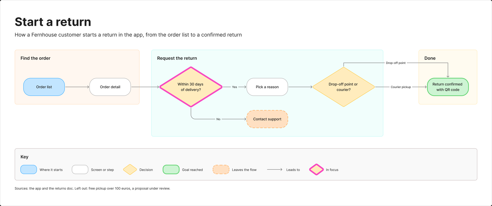

# Product Owner - Create Tickets & Stories

[](https://github.com/MichelKerkmeester/product-owner_create-tickets-and-stories/stargazers)
[](LICENSE)
[](https://github.com/MichelKerkmeester/product-owner_create-tickets-and-stories/commits/main)

> Like it? https://buymeacoffee.com/michelkerkmeester

&nbsp;

## 1. 📝 SUMMARY

A product owner in a folder: it turns a rough request into a ticket your developers can build from, a bug report, a Story or Epic, or a source-safe doc. When a flow is easier to see than to read, it draws that too, as a FigJam board.

Describe what you need in plain words or start with a `$` command. Product Owner drafts against a fixed template, checks the draft and only then hands it over. You keep the decisions. It does the structure, the formatting, the checking and the delivery.

It never invents a fact to fill a gap. A missing scope, a vague bug, a promised source that has not arrived or two sources that disagree get one question, and your answer goes straight into the draft.

Built for product managers and team leads who write the backlog and for the developers and QA engineers who build from it, in a claude.ai Project or any agent CLI that reads `AGENTS.md`

**What's inside**

- **Developer Tasks** - four task shapes, each requirement group ending in a checklist a QA engineer can tick off
- **Bug Reports** - one fixed report where a field you did not supply reads `Not provided`, never a plausible guess
- **Stories and Epics** - two artifacts in one house format, with every hard value you supplied kept verbatim and numbered Given/When/Then criteria
- **Source-Safe Docs** - five shapes and a status label on every claim, so a proposal never reads as shipped
- **One-Question Intake** - every missing fact goes into one consolidated question, and the next reply drafts
- **Blocking Quality Floors** - six dimensions scored out of 10 before export. Five need 8 and Accuracy needs 9
- **Verified Delivery** - saved, read back and only then named, with a ClickUp push only after your explicit yes
- **FigJam Diagrams** - user flows, processes, architectures, sequences, state machines, ER models and gantt charts drawn on a FigJam board from screenshots, docs or a plain description
- **Finished Boards** - every board gets a frame, a title, tinted zones, a key and one clear first glance in your team's design, checked before the write and read back from Figma

&nbsp;

## 2. 🗺️ OVERVIEW

### THE FOUNDATION

Three building blocks carry a request through Product Owner:

1. **Routing** reads your command or your wording and picks the artifact. The repository root is a hub: its `SKILL.md` picks the packet and `ROUTER.md` maps the request to the files that packet loads

2. **Shaping** loads one mode reference and its template, never a second pair, plus at most one worked example

3. **Gates and delivery** score the draft against six quality floors and a voice check, then save it and read it back before the reply names it

From request to delivery:

```text
                         YOUR REQUEST
                              │
                              ▼
         ┌──────────────────────────────────────────┐
         │  ROUTER                                  │
         │  1. Exact command     $task  $doc  $flow │
         │  2. Artifact framing  "a bug report"     │
         │  3. Topic score       nine topics        │
         │  4. Unsure            one question       │
         └─────────────┬──────────────────┬─────────┘
                       │                  │
          Task, Bug, Story,          FigJam diagram
          Epic or Doc                     │
                       │                  │
                       ▼                  ▼
          One question when a      Brief, playback,
          fact is missing          model and check
                       │                  │
                       ▼                  ▼
          Draft, six quality       Gate, then compose
          floors, voice check      after your yes
                       │                  │
                       ▼                  ▼
          Saved to export/,        Board read back
          then read back           from Figma
                       │
                       ▼
          ClickUp push after your yes
```

### Developer Tasks

Built to be ticked off.

A task takes one of four shapes: a standard task, a parent task that links one subtask per requirement, a subtask for one bounded area or a Quick task with a single requirement group. Every requirement group ends in a checklist of items a QA engineer can tick off. Refining a task you already have keeps its sections and its filename. Only what you asked for changes.

### Bug Reports

Facts, or `Not provided`.

One fixed report: a field table for frequency, severity, platform, device, OS and browser, then observed behavior, steps to reproduce, expected behavior and a four-item checklist. A field you did not supply reads `Not provided`, never a plausible guess. A root cause appears only as a fact you gave or as a labelled hypothesis.

### Stories and Epics

Your numbers stay your numbers.

Two separate artifacts in one house format. A Story opens on the business problem and the solution. Every hard value you supplied, such as `32px` or an exact button label, lands verbatim in Requirements, and the acceptance criteria are numbered Given/When/Then blocks at screen level. An Epic states the problem and the goal, proposes a solution, lists its child stories under Scope and writes its criteria at release level.

Ask for a Story with its task breakdown and you get one folder holding the Story and a linked task file per task.

### Product and Engineering Docs

A proposal never reads as shipped.

Five shapes, picked by what the reader needs to do: a Guide, a Catalog, a Behavior reference, a Proposal and a Narrative overview. Every material claim carries a status label before a line is drafted. Section 5 covers how sources are sorted and when the draft stops to ask.

### FigJam Diagrams

For when a picture says it faster.

A Story often needs its screens, a handoff or a data model beside it. Product Owner draws those on a FigJam board in one of seven diagram types, from the same sources and with the same one-question intake as the artifact it belongs to. Section 9 shows what a board looks like.

### Two Ways to Run It

| Route | What you need | What you get |
|---|---|---|
| claude.ai Project | A Claude plan with Projects, plus the optional ClickUp and Figma connectors | Each artifact rendered in the side panel, ready to copy or push to ClickUp. FigJam boards drawn in your Figma plan |
| Terminal agent | An agent CLI that reads `AGENTS.md`, such as Claude Code or Codex | Each artifact saved to `export/` and read back before the reply names it, with ClickUp and FigJam once you connect them |

Both routes run the same rules and the same templates. Section 3 sets up either one.

### At a Glance

| Item | Detail |
|---|---|
| Artifacts | Task, subtask, bug report, Story, Epic, Doc and FigJam diagram |
| Diagram types | Seven: user flow, process, architecture, sequence, state, ER and gantt |
| Worked examples | 21 filled artifacts and 7 FigJam examples, one per diagram type |
| Versions | Hub 1.0.13.0, `sk-product-owner` 1.2.5.0, `sk-create-figjam` 1.0.13.0, Project kernel v1.2.13 |
| License | MIT |

&nbsp;

## 3. 🚀 QUICK START

### Installation

```bash
git clone https://github.com/MichelKerkmeester/product-owner_create-tickets-and-stories.git
cd product-owner_create-tickets-and-stories
```

Open the folder in an agent CLI that reads `AGENTS.md` and point the model at that file. It reads the hub `SKILL.md` and `ROUTER.md`, then the packet that fits the request. From then on it works as the Product Owner. Writing tickets, stories and docs needs no package and no API key.

### Verify Installation

```bash
bash benchmark/gates/run_gates.sh
```

A healthy tree ends with `all 15 gates pass`. A standalone clone with no shared skill folder above it ends with `11 of 15 gates pass, 4 skipped`. Section 12 says where each check is documented.

### First Use

```text
$task I need a task for the creator payout pause feature.
```

A feature name is not a scope, so the first reply saves one question as `export/001 - task-creator-payout-pause-clarification.md` and drafts nothing. Answer it in one message and the task lands in `export/002 - task-creator-payout-pause.md`.

### Use It in a claude.ai Project

1. Paste `claude project/Custom Instructions.md` into the custom instructions of a Project named **Product Owner**
2. Remove superseded knowledge uploads, then upload all 65 files in `claude project/knowledge/` with their filenames unchanged
3. Start a chat and ask for a task. The reply opens with a Deliverable Block, the artifact rendered in the side panel, because a Project cannot write files
4. Optionally add the ClickUp and Figma connectors to push tasks and draw boards. [USER-GUIDE.md](./USER-GUIDE.md) Section 6 walks through adding them and checking that each one works, and the rest of the guide covers day-to-day use

### Connect ClickUp and Figma

This step is optional and for terminal agents. In Claude Desktop or claude.ai, the Project uses ClickUp's and Figma's own connectors instead, as [USER-GUIDE.md](./USER-GUIDE.md) Section 6 describes.

The repository carries its own Code Mode setup: `.utcp_config.json` registers the `clickup_official` and `figma` manuals, and `.mcp.json` and `opencode.json` start the vendored server in `mcp-code-mode/` through `scripts/code-mode.cjs`. The server needs Node 24, because its `isolated-vm` sandbox has no build for a later Node. The launcher finds an installed Node 24 through nvm, fnm, volta or `PATH` even when your default `node` is newer.

```bash
cp .env.example .env                      # figma_FIGMA_API_KEY, optional
nvm install 24                            # or any manager, as long as a Node 24 is installed
cd mcp-code-mode/mcp-server && nvm exec 24 npm ci && nvm exec 24 npm run build && cd ../..
```

Restart the agent CLI so it reads `.mcp.json` or `opencode.json`. The first ClickUp call opens a ClickUp sign-in in the browser, since `mcp-remote` authenticates with OAuth and needs no key. FigJam boards draw through Figma's hosted MCP when your agent CLI connects it. To tell the ClickUp offer where your work goes, fill in your push targets as Section 8 describes.

### Draw Through Figma Desktop

When your agent CLI has no Figma MCP connection, Flow Mode can draw user flows and processes with no lanes through Figma Desktop with `figma-ds-cli`. Set it up once per machine:

```bash
bash mcp-figma/scripts/install.sh          # figma-ds-cli 1.2.0 or later, from the silships repository
figma-ds-cli --version                     # must print 1.2.0 or later
```

Then, in Figma Desktop, import the bridge plugin once through Plugins, Development, Import plugin from manifest, picking `~/.figma-ds-cli/source/plugin/manifest.json`. That folder is hidden, so on macOS press Cmd+Shift+G in the file picker and paste the path. In each session, open the FigJam file, run Plugins, Development, FigCli and keep it open, then run `figma-ds-cli connect --safe`. Safe mode patches nothing. The plain `figma-ds-cli connect` patches Figma Desktop and breaks when Figma updates, so use it only on purpose and undo it with `figma-ds-cli unpatch`. [mcp-figma/INSTALL-GUIDE.md](mcp-figma/INSTALL-GUIDE.md) covers the daemon and troubleshooting.

&nbsp;

## 4. 🧭 MODES AND ROUTING

One request, one route. A command sets it, and plain words work too.

#### Commands

| Command | Shortcut | What you get |
|---|---|---|
| `$task` | `$t` | A developer task |
| `$task --subtask` | none | A subtask under a parent task |
| `$bug` | `$b` | A bug report |
| `$story` | `$s`, `$prd`, `$p` | A Story |
| `$epic` | `$e` | An Epic |
| `$doc` | `$d` | A product or engineering doc, new or refined |
| `$flow` | `$figjam` | A FigJam diagram |
| `$quick` | `$q` | Quick energy for any of the above |

Commands match only as whole tokens, so `$document` or `$debug` never trigger a route. One command wins over any wording that follows it. Two commands that name different artifacts become one question.

#### Plain Words Work Too

No command is needed. "Turn these notes into a PRD" and "make a FigJam flow from the signup doc" each route on their own. The artifact you name beats the topic you mention, so "create a task to document Feed v2" is a Task while "document how Feed v2 works" is a Doc. Symptom wording such as "freezes" routes to a Bug, and polish, spacing, wording or Figma feedback routes to a Task even beside "fix" or "broken". When the request is too vague to call, you get one question instead of a guess.

#### Precedence, By Example

- `$doc write a bug report about the outage` routes to Doc, because one command beats every word after it
- `Create a task to document Feed v2` routes to Task, because the artifact it names is a task
- `Document bug behavior for failed payments` routes to Doc, because "Document" frames the artifact and "bug" is only the subject
- `the app freezes when I open the inbox` routes to Bug on symptom wording alone
- `refine the settings panel spacing` routes to Task as UI polish
- `$task $doc explain Feed v2` becomes one question, because two commands name two artifacts

#### Energy Levels

- **Quick** comes from `$quick`, `$q` or framing such as "fast" or "just do it". It may skip routine Task and Bug questions and keeps the draft lean. It never skips a Doc's source check, a conflict question, a promised source or the read-back
- **Standard** is the default for every mode, with the full phase flow and at least three perspectives
- **Deep** is for high-risk or multi-source work and uses all five perspectives: User, Business, Technical, Risk and Delivery
- **Raw** skips the phase flow while every safety and delivery rule still applies. Only the words "skip depth" select it, never `$quick`

`$quick $doc` and `$doc $quick` mean the same thing. "Quick" as subject matter sets no energy, so "create a task for the quick-reply feature" runs at Standard.

&nbsp;

## 5. 💬 CLARIFICATION AND SOURCE SAFETY

Product Owner asks before it guesses, and it asks once. For Doc work a second check decides which sources may be stated as fact.

#### One Question, Once

- **Every missing fact goes into one consolidated question.** After your answer the next reply drafts, and each gap with a safe default is listed under Open items for you to confirm or strike
- **A command picks the artifact and does not supply the scope.** `$task` with only a feature name still gets its context question. Adding `$quick` is the one way to skip routine intake and accept smart defaults
- **The question is saved like any artifact,** with `-clarification` added to its name, so it survives a cleared terminal

#### Five Source Classes

Before a Doc line is drafted, every material claim is sorted into one of five classes: current behavior, approved direction, proposal, retired material or unknown. Each class carries its own status label, so a proposal never reads as shipped.

When two sources disagree and no authority settles it, the draft stops and asks which one governs. A newer timestamp, a confident filename, majority wording or a duplicate copy never decides.

#### A Doc From Two Notes That Disagree

Note A says a payout pause holds for 24 hours and then releases. Note B says it holds until the brand clears it. The first reply drafted nothing and asked which note governs. After the answer, the behavior reference stated Note A as current behavior and kept Note B visible as retired material, so a later reader still sees both.

&nbsp;

## 6. 🧱 OUTPUT FORMAT

Every artifact is ClickUp-ready markdown written against a fixed template. Tasks, bugs and Stories carry checklists or numbered acceptance criteria a QA engineer can verify line by line.

#### A Story That Keeps Your Numbers

The Requirements section of a Story from a benchmark run. Every value the source supplied lands verbatim and in backticks:

```markdown
## Requirements
* * *
**Pending payout pause**
* * *
- [] A pause of a pending payout lasts exactly `24 hours`
- [] The reason field is required
- [] The toggle that starts a pause reads `Pause payout`
- [] The payout row of a paused payout shows a `paused` badge
```

`32px` never becomes "updated spacing" and `Link Instagram` never becomes "updated copy". The acceptance criteria then describe outcomes and leave the mechanism to the developer.

#### What Never Enters an Artifact

A delivered file carries the deliverable and nothing about how it was made. These travel in the chat reply instead:

- A score, a dimension breakdown, a total or a pass or fail verdict
- The `HVR self-scan:` line or any blocker count
- A bracketed `Assumes:` tag or a perspective roster
- A phase trace
- A Mode, Template, Perspectives, Quality Score or Energy header

&nbsp;

## 7. 🎯 QUALITY GATES

Floors that block, not scores that advise. Six dimensions are scored out of 10 against every artifact before export.

| Dimension | Floor | Clears its floor when |
|---|---:|---|
| Completeness | 8 | You cannot name a section a reader would have to ask about |
| Clarity | 8 | No sentence exists that two implementers would build differently |
| Actionability | 8 | No criterion's success condition merely restates the work |
| Accuracy | 9 | The three most specific claims each name the supplied line they rest on |
| Relevance | 8 | No more than one section could be rebuilt from what remains |
| Mechanism depth | 8 | The stated why settles an edge case the artifact never mentions |

Accuracy sits a point higher because an invented fact reads as confidently as a verified one.

One dimension under its floor is a repair at the phase that owns it. Two or more send the draft back to be rebuilt. Three revision cycles is the ceiling, and after the third the best version ships with a note naming the dimension still short. Scores appear in the chat reply, never inside the artifact.

#### The Voice Check

Every reply carries a Human Voice self-scan line, and a hard blocker such as an em dash or a banned word fails the artifact on its own, whatever the six scores say.

&nbsp;

## 8. 📤 EXPORT AND CLICKUP DELIVERY

The save happens before the reply, and the reply reports only what the save proved.

#### File Naming

```text
export/[###] - task-[description].md
export/[###] - bug-[description].md
export/[###] - doc-[description].md
export/[###] - Story-[description].md
export/[###] - Story-[description]/[###] - Story-[description].md
export/[###] - Story-[description]/[###].[n] - task-[description].md
export/[###] - Epic-[description].md
export/[###] - {task|bug|doc|Story|Epic}-[description]-clarification.md
export/[original-source-filename].md
```

A new artifact takes the next free three-digit number. A clarification question is saved like any artifact, with `-clarification` added to its name. A refinement is saved under the exact source filename so you can compare it with the original, and the source itself is never overwritten. A FigJam board writes no file to `export/`, because the board is the deliverable.

#### A Delivery Reply

The reply names the saved file and proves the save. It never pastes the artifact. A task reply opens on the path, such as `export/002 - task-payout-pause-reason-on-detail-screen.md`, then a `Verified:` receipt that carries the line count the read-back returned. The `HVR self-scan:` line follows, then one quality line, a short summary and numbered Open items for every addition and assumption. When ClickUp is connected, the last line offers the push.

#### ClickUp Push Targets

Copy `claude project/templates/Product Owner - Local - Push Targets.md` into `claude project/local/`, which git ignores, and add each ClickUp list and doc by name under the team that owns it. When one fits the artifact, the reply offers it alongside a private doc. When several could fit, it asks which, and when none does, it asks where and recommends a private doc. A document lands as a new page in the named doc. The claude.ai Project reads the same file once you upload it to your own Project, as [USER-GUIDE.md](./USER-GUIDE.md) Section 5 shows.

#### How a Push Works

- **Only after a yes.** The export never asks permission. A ClickUp create, update or delete always does, as an explicit yes in the current conversation. An earlier yes never carries forward
- **Formatting that survives.** A task is pushed with `markdown_description` and a doc page with `content_format: "text/md"`, so headings, bold text and checkboxes render as formatting rather than as `###` or `**`
- **A clean body.** The artifact's H1 becomes the ClickUp name and leaves the body. HTML comments and process metadata are stripped, and everything else travels verbatim
- **Read back.** After a push the task is read back with markdown enabled to confirm the formatting survived

[`mcp-click-up/SKILL.md`](mcp-click-up/SKILL.md) owns the parameter contract.

#### What Git Keeps

`.gitignore` keeps everything under `export/` local except `.gitkeep` and `export/benchmark/`, so your own artifacts never reach the public repository. Your `.env` and your filled push targets in `claude project/local/` stay local too.

&nbsp;

## 9. 🎨 FIGJAM DIAGRAMS

Some answers read better as a picture than as a ticket: the screens a person passes through, who hands work to whom or how a booking moves from one status to the next. Ask for one and Product Owner draws a finished FigJam board, framed, titled, coloured by meaning and checked against its sources before it reaches your Figma plan. It works from the same material a ticket does, such as screenshots, a Figma flow, a product doc, a schema or a plan. Every node and connector traces back to a source you supplied, and anything the sources left open is named to you before the write.

#### Seven Diagram Types

The reader's question picks the type.

| The reader asks | Type |
|---|---|
| Which screens does a person pass through, and where do they choose? | User flow |
| Who does what in which order, and where does work change hands? | Process |
| What parts make up this system and how do they connect? | Architecture |
| In what order do these parties exchange messages? | Sequence |
| Which states exist and what moves the thing between them? | State |
| Which entities exist, what fields do they carry and how do they relate? | ER |
| Which tasks and phases are active when? | Gantt |

When two types fit, such as an architecture and a sequence for the same system, its first reply asks only which question your reader has, before any other question. Ask for a journey, a timeline, a class diagram or a C4 view and it offers the nearest type it draws: a user flow, a gantt, an ER diagram or an architecture. It does not draw pie charts, mindmaps, Venn or quadrant charts, and it says so rather than drawing a stand-in.

#### What a Composed Board Looks Like

- **A frame and a title.** One white section around everything, named after the board's title, with a one-sentence subtitle under it
- **Zones.** Tinted sections group the steps or entities that belong together. Each zone shows its name, never takes the colour of a step inside it, and neighbouring tints always differ
- **Colour by kind.** A goal is light green and a decision a light yellow diamond on every board, so a colour means the same thing everywhere. Colour never marks a team or a position
- **A key.** One sample for every mark the board uses, and nothing else
- **One pink outline.** The node a reader should see first takes a heavy pink outline, the only pink and the heaviest line on the board. A user flow or a process always carries one, and on the other five types it is optional
- **A source line.** Under the key, naming the sources the board was drawn from and what was left out
- **Your team's look.** `sk-create-figjam/assets/figjam-design.md` holds the design every board is drawn in: which FigJam colour means what, the first-glance accent, the type sizes, the lines, the zone tints and the words on the key. Edit it once and every board composed after it follows. An edit that would weaken contrast or compete with the pink outline falls back to the shipped value, and the reply names it on a `Finding:` line

A real board the packet composed on a fictional test file. The pink outline on the green Confirmation with QR code goal is the first glance, three zones run left to right and each decision is a yellow diamond with labelled exits:



The [FigJam packet gallery](sk-create-figjam/README.md) shows a board for each of the seven types.

Everything sits on an 8 pixel grid with one type scale, from a 64 pixel title down to 18 pixel edge labels and 14 pixel step numbers, sized to read at overview zoom on a laptop. The main route runs on one straight line with every branch beside it. A new board lands to the right of everything already on the page, so it never covers existing work.

#### From Request to Board

1. **Brief.** A short interview fills a nine-row Brief: the reader, their question, the outcome, the scope, the entry, the exit, the actors, the decisions and the sources. Every question carries a reading of your input and a recommended answer, so a plain "yes" moves things on. `$quick` skips the rounds and proposes the whole Brief in one message
2. **Playback.** Before any model, one reply plays back what each source settled and every fact it assumed, then ends the turn on its question and waits for your answer. That answer covers the reading, never the write
3. **Model and check.** The diagram becomes a Mermaid model with a provenance table that ties every item to its source. A pre-write check holds it to its type's rules and layout budgets, and a quality rubric asks whether every node earns its place. Nothing is written until the model passes
4. **Gate.** A reply of its own, the last message of its turn, names the Figma plan and file, what will be drawn, any notes it adds, the Figma calls it will spend and how to undo it. Name an existing FigJam file by its link and the board goes beside what it holds, with no plan to pick. Only a yes to that question writes
5. **Write.** One call per diagram composes the framed board in your plan
6. **Read-back.** The board is read back from Figma and compared with the model, node by node and connector by connector. The reply opens with the board link and a line such as `Read-back: 8 of 8 nodes, 8 of 8 connectors, 2 of 2 decision exits labelled`. On a match that line also names the first glance

A board that does not match its model is reported as measured and never called done. Some Figma plans and seats cap tool calls each month, which is why the gate lists the calls before you say yes.

#### Why It Beats a Hand-Drawn Board

- **Nothing invented.** A missing step, service, field or date is asked for or named as a gap. Text inside a screenshot that reads like an instruction is modelled, never followed
- **Checked before anyone sees it.** The pre-write check refuses a model that breaks its type's rules, runs over its node budget, uses an off-palette colour or styles an architecture. An oversized diagram splits into an overview board and a detail board instead of shrinking. When you asked for one board, it cuts the part your reader needs least and offers the split
- **Colour you can trust.** The same colour means the same kind on every board, and the key explains every colour on it. Each fill is a FigJam palette swatch, so anyone can still recolour it from FigJam's own picker
- **Proof it landed.** The read-back counts what is on the board, so you know it matches the model before you share it
- **Nothing dropped quietly.** Every cut and split, and every point the sources left open, appears on a `Left out:` line in the reply
- **Safe revisions.** A change goes into the model and the board is composed again. The old board is deleted only on a yes to a question that names it by its title, so a failed write never leaves you with no board and a bare yes deletes nothing

#### Ask for a Board

```text
$flow the location change from these screenshots
make a FigJam flow from the signup doc
$figjam the booking status lifecycle from the bookings doc
put the launch plan on a FigJam gantt chart
write a story for the location change and draw its user flow in FigJam
```

The last request pairs an artifact with a board. The Story is saved and read back first and becomes the source for the board. Once the board's read-back matches, the Story links to it from its Flows group. To annotate a board you already have, ask for notes on it: they land on top as numbered pins or stickies and leave the composed diagram untouched.

#### Where It Draws

- **claude.ai Project with the Figma connector.** A new FigJam board in your Figma plan, or in a FigJam file you named, read back to check it. With the connector off you get the checked model as a Mermaid block
- **Terminal agent with Figma's hosted MCP.** The same composed board, with the same gate and read-back
- **Figma's diagram generator.** The fallback when the composing tool is not connected. The board is plainer, with Figma's own layout and none of the framing: no title, zone, key or source line
- **Figma Desktop through `figma-ds-cli`.** User flows and processes without lanes, drawn node by node into the FigJam file you have open. Section 3 covers the one-time setup

With no route at all, the reply names what is missing and hands you the checked model to keep. It never renders the diagram as an image or an HTML page in place of the board.

#### What the Reply Says

A board reply opens on the board link where an artifact reply opens on its path, with its lines in this order:

```text
{board URL}
Read-back: 8 of 8 nodes, 8 of 8 connectors, 2 of 2 decision exits labelled, first glance: the failed payment
Left out: the retry path, split into a second diagram
HVR self-scan: 0 hard blockers. Fixed: none. Kept with reason: none.
```

An `Extensions:` line counts any pins or stickies the write added, and a `Finding:` line names each open question or read-back finding. The self-scan line always comes last.

&nbsp;

## 10. 📚 TEMPLATES AND EXAMPLES

Every shape is a plain markdown file you can change to fit your team.

| Folder | What it holds |
|---|---|
| [`sk-product-owner/assets/`](sk-product-owner/assets/) | Six templates: Task, Bug, Doc, Story, Epic and the intake questions |
| [`sk-product-owner/assets/examples/`](sk-product-owner/assets/examples/) | 21 worked artifacts: 5 tasks, 4 bugs, 7 docs and 5 Stories, one of them an Epic |
| [`sk-product-owner/references/`](sk-product-owner/references/) | 12 rule files: the mode rules, routing, quality scoring and the two voice cards |
| [`sk-create-figjam/assets/`](sk-create-figjam/assets/) | The diagram patterns per type, the reply shapes, the board composer and 7 worked examples on fictional companies |
| [`sk-create-figjam/references/`](sk-create-figjam/references/) | The Flow Mode workflow, the notes-on-a-board workflow, one reference per diagram type, the style guide and the quality rubric |

A backlog or doc route loads one mode reference and its template, never a second pair, plus at most one worked example.

&nbsp;

## 11. 🧩 CLAUDE PROJECT PACKAGE

`claude project/` carries the same system for a claude.ai Project, which has no filesystem.

- `Custom Instructions.md` is the kernel, v1.2.13, and the routing authority inside the Project
- `knowledge/` holds the 65 knowledge files you upload
- `README.md` holds the upload steps and the smoke matrix

#### What Changes in a Project

| Terminal agent | claude.ai Project |
|---|---|
| Saves to `export/` and reads the file back | Renders a Deliverable Block in the side panel |
| Reports `Path:` and the `Verified:` receipt | Reports an export-equivalent path |
| Pushes to ClickUp through a connected MCP server | Pushes to ClickUp through the claude.ai connector, when present |

A claude.ai Project reads hand-written copies of the skill files from `claude project/knowledge/`, so a change you make to a template reaches a Project only after you update and upload its knowledge files.

&nbsp;

## 12. 🧪 BENCHMARKS AND CHECKS

```bash
bash benchmark/gates/run_gates.sh
```

A healthy tree ends with `all 15 gates pass`. A standalone clone with no shared skill folder above it ends with `11 of 15 gates pass, 4 skipped`.

#### Where the Detail Lives

| Topic | Document |
|---|---|
| Every gate, what it checks and how it skips in a clone | [benchmark/gates/README.md](benchmark/gates/README.md) |
| The router checks | [benchmark/router/README.md](benchmark/router/README.md) |
| The hub routing baseline | [benchmark/README.md](benchmark/README.md) |
| The output format validator | [benchmark/format/README.md](benchmark/format/README.md) |
| The reply grader and twin comparison | [benchmark/grader/README.md](benchmark/grader/README.md) |
| Dated playbook and benchmark runs | [benchmark/reports/README.md](benchmark/reports/README.md) |
| Vendor sync and the Code Mode launcher | [scripts/README.md](scripts/README.md) |
| The Claude Project package and its smoke matrix | [claude project/README.md](claude%20project/README.md) |
| The manual parity method and dated review notes | [SYNC.md](SYNC.md) |

The Claude Project files are written by hand from the skill sources, so a matching local package proves nothing about the live Project, which is a separate manual upload.

&nbsp;

## 13. 🗂️ REPOSITORY STRUCTURE

```text
.
├── SKILL.md, ROUTER.md              the hub and its leaf map
├── mode-registry.json               the packet registry
├── hub-router.json                  the stage one routing signals
├── sk-product-owner/                tasks, bug reports, Stories, Epics and Docs
├── sk-create-figjam/                FigJam diagrams, from the Brief to the read-back
├── mcp-click-up/                    vendored ClickUp tool packet
├── mcp-figma/                       vendored Figma Desktop tool packet
├── mcp-code-mode/                   vendored Code Mode server, built locally under Node 24
├── claude project/                  the claude.ai kernel, its knowledge files and the push targets template
├── benchmark/                       router, format, gate and grader checks, plus the dated runs
├── manual-testing-playbook/         the hub routing scenarios
├── export/                          your generated artifacts, kept local
├── specs/                           spec packets for changes to this system
├── AGENTS.md                        terminal entry point and command registry
└── USER-GUIDE.md                    day-to-day use and connector setup
```

`AGENTS.md` points an agent CLI at the hub. A claude.ai Project reads `claude project/Custom Instructions.md` and the files under `claude project/knowledge/` instead.

&nbsp;

## 14. ❓ FAQ

**Q: Does Product Owner implement the task it writes?**

No. It writes backlog and documentation artifacts and draws diagrams. A Doc may explain source-backed code or a runbook, but live implementation and live diagnosis are out of scope.

**Q: Why did `$task` ask me a question instead of drafting?**

A command picks the artifact and does not supply the scope. `$task` with only a feature name still gets its context question. Adding `$quick` is the one way to skip routine intake and accept smart defaults.

**Q: What does `$quick` skip?**

Length, optional sections and routine Task and Bug questions. It never skips source classification, conflict gates, factuality, refinement fidelity or the export receipt. A Quick doc is shorter, not looser.

**Q: What happens when two sources disagree?**

The draft stops. One question lists the conflicting claims and asks which source governs each. Recency and duplicate wording never decide.

**Q: What if I state one requirement and the model finds four?**

Your count wins. States and edge cases inside a stated requirement never become extra requirements.

**Q: Does it push to ClickUp on its own?**

No. The local file is saved first, without asking. A ClickUp write waits for an explicit yes in the current conversation, every time.

**Q: Do I need the claude.ai package?**

No. The terminal route is complete on its own. The Project package exists for people who work in claude.ai.


**Q: Does it write to my FigJam file without asking?**

No. Only a yes to the gate's own question writes, and the gate comes after the playback. A yes to the Brief or the playback never writes.

**Q: Can I move a box after the board is drawn?**

Yes, by hand in FigJam. Product Owner itself never moves, resizes, restyles or rewires a composed node. A change it makes goes into the model, and the board is composed again after your yes.

**Q: Can my team change the colours or the type on every board?**

Yes. Edit the token block in `sk-create-figjam/assets/figjam-design.md`, which says what each colour means, which pair carries the first glance, the type sizes and the words on the key, and run `python3 sk-create-figjam/scripts/compose_board.py --design-check` to see what the boards will use. Every board composed after the edit follows it. A token that would weaken contrast or compete with the first glance falls back to the shipped value and is named in the reply. Colours stay on FigJam's own palette, so anyone can still recolour a shape from FigJam's picker.
&nbsp;

## 15. 🔧 TROUBLESHOOTING

**`$task` or `$bug` replies with a question**

The command routed the request, but the scope is missing. Answer in one reply, or resend with `$quick` to accept smart defaults.

**A Doc request stops before drafting**

A missing field, an open conflict, an unapproved restructure or a subject no source covers blocked the draft. Answer the consolidated question with the source or decision it names.

**The route does not match the request**

A token is not an exact command, or framing outranked a topic word. Check it with `python3 benchmark/router/route_contract.py --request "<request>"`, then use one command.

**UI feedback routed to Bug**

The wording read as a defect, such as "fix" or "broken" with no polish or Figma term. Use `$task`, or phrase it as polish or Figma alignment.

**A Story has no Requirements section**

The source supplied no hard value. Supply the exact values the build must meet, such as sizes or strings.

**No `Path:` or `Verified:` line**

The read-back failed twice. Treat the artifact as undelivered and rerun the request.

**The `Verified:` line count differs from the file**

The model printed a different number than the read returned. Trust the file on disk.

**ClickUp shows raw `###` or `**`**

The push used the plain `description` field. Push again with `markdown_description`.

**A Mermaid block instead of a board**

No Figma route is connected in this session. Switch on the Figma connector in the Project, or connect Figma's MCP in your agent CLI.

**A board with no title, zones, key or source line**

The composing tool was not connected, so Figma's generator or the Figma Desktop route drew it. Connect the Figma MCP's `use_figma` tool and ask for the board again.

**`Read-back: not possible` with a limit named**

Your Figma plan or seat has used its monthly tool calls. Open your FigJam drafts, since the board may still exist, and wait for the limit to reset.

[USER-GUIDE.md](./USER-GUIDE.md) Section 7 covers connector problems inside a claude.ai Project.

&nbsp;

## 16. 📚 RELATED DOCUMENTS

**Using Product Owner**

- **[→ User Guide](USER-GUIDE.md)** - day-to-day use: asking for artifacts, drawing boards, steering results, sending to ClickUp and connecting ClickUp and Figma
- **[→ Agent Bootstrap](AGENTS.md)** - the terminal entry point and command registry
- **[→ Product Owner Skill Guide](sk-product-owner/README.md)** - mode-by-mode guide to the backlog and doc packet
- **[→ FigJam Packet Guide](sk-create-figjam/README.md)** - orientation for the diagram packet

**Mode references**

- **[→ Task Mode](sk-product-owner/references/task-mode.md)** - task and subtask rules
- **[→ Bug Mode](sk-product-owner/references/bug-mode.md)** - defect evidence and reproduction rules
- **[→ Story Mode](sk-product-owner/references/story-mode.md)** - the house format for Stories and Epics
- **[→ Doc Mode](sk-product-owner/references/doc-mode.md)** - source classes and the authority order
- **[→ Flow Mode](sk-create-figjam/references/flow-mode.md)** - the FigJam workflow from Brief to read-back
- **[→ FigJam Style Guide](sk-create-figjam/references/style-guide.md)** - colour by kind and the pink accent
- **[→ Interactive Mode](sk-product-owner/references/interactive-mode.md)** - the one-question flow

**Release notes**

- **[→ Hub v1.0.13.0](changelog/v1.0.13.0.md)** - the latest hub release
- **[→ `sk-product-owner` v1.2.5.0](sk-product-owner/changelog/v1.2.5.0.md)** - the latest backlog and doc packet release
- **[→ `sk-create-figjam` v1.0.13.0](sk-create-figjam/changelog/v1.0.13.0.md)** - the latest FigJam packet release
