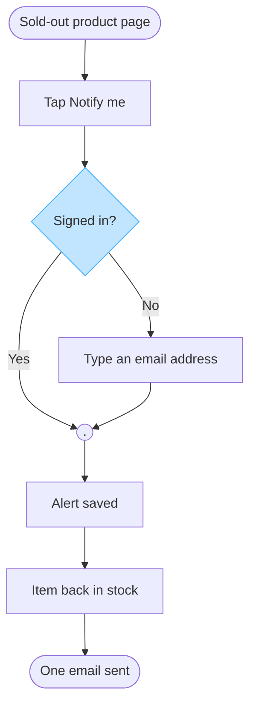

No Figma connector is present in this Project, so I cannot create the board in the **Fernhouse Product** plan, and no read-back is possible. It needs the Figma connector to write. Below is the checked model, ready to paste into a new board once the connector is there.

## What the brief settled

| Row | Value | Status |
|---|---|---|
| Reader | The Storefront team and Lotte, reading it in the Fernhouse Product plan | assumed |
| Question | Which screens does a customer pass through to register a back-in-stock alert, and where does the sign-in state change the path? | captured |
| Outcome | The team sees the one fork in the flow and what a guest must supply before the alert exists | captured |
| Scope | The notify-me flow on a sold-out product page. In-app push is outside it | assumed |
| Entry | Product page of a sold-out item | captured |
| Exit | One email reaches the customer when the item returns | captured |
| Actors | Customer, signed in or guest, and the system that reacts to stock coming back | captured |
| Decisions and states | `Signed in?`, one decision with two exits. What a guest sees after typing the email is not stated | captured |
| Sources and class | Lotte's spec, approved direction for the notify-me flow and proposal for push alerts. Fernhouse context, current behavior for surfaces and stock | captured |

**The two assumed rows.** Reader: the request places the board in the Fernhouse Product plan, so I read the audience as the Storefront team plus Lotte, written in plain verbs. Scope: the spec says the product page and names no surface, so I read it as the shared web and app flow, drawn once. Either answer changes the labels only, not the shape.

**Rung one, what the board must not do.** It must not show push alerts as agreed behavior, because the spec calls them a proposal nobody has agreed.

**Type.** User flow, because the reader's question is about screens and a choice. Checked: 8 nodes against a budget of 9, 8 connectors, 2 of 2 decision exits labelled, four shapes only, top to bottom, one accent.

**Glance lines.** First glance: the `Signed in?` fork, the one place the flow splits. Second glance: the extra step a guest takes before the alert exists. Last glance: the single email, the flow's only output.

## Provenance

| Item | Kind | Source | Class | Confidence | Rung |
|---|---|---|---|---|---|
| start | node | Lotte's spec | approved direction | high | stated |
| tap | node | Lotte's spec | approved direction | high | stated |
| signedIn | node | Lotte's spec, the two paths | approved direction | medium | stated |
| email | node | Lotte's spec | approved direction | high | stated |
| merge | node | Lotte's spec, the two paths converge | approved direction | high | stated |
| saved | node | Lotte's spec | approved direction | high | stated |
| restock | node | Lotte's spec | approved direction | high | stated |
| sent | node | Lotte's spec | approved direction | high | stated |
| tap to signedIn | edge | Lotte's spec, no stated check | approved direction | medium | one reading |

The `Yes` and `No` exit labels are my wording, since the spec states the two outcomes and not the question.

## The model

Read-back: not possible, the connector has no read tool
Left out: push alerts in the app, a proposal only that nobody has agreed. The iOS and Android variants, the same steps as web, so a platform split adds nodes without a different answer
HVR self-scan: 0 hard blockers. Fixed: none. Kept with reason: none.

Three things the spec leaves open, which a board would show as gaps rather than nodes. What a guest sees after typing the email, whether a confirmation exists at all. How stock coming back is detected, since the context file names a warehouse sync and no alert trigger. Whether the alert is removed or expires once the email has gone.

With the Figma connector connected, the gate would name a new file in the Fernhouse Product plan and one diagram, and I would ask for a yes before writing. Want me to adjust the model first, for example dropping the `restock` node or adding the guest confirmation once you tell me what it shows?