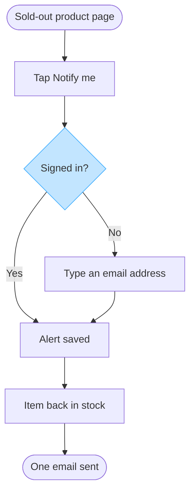

Taken as a yes to the model as final. I still cannot put it on a board: this Project has no Figma connector, so nothing was written, no new file exists in the **Fernhouse Product** plan, and there is no board URL or read-back to report. The checked model below is what would go into that file.

## Two changes from the remove test

- The merge dot is gone. Both branches lead straight to `Alert saved`, so the dot added a node without adding a step. That drops the diagram to 7 nodes and 7 connectors, against a budget of 9.
- The accent moved to `Signed in?`. It is the node the first glance names, and the first glance is the fork, so the accent belongs on the fork rather than on `Alert saved`.



Checked rule by rule: 7 nodes, 7 connectors, 2 of 2 decision exits labelled, four shapes only, no merge dot left, top to bottom, one accent on the focal node, widest rank 2 steps, longest path 5 steps, labels averaging 20 characters.

## The write, when a connector is present

```text
Plan: Fernhouse Product. File: a new FigJam file, which the first call creates.
Writes: one user flow, 7 nodes and 7 connectors, named "Register a back-in-stock alert".
userIntent: "Which screens does a customer pass through to register a back-in-stock alert, and where does the sign-in state change the path?"
Rollback: delete the new file.
```

That is one `generate_diagram` call, then the read-back against the 7 nodes and 7 connectors above, then the board URL as the first line of the reply.

Left out: push alerts in the app, a proposal only that nobody has agreed. The iOS and Android variants of the same three screens, which add a platform split without changing the answer. What a guest sees after typing the email, which the spec does not state, so no confirmation node is drawn and `Alert saved` carries the guest path too
HVR self-scan: 0 hard blockers. Fixed: none. Kept with reason: none.

Two things worth settling before this ever reaches a board: whether a guest sees a confirmation after typing the email, since that is a screen the flow omits, and whether the alert expires or clears once the email has gone. Tell me which way each should go, or say adapt the model and I will rework the nodes.