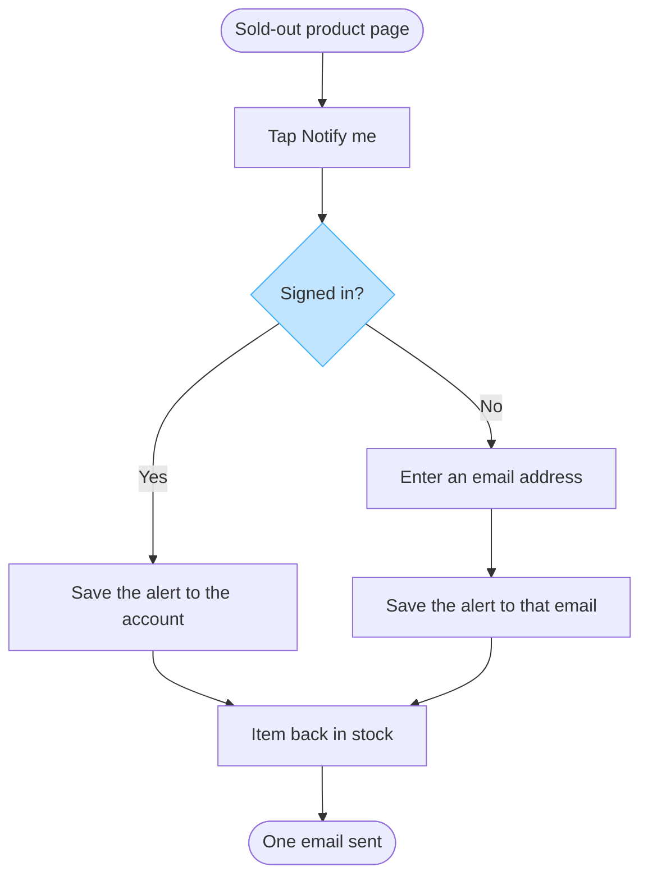

This Project has no Figma connector, so I cannot create a board or open the Fernhouse Product plan. Nothing was written to Figma. What follows is the checked model, for you to keep or paste into a FigJam board once a connector is in place.

## Round one: the reader

Reading: the request names no reader, and `context/fernhouse-context.md` puts product pages and the account with Storefront.
Question: who reads this board, and where?
Recommended: the Storefront team building the alert, read on a laptop as a mixed audience.
Why: Storefront owns the product page and `accounts-service`, so one team owns both save paths.

## The brief

| Row | Value | Status |
|---|---|---|
| Reader | Storefront team building the alert, read on a laptop | assumed |
| Question | Which screens does a customer pass through to set a back-in-stock alert, and where do guests and signed-in customers diverge? | captured |
| Outcome | Confirm the two save paths and that one email is the only notification | captured |
| Scope | The alert from the sold-out product page to the email. Push alerts are out | captured |
| Entry | The sold-out product page | captured |
| Exit | One email sent when the item is back in stock | captured |
| Actors | Customer, guest, system at restock | captured |
| Decisions and states | Signed in, and its two exits | captured |
| Sources and class | Lotte's spec, class approved direction. Nothing in it says the alert is live today | assumed |

The spec settles the entry, both save paths and the exit, and it excludes push. Two rows are assumed, both named above so you can correct them before anything is drawn.

## Type and dials

User flow, because the reader asks which screens a customer passes through and where they choose. A process would be wrong here, since no work changes hands. Dials: balanced detail, mixed audience, laptop distance.

## Glance lines

- First glance: the signed-in question that splits the flow into two save paths.
- Second glance: both save paths feeding the same restock email.
- Last glance: the guest email entry, which one path alone passes through.

Accent: light blue on `signedin`, the node a reader would keep if they kept one, because the split is the answer to the question.

## Remove test

One node went from the outline: a merge dot where the two save paths meet, because `restock` already joins them. Nothing else was removed, and push alerts are named under `Left out:` rather than drawn as current behavior.

## The model



Check: 8 nodes and 8 connectors, 2 of 2 decision exits labelled, widest rank 2 steps, longest path 7 nodes, labels average 19 characters, 0 crossing pairs, one accent. Every user flow rule holds.

## Provenance

| Item | Kind | Source | Class | Confidence | Rung |
|---|---|---|---|---|---|
| soldout, notify | node | Lotte's spec | approved direction | high | stated |
| signedin | node | Lotte's spec, both cases in one paragraph | approved direction | medium | container order |
| saveAccount | node | Lotte's spec | approved direction | high | stated |
| askEmail | node | Lotte's spec | approved direction | high | stated |
| saveEmail | node | Lotte's spec, the save that follows the email entry | approved direction | medium | stated |
| restock, oneEmail | node | Lotte's spec | approved direction | high | stated |
| notify to signedin | edge | Lotte's spec, the two cases stated in order | approved direction | medium | container order |
| signedin to saveAccount, signedin to askEmail | edge | Lotte's spec | approved direction | high | stated |
| askEmail to saveEmail | edge | Lotte's spec, "then the alert is saved" | approved direction | high | stated |
| saveAccount to restock, saveEmail to restock | edge | Lotte's spec, the only stated trigger for the email | approved direction | medium | container order |
| restock to oneEmail | edge | Lotte's spec | approved direction | high | stated |

```text
Left out: push alerts in the app, a proposal nobody has agreed
Left out: what the product page shows after the tap, which the spec does not state
HVR self-scan: 0 hard blockers. Fixed: none. Kept with reason: none.
```

Confirm the reader and tell me whether the alert is live today or still to build, and I will reshape the model on your answer. If you want push on the board, I can add it as one node labelled as a proposal. With a Figma connector added, the write gate would name plan Fernhouse Product, one new file, one diagram titled "Set a back-in-stock alert", with that file as the rollback.