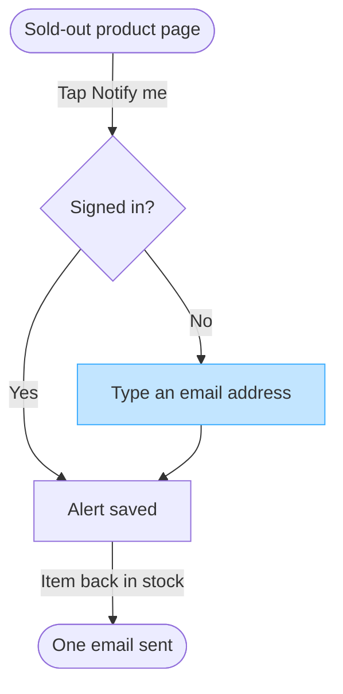

No Figma connector is attached to this Project, so no board was written and your Fernhouse Product plan is untouched. The checked model is below as a Mermaid block you can keep or paste into FigJam. With a connector attached, the write would name the plan, the file and the rollback and wait for your yes first.

### What your sources settle

| Row | Reading | Status |
|---|---|---|
| Reader | The Fernhouse product team, with Lotte reviewing the spec she wrote | assumed |
| Question | Which screens does a customer pass through to get one back-in-stock email, and where do they choose | assumed |
| Outcome | Whether the guest email step is the shape to build, and whether push stays out | assumed |
| Scope | The product page to one email, on web and in the apps | captured, platform assumed |
| Entry | The product page of a sold-out item | captured |
| Exit | One email once the item is back in stock | captured |
| Actors | The customer taps and types, the store sends the email | captured |
| Decisions and states | Signed in or guest, and only the guest types an email | captured |
| Sources and class | Lotte's spec as approved direction, push alerts inside it as a proposal, fernhouse-context.md as current behavior | captured |

Three rows had no source, so they stand assumed and one line from you corrects any of them. I read your spec as approved direction for the alert and its email, because the context lists no back-in-stock email today.

### The model

A user flow answers this, because the spec names one choice and the flow fans out at it. A list would hide the wait between the save and the email. The board must not present push alerts as agreed.

First glance is the guest typing an email, which is where the accent sits. Second glance is the signed-in customer skipping that step and being saved at once. Third glance is the wait for stock and the one email.

Left out: push alerts, a proposal nobody has agreed
Left out: how the alert email is sent, since the context lists order, shipping and refund emails and no back-in-stock type
Left out: what happens to the alert after the email, which the spec does not state
HVR self-scan: 0 hard blockers. Fixed: none. Kept with reason: Notify me, Sold-out product page and Signed in, the spec's and the context's own wording.

Want me to change anything?