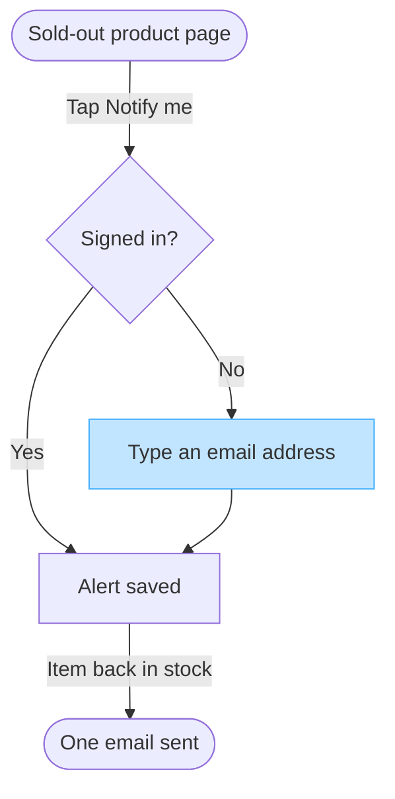

Your yes clears the three assumed rows, so the reader, question and outcome stay as read. The model is unchanged. No board was written: this Project has no Figma connector, so the Fernhouse Product plan holds nothing from this run.

### The checked model

A user flow, five nodes, one decision with two labelled exits. The guest branch carries the accent because that is the step the reader came for.

Check against the user flow rules: five nodes inside the nine budget, five connectors, two of two decision exits labelled, one accent, solid one way arrows, stadiums only at the entry and the exit. The longest path is five steps and labels average fifteen characters.

Paste the block into FigJam with its Mermaid import, or hand it to whoever draws the board. The accent comes through as a fill on the guest step.

Left out: push alerts, a proposal nobody has agreed
Left out: how the alert email is sent, since the context lists order, shipping and refund emails and no back-in-stock type
Left out: what happens to the alert after the email, which the spec does not state

Attach a Figma connector and I name the plan, the file and the rollback, wait for a fresh yes, write the diagram and read it back node by node. Until then the block above is the model, not the board.

HVR self-scan: 0 hard blockers. Fixed: none. Kept with reason: Notify me, Sold-out product page and Signed in, the spec's and the context's own wording.