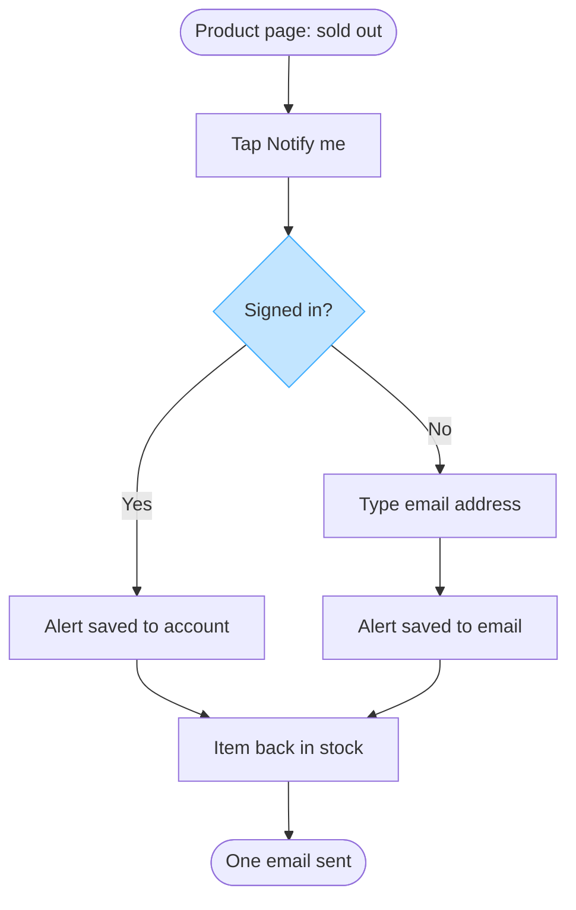

No Figma connector is present in this session, so I cannot create the board in the Fernhouse Product plan, and no read-back exists to report. What follows is the checked user-flow model, which is the model and not the board. A session holding the Figma connector writes it as one new file in that plan.

**The reading**

The question the board answers: which screens does a customer pass through to ask for an alert on a sold-out item, and where do a signed-in customer and a guest part?

| Row | Value | Status |
|---|---|---|
| Reader | Storefront team reviewing the spec, with Lotte as approver | assumed |
| Question | Which screens a customer passes through, and where the two customer types part | captured |
| Outcome | The reader can confirm the build surface and see where push sits | assumed |
| Scope | The customer's path from a product page, drawn surface-neutral because web and the apps share the shopping flows | captured |
| Entry | A product page showing a sold-out item | captured |
| Exit | One email to the customer | captured |
| Actors | Signed-in customer, guest customer, the system that sees the restock, the email provider | captured |
| Decisions and states | Signed in or guest, alert saved, back in stock, push as a proposal | captured |
| Sources | Lotte's spec as approved direction, push as a proposal, fernhouse-context.md as current behavior | captured |

Two rows are assumed, and each settles with one answer: the reader if Lotte names a different audience, the outcome if the push question moves into scope.

The type is a user flow, because the reader's question is screens and one choice. A state diagram of the item's stock would answer a different question, so it is not this board. The board must not show push alerts as agreed, and must not imply a second email.

**The model**

Eight nodes, eight connectors, two labelled decision exits, one light blue accent on the fork where the two customer types part. The first glance is that fork, because it is where the spec's two branches begin and the only choice in the flow. The second glance is where each path saves the alert, and the last is the restock email.

Left out: push alerts, a proposal with no agreement behind it and app-only besides; managing or removing an alert, which the spec does not cover; the wait between saving and restock, because nothing happens in it.

HVR self-scan: 0 hard blockers. Fixed: none. Kept with reason: no sanctioned term appears in the labels or this reply.

Add the Figma connector and I will write this to a new board in the Fernhouse Product plan and read it back. Until then this block is the model to keep.