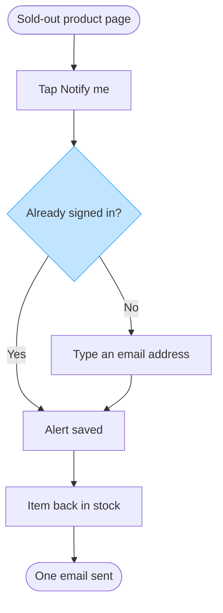

No Figma connector is loaded in this session, so I could not create a board in Fernhouse Product. Nothing was written to Figma and there is no board URL to give you. What follows is the checked model, labelled as the model and not as the board.

**Brief playback**

| Row | Value | Status |
|---|---|---|
| Reader | Lotte and the team picking this up, deciding what the back-in-stock alert builds | captured |
| Question | Where does a customer's alert get created, and where does a guest part from a signed-in customer? | captured |
| Outcome | The reader can settle the build scope: the surfaces it covers, the one email step it adds and that push sits outside it | captured |
| Scope | The email alert on the product page of a sold-out item, on Web, iOS and Android. Push, cancelling an alert and the email's own content sit outside | assumed, the spec names no surface |
| Entry | The product page of a sold-out item | captured |
| Exit | One email sent when the item returns | captured |
| Actors | The customer taps and types. The system checks the session, saves the alert, sees the stock return and sends the email | captured |
| Decisions and states | One decision, already signed in, with Yes and No. `Alert saved` is the state both answers reach | captured |
| Sources and class | Lotte's spec, approved direction. Fernhouse company context, current behavior. The push line, proposal | captured |

**Type and dials**

A user flow, because the reader's question is which screen a person passes through and where they choose, and six steps with a branch in the middle is past what a list carries. Balanced detail, mixed audience, laptop distance, top to bottom, because the flow fans out at the decision.

- First glance: the sign-in check, where a guest picks up an extra step
- Second glance: both answers land on the same saved alert
- Last glance: the single email once the item returns, and the stock trigger behind it

**Provenance**

| Item | Kind | Source | Class | Confidence | Rung |
|---|---|---|---|---|---|
| start | node | Spec, product page of a sold-out item | approved direction | high | stated |
| notify | node | Spec, taps "Notify me" | approved direction | high | stated |
| start to notify | edge | Spec, document order | approved direction | medium | ladder 3, document order |
| signed | node | Spec, the signed-in and guest sentences split here | approved direction | medium | ladder 3, document order |
| notify to signed | edge | Spec, the two sentences that follow the tap | approved direction | medium | ladder 3, document order |
| saved | node | Spec, saved straight away, and the alert is saved | approved direction | high | stated |
| signed to saved | edge | Spec, saved to their account straight away | approved direction | high | stated |
| email | node | Spec, a guest types an email address first | approved direction | high | stated |
| signed to email | edge | Spec, the guest sentence | approved direction | high | stated |
| email to saved | edge | Spec, then the alert is saved | approved direction | high | stated |
| restock | node | Spec, when the item is back in stock | approved direction | high | stated |
| saved to restock | edge | Spec, document order | approved direction | medium | ladder 3, document order |
| done | node | Spec, one email | approved direction | high | stated |
| restock to done | edge | Spec, the back-in-stock sentence | approved direction | high | stated |

The tap and the email typing are the customer's moves. The session check, the save, the stock trigger and the email are the system's, so no move is left without an actor.

**Check**

7 of 9 nodes. 7 connectors, all solid one way. 2 of 2 decision exits labelled. Widest rank 2, longest path 5, 1.0 connectors per step, labels averaging 17 characters, 0 crossing pairs. Four shapes only, camelCase ids, no subgraph, no emoji, one accent.

**The model**

Read-back: not possible, no Figma connector in this session, so nothing was written to a board
Left out: push alerts in the app, a proposal that nobody has agreed, so it is not drawn beside the email
Left out: the screen a customer sees after tapping "Notify me", which the spec does not state
Left out: where a guest's alert is stored, which the spec does not say beyond the alert being saved
HVR self-scan: 0 hard blockers. Fixed: none. Kept with reason: none.

**Before this goes onto a board**

Two things to settle first. The surfaces row is assumed, so say if this is web only and I will re-check the labels. The screen after the tap is a named gap, so say what the customer sees and it becomes a node.

Then add a Figma connector and say yes, and I will write this as one diagram named "Back in stock alert" into a new file in the Fernhouse Product plan: one write call, one read-back, and the rollback is that new file.