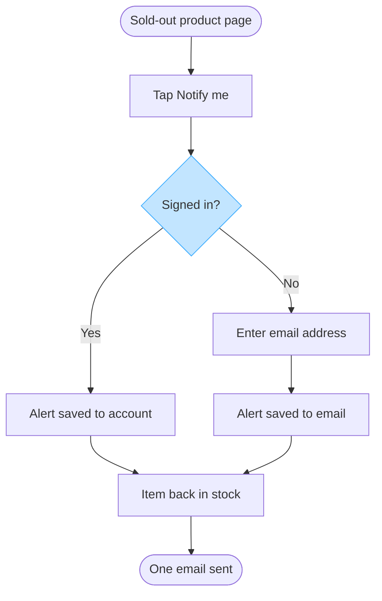

No Figma connector is attached to this Project, so I cannot create the board in the Fernhouse Product plan. Nothing has been written there and no board exists yet. What follows is the checked model of the flow, which you can keep, and one connector plus a yes turns it into the board.

The reader's question is which screens a customer passes through to set a back-in-stock alert, and where they choose. That makes it a user flow: no work passes between teams here, so a process would draw hand-offs that do not happen. Dials are balanced detail, mixed audience and laptop distance, because the labels are screen and action names that product and engineering both read.

Every node traces to Lotte's spec, which I read as agreed direction. Nothing is inferred except the join out of the two saving steps, which the spec's own order settles.

| Item | Source | Class | Confidence | Rung |
|---|---|---|---|---|
| Sold-out product page | spec, opening sentence | approved direction | high | stated |
| Tap Notify me | same sentence | approved direction | high | stated |
| Signed in? with Yes and No exits | spec, signed-in and guest sentences | approved direction | high | stated |
| Enter email address | spec, guest sentence | approved direction | high | stated |
| Alert saved to account | spec, signed-in sentence | approved direction | high | stated |
| Alert saved to email | spec, guest sentence | approved direction | high | stated |
| Item back in stock | spec, closing sentence | approved direction | high | stated |
| One email sent | same sentence | approved direction | high | stated |
| Join from both saved steps into Item back in stock | spec's order, alert saved then email when stock returns | approved direction | high | rung 2 |

Check: 8 nodes and 8 connectors, inside the 9 node budget. 2 of 2 decision exits labelled, widest rank 2 steps, longest path 7 steps, labels averaging 17 characters. One accent, light blue on the sign-in decision, since that fork is what the reader came for.

Read-back: not possible, no board was written.

Left out: push alerts, called a proposal in the spec and agreed by nobody, so drawing them beside agreed steps invites someone to build them. Left out: how stock is detected, a catalog-service and warehouse-system mechanism rather than a screen a customer passes through, and the spec states only that the item comes back in stock.

Three rows are still open, each on my reading and recommendation:

Question 1, the reader. Reading: the request puts the board in the Fernhouse Product plan, and the spec comes from Lotte as Head of Product. Recommended: the team that builds the alert, at mixed audience and laptop distance. Why: the flow names screens and actions, and no team hand-off needs drawing for that reader. Settles with a note on who reviews it.

Question 2, the surface. Reading: Fernhouse sells on Web, iOS and Android, and the spec says "product page" without naming one. Recommended: one surface-agnostic flow. Why: the spec states no platform difference, and a split with nothing different on each side draws the same flow twice. Settles with one line on whether the apps differ.

Question 3, the edges. Reading: the spec starts at a sold-out product page and ends at one email, and says nothing about a customer who already has an alert or a second restock. Recommended: keep both out. Why: neither is stated, and the "one email" wording is the only quantity the source gives.

Send a Figma connector and a yes and I will write this as one diagram in a new file in Fernhouse Product, rollback being that file.

HVR self-scan: 0 hard blockers. Fixed: none. Kept with reason: none.