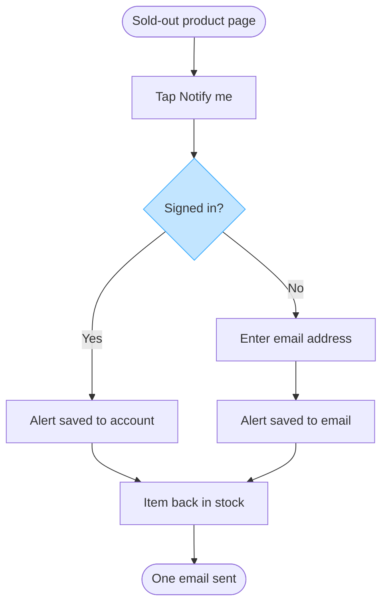

Nothing was written. This Project still has no Figma connector, so I cannot create a file in the Fernhouse Product plan, and I cannot add a connector myself. A yes is not enough on its own, because the board has to be created by the connector's diagram tool.

Your yes did settle the three open rows, and none of them changes a node:

- Reader: the team that builds the alert, at mixed audience and laptop distance.
- Surface: one surface-agnostic flow, since the spec names no platform difference.
- Edges: no already-alerted path and no second restock, neither being in the source.

The model, labelled as the model and not as a board:

Once a Figma connector is attached, the gate I would put to you reads: plan Fernhouse Product, file a new FigJam file that the call creates, one user flow of 8 nodes and 8 connectors named "Back-in-stock alert", userIntent "which screens does a customer pass through to set a back-in-stock alert, and where do they choose", rollback being that new file. Saying yes to that gate writes it, and the read-back then compares the board node by node.

Read-back: not possible, no board was written.

Left out: push alerts, called a proposal in the spec and agreed by nobody. Left out: how stock is detected, a catalog-service and warehouse-system mechanism rather than a customer step.

HVR self-scan: 0 hard blockers. Fixed: none. Kept with reason: none.