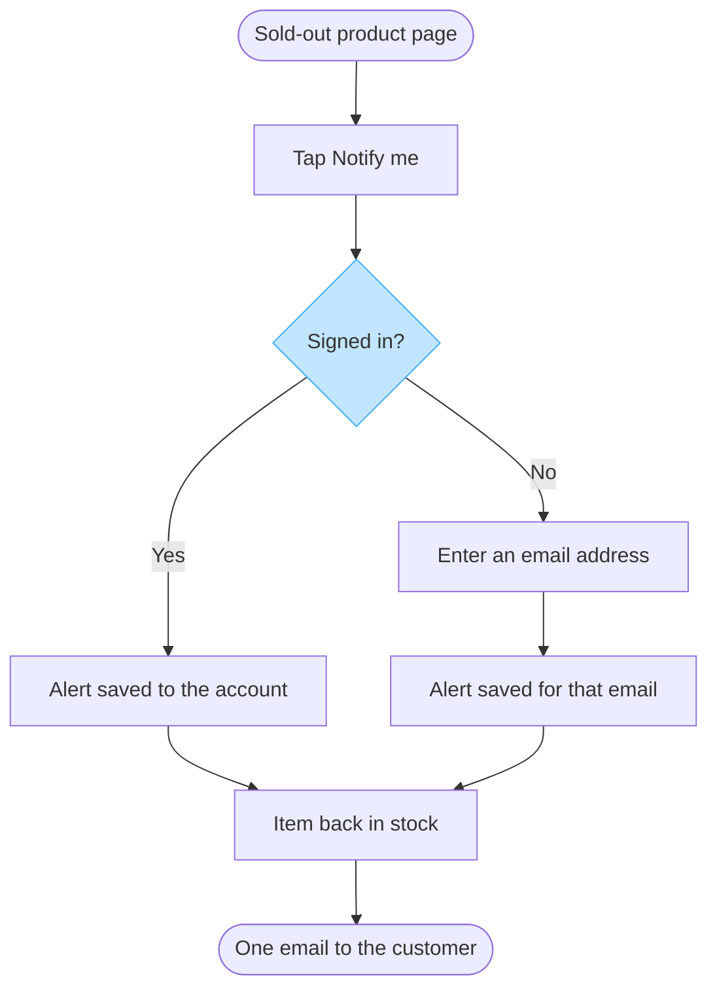

No Figma connector is attached to this Project, so there is no board and nothing was written into the Fernhouse Product plan. What follows is the intake playback and the checked model, labelled as the model.

**Type.** A user flow, because the reader's question is where a customer's tap branches. `userIntent`: where does the path from a sold-out product page to a saved back-in-stock alert branch for a signed-in customer, compared with a guest?

A numbered list would carry the steps, but it flattens the branch and hides that nothing after the save happens until stock returns, so the board earns its place. The board must not draw push alerts as built behaviour. It must not read as if a guest needs an account.

## Playback

| Row | Value | Status |
|---|---|---|
| Reader | The team building the alert, most likely Storefront, with Lotte as owner of the spec | assumed, settled by Lotte naming the team |
| Question | Where the signed-in path and the guest path part | captured from the request |
| Outcome | The reader can follow both save paths and see what triggers the email | captured from the request |
| Scope | In: product page entry, both save paths, the restock trigger, the one email. Out: push, Admin, email copy | captured from the spec |
| Entry | The product page of a sold-out item | captured |
| Exit | One email to the customer, sent when the item returns | captured |
| Actors | Customer on the product page. The restock is reported by a system the spec does not name | assumed, settled by naming the service that owns stock |
| Decisions and states | Signed in or guest. Sold out at entry, alert saved after it | captured |
| Sources and class | Lotte's spec, approved direction. `context/fernhouse-context.md`, current behavior. The push line in the spec, proposal | captured |

Drawn at Balanced detail, Mixed audience, Laptop distance, with every label at 29 characters or under. Two rows are assumed and both are named above, so either can be corrected before a write.

The glances, written before the model: the branch at `Signed in?` should win first, since it is the one choice a customer makes. Then the wait on `Item back in stock` before any email. Then that a guest's alert hangs on an email address rather than an account.

## The model

Every item above has a provenance row. The eight nodes and six of the connectors are stated in Lotte's spec and classed approved direction. The two connectors into `Item back in stock` are inferred from the spec's own order, so they carry medium confidence, and the actor behind the restock is recorded as unstated rather than named.

Model check: 8 nodes of 9, 8 connectors, 2 of 2 decision exits labelled Yes and No, longest path 7 steps, labels 29 characters or under, one accent from the light blue pair on the branch.

Read-back: not possible, no connector was attached, so nothing was written to read.

To write it, I need a Figma connector, then one `generate_diagram` call with this block, `userIntent` set to the sentence above, and a new file in the Fernhouse Product plan. I could not call `whoami`, so that plan name comes from your message and is unconfirmed. Rollback for a new file is that file.

Left out: push alerts, a proposal only and nobody agreed them, so not drawn as behaviour
Left out: the per-platform screens, the spec states one flow and names no platform split
Left out: alert storage and ownership, no alert service or feature code appears in the context
Left out: a guest confirmation screen, the spec ends the guest path at the save
Left out: a second tap and an expiring alert, the spec states neither

HVR self-scan: 0 hard blockers. Fixed: none. Kept with reason: none.