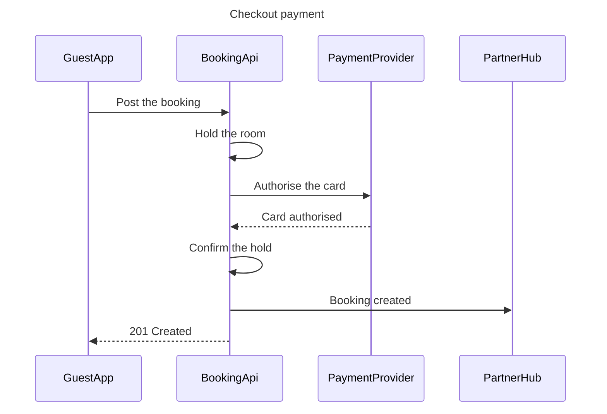

No board was written. This session has no Figma tool at all, so `generate_diagram` is missing, and a sequence needs that hosted route.

**What the write needs.** A connection to Figma's hosted MCP server at `https://mcp.figma.com/mcp`, signed in to the account that holds the Roamstay Product plan, exposing `generate_diagram` and `get_figjam`. The `fj` fallback is unreachable here (`figma-ds-cli fj info` returns `fetch failed`) and cannot draw a sequence either way, because it has no layout verb.

**Reading of the payments brief**

* Reader: the Booking and Payments squads reviewing checkout. Assumed, settled by who the board is shared with
* Question: in what order do the app, the booking API, the payment provider and the partner hub exchange messages on a checkout payment
* Outcome: see which step gates the guest's 201
* Scope: the happy path from the post to the 201. Out: a declined card, the webhook confirmation, refunds
* Entry and exit: the guest app posts the booking, the booking API answers with 201
* Actors: the four the brief names, in its order
* Source: the payments brief as you quoted it, read as current behavior

**One clash.** The brief has the booking API asking the provider to authorise the card. `context/roamstay-context.md`, last reviewed 2026-09-18, says only `payments-service` talks to the payment provider, that Pay now charges the full total, and that the booking waits in `payment_pending` for the provider's webhook before it confirms. I drew the brief's four parties, reading the brief as collapsing the payment leg at its own detail level. If the split belongs on the board, it becomes five participants and the 201 lands before the webhook.

**The model, checked**



`flow_check.py`: `PASSED, 4 participants and 7 messages`. `Card authorised` is the one inferred message, implied by the brief's "confirms the hold" rather than stated.

**Glance lines.** First glance: the authorisation exchange between the booking API and the payment provider, the step that gates the guest's 201. Second glance: the hold and the confirm-hold on either side of it, so the room stays held across the authorisation. Last glance: the notification to the partner hub, after the hold and outside the guest's answer. No accent, because a sequence takes no colour in the generator.

```text
Plan: Roamstay Product. File: a new FigJam file, which the first call creates.
Writes: one sequence, 4 participants and 7 messages, named "Checkout payment", with a title text node above it.
Reads: one get_figjam read-back, with its screenshot.
Rollback: delete the new file.
Write it?
```

The plan comes from your request. `whoami` was not available to confirm the account holds it.

Nothing is written until you say yes and the Figma tool is connected.

`Left out: the declined-card path, unnamed in the brief and a second diagram whatever it says, because a fragment renders flat`
`Left out: the payments-service split and the webhook confirmation, held back until you settle which source governs`
`Read-back: not possible, no board was written`

HVR self-scan: 0 hard blockers. Fixed: none. Kept with reason: none.