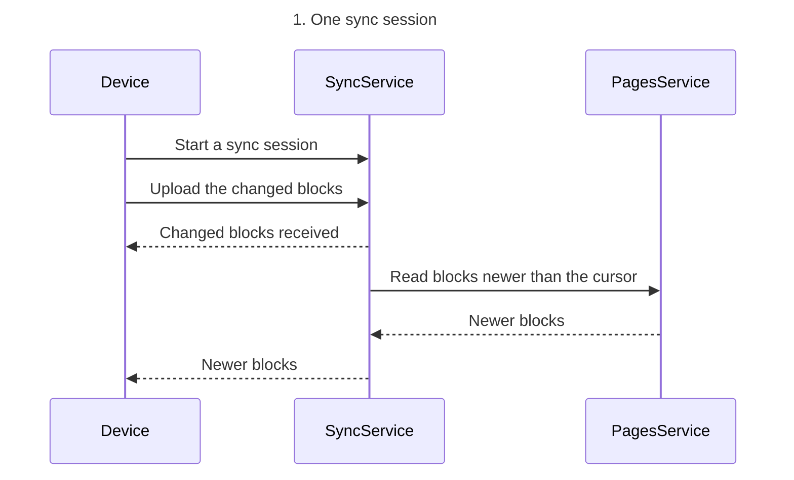
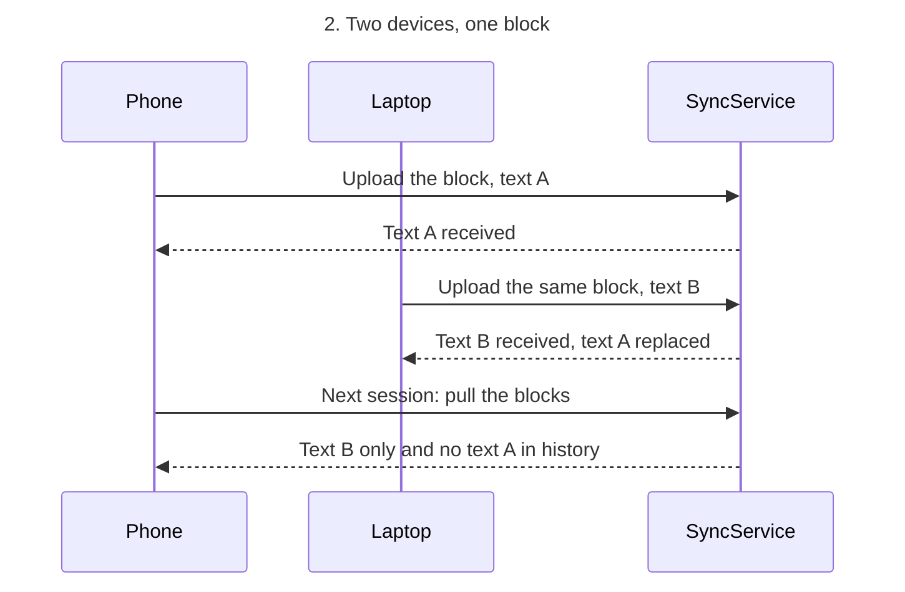

No FigJam board was written. The hosted Figma MCP is not connected in this session, so `generate_diagram` and `get_figjam` are unavailable. The `figma-ds-cli` fallback cannot reach Figma Desktop, which needs Figma open on a FigJam file, and it cannot draw a sequence even with a connection.

Read-back: not possible, this session has no Figma write route.

The board answers one question: how a device's changed blocks reach sync-service and the other devices, and which edit survives when two devices change the same block. That is an order question, so the type is a sequence, with one diagram for a sync session and one for a shared block. The model draws current behavior only, on protocol v3.

```text
diagram 1, sequence: ok, 3 participants and 6 messages
diagram 2, sequence: ok, 3 participants and 6 messages
PASSED 2 diagram(s).
```

Diagram 1, one sync session:



Diagram 2, two devices, one block:



Two points the sources imply rather than state:
- Sync-service reads newer blocks through pages-service. The services table says every other service reads block data through pages-service.
- The phone's next pull returns the laptop's text. The context page says sync-service keeps every device on the same version of each block.

Left out: Option A field-level last-writer-wins, Option B three-way merge with a conflict copy and Option C CRDT (proposals, decision owner Joana, due 2026-10-09), the offline mode epic with sync on reconnect (proposal, Q1 2027) and the no-connection retry path (current behavior, a separate path from the sync session).

Connect the Figma MCP at `https://mcp.figma.com/mcp`, then the gate can run: one board, two diagrams, with the write plan and rollback named before anything is written.

HVR self-scan: 0 hard blockers. Fixed: none. Kept with reason: none.