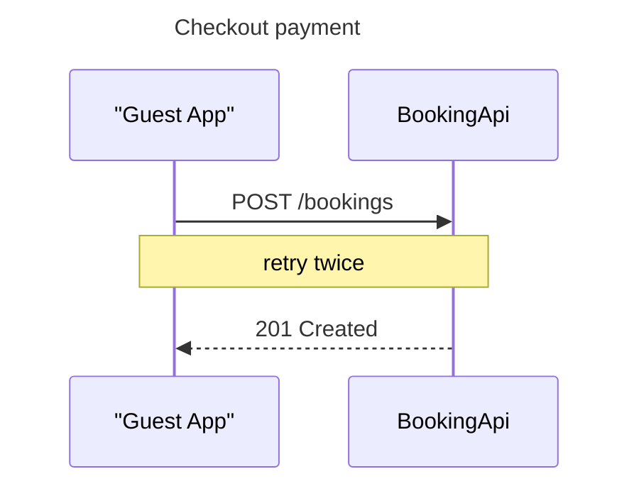

I ran the check on a scratch sequence model outside the repository. It fails, and it names both rules.

**Model under test** (`sequenceDiagram`, title line, 2 participants, 4 content lines):



**Command**

```text
python3 sk-create-figjam/scripts/flow_check.py <tmp>/sequence-aliased-note.mmd
```

**Output**

```text
  diagram 1, sequence: line 3: GuestApp carries the alias "Guest App", which the generator drops: the id is what the board shows, so make the id readable
  diagram 1, sequence: line 6: a note is dropped by the generator: draw it afterwards through the hybrid workflow
FAILED 1 of 1 diagram(s) in sequence-aliased-note.mmd
```

**Exit status: `1`**

Both rules are named: the alias refusal on line 3 (`carries the alias … which the generator drops`) and the dropped note on line 6 (`a note is dropped by the generator`). Both sit where `sk-create-figjam/references/types/sequence.md` Section 2 and Section 3 put them, and both come from `scripts/figjam_checks/sequence.py`, the alias check at line 69 and the `note` entry in the `DROPPED` map at line 38.

**Controls run alongside it**

* The same model with the alias and the note removed: `PASSED 1 diagram(s) in sequence-clean.mmd`, exit `0`. So the failure is caused by those two features and nothing else in the model
* `flow_check.py --self-test`: `142 of 142 self-test checks passed`, exit `0`. The checker itself is healthy, so the failure is the model's

**Cleanup**

* Both scratch models lived in a `mktemp -d` directory under `$TMPDIR` and were removed after the runs. A re-`ls` of the path returns `No such file or directory`
* `find` returns no `.mmd` or `.mermaid` file in the repository, and `export/` still holds 0 entries. The run wrote no export, which is correct here: this was a check-script verification, not a board write, and the packet's NEVER rule 1 forbids leaving a model file in the repository

Nothing was written to a board and no `generate_diagram` call was made, so there is no board URL or read-back to report. If you want the same two refusals proved in a form you can keep, the planted fixtures in `scripts/figjam_checks/fixtures.py` are the durable pair to point at, rather than a scratch file.