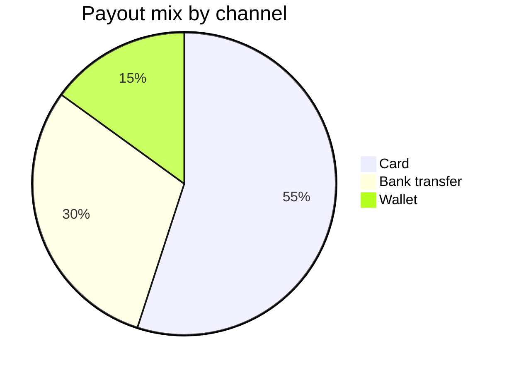

## Output

```
diagram 1, unknown: a pie block: the board generator does not draw it, see references/flow-mode.md Section 3
FAILED 1 of 1 diagram(s) in pie.md
```

**Exit status: `1`** — the documented rule-failure code (`0` every diagram passes, `1` a rule fails, `2` unreadable).

Model checked, in a temp directory outside the repo:

````

````

Run as `python3 sk-create-figjam/scripts/flow_check.py /tmp/po-pie-check/pie.md` from `sk-create-figjam/scripts/`. Fed as a bare `.mmd` file with the same `pie` header, it returns the identical line and the same exit status.

## The pointer lands on the type table

The message's `references/flow-mode.md Section 3` is the type section, and it carries both tables the claim rests on:

* Line 114, the `| The reader asks | Type | Reference |` table, which lists only the seven drawable types and so has no pie row
* Line 149 `### What the generator does not draw` names the pie chart plainly, and line 159 gives its nearest-type row: `| Pie, mindmap, Venn, quadrant | None. Offer a table or a list in a Doc |`

So the failure is a type rejection with a route out, not a parse problem. One label to read past: the name prints `diagram 1, unknown` because `NAMES` has no entry for a rejected profile, which is why the kind is spoken in the message body instead.

## Checks behind the result

* `flow_check.py --self-test` passes 142 of 142, including the planted `an unsupported kind` fixture that asserts `a pie block: the board generator does not draw it`, so the rule is proven to fire and not merely to be silent
* The palette record and `SKILL.md DIAGRAM_TYPES` cross-checks pass inside that run, so the check itself is not degraded
* No `.md`, `.mmd`, `.mermaid`, SVG or PNG was written to the repository, and nothing was saved to `export/`. The packet's NEVER rule 1 bars an `export/` write and any Mermaid file in the repo, and this run was a diagnostic rather than a model delivery, so there is no artifact and no `HVR self-scan:` line to report

If the pie's question still needs answering, Section 3's verdict is that no drawable type stands in for it and the offer is a table or a list in a Doc. Say the word and I'll take it there.