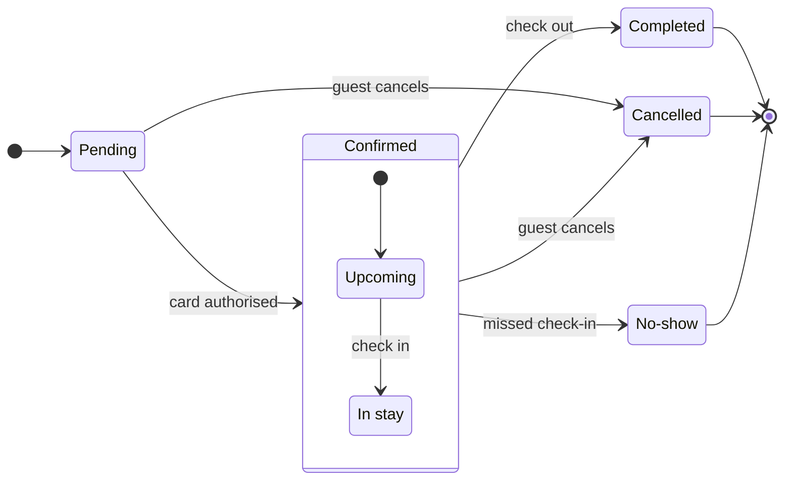

No board was written. This session holds no Figma MCP connection, so the hosted `generate_diagram` tool that draws a state diagram cannot be reached, and the `figma-ds-cli` fallback is not able to draw a state diagram at all. Nothing landed in the Roamstay Product plan, so there is no URL to hand you.

Here is the reading and the checked model, ready for the moment that connector exists.

**The question the board answers.** Support reads a booking's status and needs to know what can still move it and which statuses are over. A state diagram, not a flow, because the subject is one booking's states and not a person walking screens.

- Entry: the booking exists and waits on its card authorisation
- Confirmed is one state that holds two: Upcoming and In stay
- Exit: Completed, Cancelled or No-show, each of them terminal
- Actors: the card authorisation, the guest and the hotel

**Two rows your message left open, drawn on the recommended reading**

1. Check-in is the move from Upcoming to In stay. You named the missed check-in behind No-show but not the arrival that starts the stay, so the label reads `check in`. A check-in time on the booking would settle it
2. No-show leaves Confirmed as a whole, with the guard in its label, because a move from a substate to a top-level state is not a shape this grammar draws. Read the label as "missed check-in, so the stay never started", which cannot happen from In stay



The pre-write check passes it: `diagram 1, state: ok, 7 states and 11 transitions`, `PASSED 1 diagram(s)`. Labels keep your own words, so `In stay` and `No-show` read with their hyphen and space rather than as ids.

**The colour you asked for cannot live in the model.** A state diagram strips Mermaid styling, and a style line is read as new states, which would put three phantom boxes on the board. So the colour is a hybrid extension added after the write: one rounded rectangle behind Completed, Cancelled and No-show, fill `#D9D9D9` with a dashed `#B3B3B3` stroke, layer name `Ended`, plus one key sticky that names it. Support then reads grey as ended rather than as decoration. Those three states land in the last column of an `LR` layout, so one rectangle should cover exactly them. If the read-back shows a live state inside those bounds, the tint goes per end state with the same key entry and I report which of the two landed.

When the tool is connected, the gate you answer is this one.

```text
Plan: Roamstay Product. File: a new FigJam file, created by this call.
Writes: one state diagram, 7 states and 11 transitions, titled "Booking status".
Then: one grey tint behind the three end states, plus one key sticky naming it.
Reads: one get_figjam read-back, one screenshot.
Rollback: delete the new file.
Write it?
```

Read-back: not possible, nothing was written

Extensions: none, nothing was written

Left out: the card authorisation failure, which your message does not state, so no declined or expired status sits on the board and a failed authorisation currently reads as a booking that stays Pending

Left out: refunds, payout to the hotel and authorisation retries, out of the scope you set

HVR self-scan: 0 hard blockers. Fixed: none. Kept with reason: none.

Connect Figma's hosted MCP server to a session and say go, and I will run that gate, write the board and read it back to you.