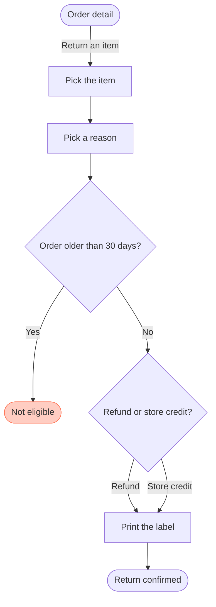

No Figma connector is attached in this chat, so no board was written and there is no board URL to read back. The desktop `fj` route writes into an open FigJam file and cannot create a new board in a plan.

**User flow: Start a return (planned)**

Reader: the Fernhouse Product team. Question: which screens does a customer pass through to return an item, and where do they choose? Outcome: agree the screens and the two decision points, including the ineligible exit.

Check: PASSED, 8 nodes and 8 connectors, 4 of 4 decision exits labelled, 0 crossing pairs.

The returns doc is not attached here, so the model follows the steps in your message. The company context still says there is no self-serve return today, so the flow is marked planned rather than current. Say if it has shipped and I'll drop the label.

First glance: the Not eligible screen, where the 30-day check sends an ineligible order. Second glance: the refund or store credit choice feeds the same label screen. Last glance: the confirmation closes the happy path.

**Write gate**

Plan: Fernhouse Product. File: a new FigJam file, which the write creates.
Writes: one user flow with 8 nodes, 8 connectors and 4 labelled decision exits. One red accent on Not eligible and the title "Start a return (planned)".
Extensions: none.
Read calls: `whoami` when the server reports it, `get_figjam` read-back and a screenshot when the read carries none.
Rollback: delete the new file.

Attach the Figma connector, then say yes and I'll write it.

Left out: the current CS-assisted return process, out of scope and still live per the company context. The next step after Not eligible, not stated in your summary.

HVR self-scan: 0 hard blockers. Fixed: none. Kept with reason: none.