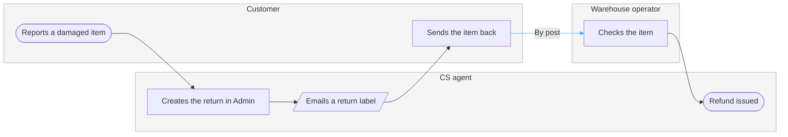

No board was written. Figma's hosted MCP is not connected in this session, so `generate_diagram` is unavailable, and `figma-ds-cli` reports no Figma connection. Nothing landed in the Fernhouse Product plan, and the model below is checked and ready so you can correct it before a route exists.

### What the source states

`context/fernhouse-context.md` is the only Fernhouse material in the workspace. It is current behavior, last updated 2026-09-18, and its key flow 6 states one returns path: the customer contacts CS, a CS agent creates the return in Admin and emails a return label, the warehouse checks the item, and the agent refunds. It names no damaged-goods path of its own, so the board draws that return path for the damaged case and puts the accent where work crosses into the warehouse.

Two rows rest on a reading rather than a stated line:

| Row | Reading | What would settle it |
|---|---|---|
| Decisions and states | A damaged item runs the stated return path, with the damage as the reason the customer reports it | A RET runbook or Admin notes naming a damaged-goods branch |
| Where the warehouse is reached | The customer posts the item back, so the warehouse check follows the parcel | The RET workflow notes, or a CS walkthrough |

### The model, checked



```text
  diagram 1, process: ok, 6 nodes and 5 connectors, widest rank 1 steps, longest path 6 steps, 0.8 connectors per step, labels average 20 characters, 0 crossing pairs
PASSED 1 diagram(s) in model.md
```

First glance: the blue connector into the warehouse lane, the handoff you asked to highlight. Second glance: the refund sits back in the CS lane after that crossing, so CS releases the money and the warehouse only checks the item. Last glance: the policy facts, the 30-day window and the €200 limit with a CS lead above it.

The gate, ready for a route:

```text
Plan: Fernhouse Product. File: a new FigJam file, which the first call creates.
Writes: one process named "Damaged-item refund", 3 lanes, 6 nodes, 5 connectors, the accent on the customer-to-warehouse handoff, and a title text node above it.
Extensions: 2 step notes (a refund takes 6 days on average from first contact, CS handles about 1,900 return requests a month) and 1 key sticky.
Read calls: whoami, then get_figjam for the read-back. A Starter plan or a View seat caps these at six a month.
Rollback: delete the new file.
```

Connect Figma's hosted MCP and your yes covers the write. `fj` with Figma Desktop running draws it without lanes, which loses the lane ownership and the crossing the accent sits on.

Read-back: not possible, no board was written this session
Left out: CS lead approval above €200 (a fourth actor outside the three you named), the 30-day return window and the absent self-serve return (constraints rather than steps)
HVR self-scan: 0 hard blockers. Fixed: none. Kept with reason: none.

One question before this is worth a write call: does a damaged-item refund follow this return path, or is there a separate damaged-goods route I should draw instead? Recommended: this path, because the source states one return flow and no damaged branch.