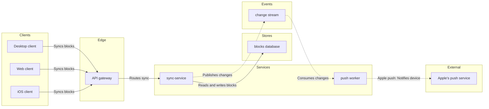

No board written: Figma's hosted MCP route is not connected in this session, and the `figma-ds-cli` fallback cannot draw an architecture.

The hosted route is `generate_diagram` on Figma's server at `mcp.figma.com/mcp`, reached through Figma's plugin or this client's connector, on an account that holds the Loomlist Engineering plan. `figma-ds-cli` 1.2.0 is installed here and its `fj` group answers, but it has no verb for a lane or a container, so it draws a user flow or a process with no lanes. Its desktop daemon is not up either, because `fj info` returns `fetch failed`. I could not read the plan list, because `whoami` sits on that same server.

The reading

| Row | Value | Status |
|---|---|---|
| Reader | Loomlist engineering team, mixed audience, your component names kept | assumed |
| Question | Which parts take part in block sync, and how they connect | captured |
| Outcome | Decide which parts the sync work has to touch | assumed |
| Scope | The sync path only, three clients through to Apple's push service | captured |
| Entry | Desktop, web and iOS clients | captured |
| Exit | Apple's push service | captured |
| Actors | Nine parts, all of them named in your message | captured |
| Decisions and states | None, an architecture carries no branches | captured |
| Sources | Your message, one source, class current behavior | captured |

Four connectors are my reading rather than your words: sync-service to the blocks database, sync-service to the change stream, the change stream to the push worker, and the push worker to Apple's push service. They follow what each named part does, and they are the ones to check. The three client connectors and the route from the gateway to sync-service follow the order you listed the parts in.

One cut: file storage. Nothing you supplied says sync-service touches it, so drawing it would mean inventing an edge, and that guessed edge puts the diagram at ten nodes against a nine-node budget. One question before the yes: does sync-service write to file storage? If it does, I will add it and split the board into an overview and a detail rather than thin the path.

Not drawn either: a return leg from the gateway to the desktop and web clients, since you stated no channel. The sync path reaches the iOS device only through Apple's push service, and this layout has no edge from an outside system back to a client.

First glance is sync-service, the part every sync request passes through. Second is its two outputs, the blocks write and the change stream publish. Last is Apple's push service at the end of the chain.

The model



The check, on `flow_check.py`

```text
  diagram 1, architecture: ok, 9 nodes and 8 connectors, widest rank 3 steps, longest path 6 steps, 0.9 connectors per step, labels average 13 characters, 0 crossing pairs
PASSED 1 diagram(s)
```

The gate

```text
Plan: Loomlist Engineering, as you named it, unconfirmed until whoami answers
File: a new FigJam file, which the first call creates
Writes: one architecture, 9 nodes and 8 connectors, named "Block sync", with useArchitectureLayoutCode set to FIGMA_DIAGRAM_2026, plus one title text node above it
Read calls: whoami if the server reports one, the get_figjam read-back, then one screenshot, which a Starter plan counts against six tool calls a month
Rollback: delete the new file
```

Read-back: not possible, no Figma write route is connected in this session
Left out: file storage, no call to it is stated and a guessed edge would take the model to ten nodes against a nine-node budget
HVR self-scan: 0 hard blockers. Fixed: none. Kept with reason: none.