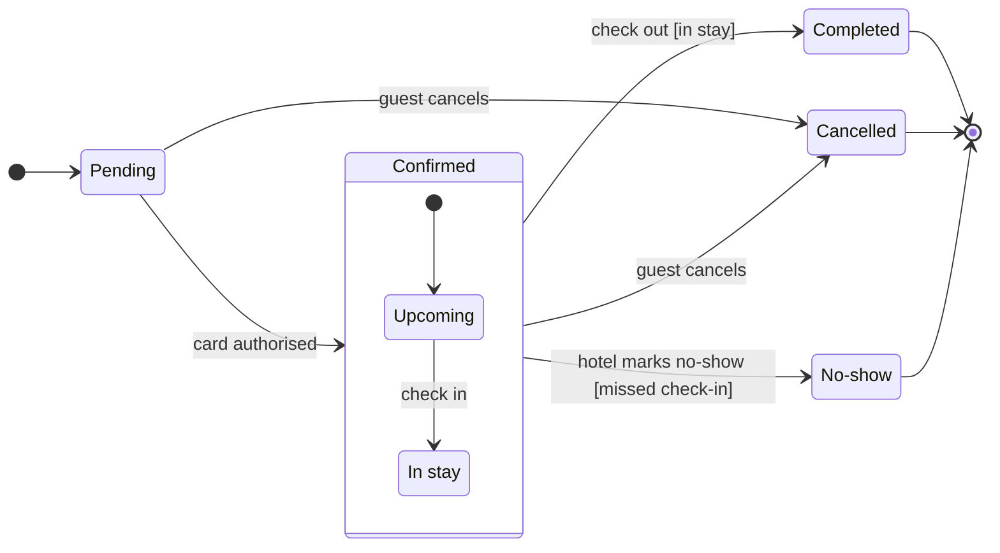

No plan called Roamstay Product is on this Figma account, so nothing has been written yet. The model, the check and the gate are ready, and the gate needs the plan settled first.

**Reading**

This is a state diagram: seven statuses a booking can hold and eleven moves between them. Confirmed is drawn as a box around Upcoming and In stay, because the request says Confirmed covers both. Support is the reader, so the three states that end a booking carry the colour.

Check-out and no-show leave the Confirmed box rather than a sub-state, because this grammar will not draw a transition from a sub-state to an outside state. The guards `[in stay]` and `[missed check-in]` keep the condition the box would otherwise hide.

**Glance lines**

First glance: the grey Ended band, so support sees where a booking can stop
Second glance: the two exits into it, guest cancels and hotel marks no-show
Last glance: the Confirmed box, Upcoming then In stay

**Assumed**

Scope is the status field, so card decline, refunds and cancellation fees stay out. Detail is balanced, audience mixed, distance laptop. Three gaps stay named instead of filled: a declined authorisation has no state, a no-show has no timing beyond the missed check-in, and Pending has no exit if the card is never authorised.

**Check**

`diagram 1, state: ok, 7 states and 11 transitions` then `PASSED 1 diagram(s)`

**The plan**

whoami returns three plans, none named Roamstay Product.

| Plan | Tier and seat | Key |
|---|---|---|
| <figma-plan-3> | Starter, View | team::955111831884247158 |
| <figma-plan-1> | Pro, Full, admin | team::1297132374291579406 |
| <figma-plan-2> | Pro, Full, member | team::1285583218246154085 |

The Starter plan's View seat cannot edit, so a board there would fail. If Roamstay Product is a project or folder inside a team, it is still not a plan: `generate_diagram` creates the file in a plan and cannot target a project. <figma-plan-1> is the <figma-plan-5> team this workspace serves and the only plan where you hold a Full seat as admin, so it is the one I recommend.

**Gate**

Plan: <figma-plan-1> (`team::1297132374291579406`), unless you name another
File: a new FigJam file, created by the write
Writes: one state diagram, 7 states and 11 transitions, named Booking status lifecycle, with its title above it
Then: one light gray tint `#D9D9D9` with a dashed `#B3B3B3` edge behind Completed, Cancelled and NoShow, named Ended, and one key entry to its right so the tint's meaning is readable on the board
Reads: one `get_figjam` read-back that also returns the node bounds, a second `get_figjam` after the tint, and a screenshot only if the read returns none
Rollback: delete the new file
The write tags the nodes it creates

Name the plan and say write, and I will draw it.