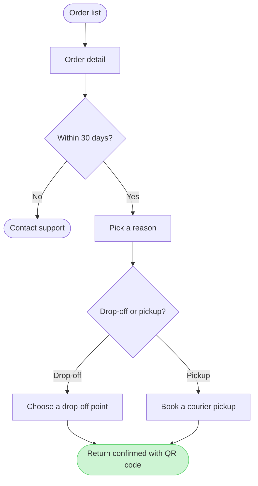

**The reading**

Question: which screens does a Fernhouse customer pass through to start a return in the app, and where do they choose?

| Row | Reading |
|---|---|
| Reader | Post-purchase and CS, agreeing the app path before build |
| Outcome | One agreed screen order with both branch points marked |
| Entry | The order list in the app |
| Exit | Return confirmed with a QR code, or Contact support after 30 days |
| Actors | The customer takes every step. The 30-day check is automatic |
| Decisions | Within 30 days, then drop-off or courier pickup |
| Scope | Order list through confirmation. Refund and label handling sit outside it |

Sources: your summary of the app screens and the returns doc, read as current behavior. The company context disagrees on one point, raised below.

**The outline**

1. The customer opens the order list and taps an order
2. The order detail shows Start a return
3. Start a return runs the 30-day check, automatic and inferred to sit here
4. Within 30 days? No, Contact support appears and the flow ends
5. Within 30 days? Yes, the reason list opens
6. The customer picks a reason, then chooses drop-off or courier pickup
7. Drop-off leads to choosing a point, pickup to booking a courier
8. Both end on the confirmation with the QR code

A merge dot was cut: the two methods now run straight into the confirmation, which keeps the flow at nine nodes without losing a step.

**The sketch**



**The check**

PASSED. 9 nodes, 9 connectors, 4 of 4 decision exits labelled, 0 crossing pairs, widest rank 2. Light green sits on the confirmation, the node a reader keeps if they keep one.

I framed it as the screens in order with both branches beside the path. A state map would show the expiry better and lose the screen order you asked about.

**What I need before writing**

1. Plan. "Fernhouse Product" is not one of the three plans this Figma account holds: <figma-plan-3> (View seat, Starter), <figma-plan-1> (Full seat, Pro), <figma-plan-2> (Full seat, Pro). I will not pick one for you, because the board is visible to that plan's members as soon as it lands. Recommended: <figma-plan-1>, the Full seat with the admin role, which also keeps the write off the Starter seat's six-call monthly cap. If Fernhouse Product is a project folder rather than a plan, send its Figma URL.
2. Status. The company context, last updated 18 September, says there is no self-serve return today: the customer contacts CS, an agent creates the return in Admin and emails the label. Your returns doc and the app screens show a self-serve flow. Reading: the returns doc governs, because you named it and the app as the source and marked only the €100 pickup as a proposal. If the flow is still a design, say so and the board will be labelled as proposed.

**The write I would run**

```text
Plan: <the plan you name>. File: a new FigJam file, created by the first call.
Writes: one user flow, 9 nodes and 9 connectors, named "Start a return", with its title node above the diagram.
Accent: light green on Return confirmed with QR code. First glance is that confirmation, second the two method branches, last the 30-day rule and Contact support.
Extensions: none.
Calls: one generate_diagram write, one get_figjam read-back.
Rollback: delete the new file.
```

Nothing is on a board yet. Name the plan, and the status if it differs, and I will write it.