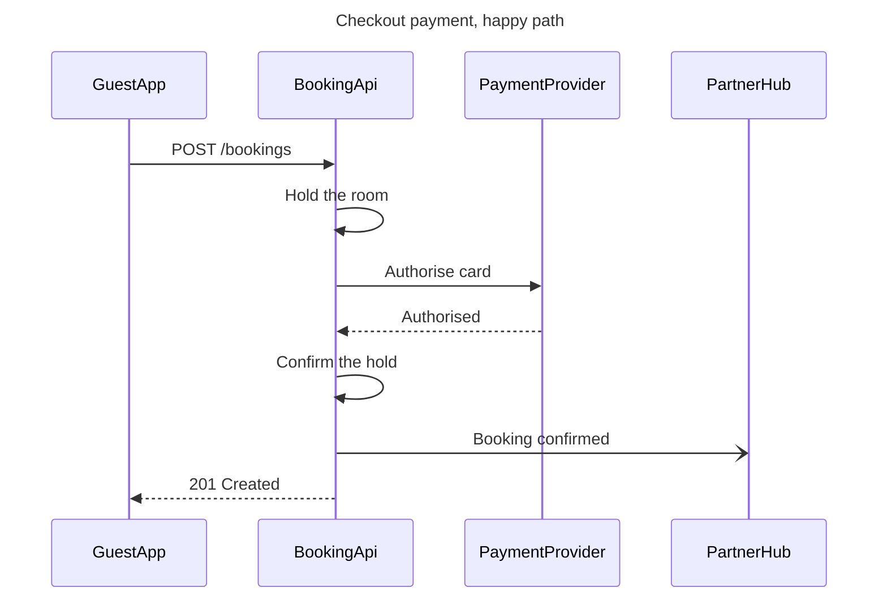

**Reading of the brief**

| Row | Reading |
|---|---|
| Question | In what order do the guest app, booking API, payment provider and partner hub exchange messages on a booking that succeeds |
| Outcome | A reader can place the room hold, the card authorisation and the hub notification around the 201 |
| Entry and exit | `POST /bookings` from the guest app, `201` back to it |
| Actors | GuestApp, BookingApi, PaymentProvider, PartnerHub |
| Scope | The happy path. The declined card is a second path, so it is its own diagram |
| Source | The payments brief, read as current behavior. It states the flow in the present tense and carries no approval label |
| Assumed | The reader is the payments engineer who owns this flow. Audience engineer, reading distance Laptop |

Check: one sequence diagram, 4 participants, 7 messages, `PASSED`.

**The plan is not on the account**

Reading: `whoami` returns three plans, <figma-plan-3> (Starter, View seat), <figma-plan-1> (Pro, Full seat) and <figma-plan-2> (Pro, Member seat). None is called Roamstay Product.

Question: which plan should own the new board, and is Roamstay Product a project inside it?

Recommended: <figma-plan-1>, `team::1297132374291579406`, with the board moved into the Roamstay Product project afterwards.

Why: it is the only Pro plan where you hold a Full seat, the Starter plan's View seat cannot edit, and the write takes a plan rather than a project.

**The write, once the plan is settled**

*   File: a new FigJam board, created by the write, with no existing `fileKey`
*   Diagram: one sequence named "Checkout payment, happy path", 4 participants, 7 messages
*   Extensions: none. A sequence takes no colour in the model, so no accent and no key
*   Reads: one `get_figjam` read-back after the write. The `whoami` call is already spent
*   Rollback: delete the new file
*   Left out: the declined card, the 402 and the released hold, kept as a second diagram because `alt` renders flat

First glance: the authorisation between BookingApi and PaymentProvider, because the payment only completes once the provider answers. Second glance: the room hold on either side of it. Last glance: the 201 to the app and the notification to the hub.

Name the plan and say yes, and I will write it.