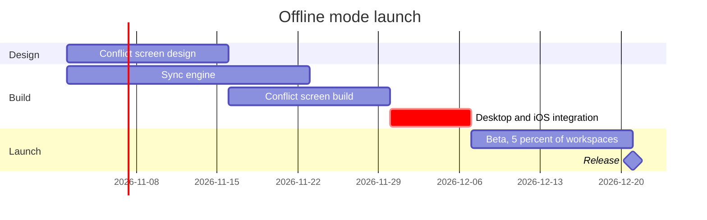

**Playback, offline mode launch**

The board answers: which work runs when, and what holds the release
Outcome: a reader sees the 21 December release and that integration, not either build, is what moves it

* Design starts 2 November 2026, two weeks on the conflict screen
* Sync engine starts the same day, three weeks, ending 23 November
* Conflict screen build follows its design, two weeks, ending 30 November
* Desktop and iOS integration starts when both builds are done, one week, on the critical path
* Beta runs two weeks for 5 percent of workspaces, then the release

Check: PASSED, 6 tasks in 3 sections

* First glance: the release on 21 December, reached through integration
* Second glance: the two 2 November starts, and the build that gates integration
* Last glance: the 5 percent beta scope

Left out: Android in the next quarter, because you have not approved it and it carries no dates

**The write gate**

Plan: not settled. Your Figma account holds three plans, and none is named Loomlist Product.

| Plan | Tier | Your seat |
|---|---|---|
| <figma-plan-1> | Pro | Full |
| <figma-plan-2> | Pro | Member |
| <figma-plan-3> | Starter | View |

Writing from the Starter plan would spend most of its six tool calls a month on this board.

Question: which plan should hold the new board, or is Loomlist Product a project folder inside one of these
Recommended: <figma-plan-1>, the team plan where your product work lives, and your seat there is Full

File: a new FigJam file, created by the first write, titled Offline mode launch
Writes: one gantt chart, 3 sections, 6 tasks and 1 milestone
Extensions: none. A gantt chart takes no colour and this board needs no pins or stickies
Read calls: two more, get_figjam for the node-by-node read-back and one screenshot, after the whoami call already spent
Rollback: delete the new file

Name the plan and say yes, and I will write it.

HVR self-scan: 0 hard blockers. Fixed: none. Kept with reason: none.