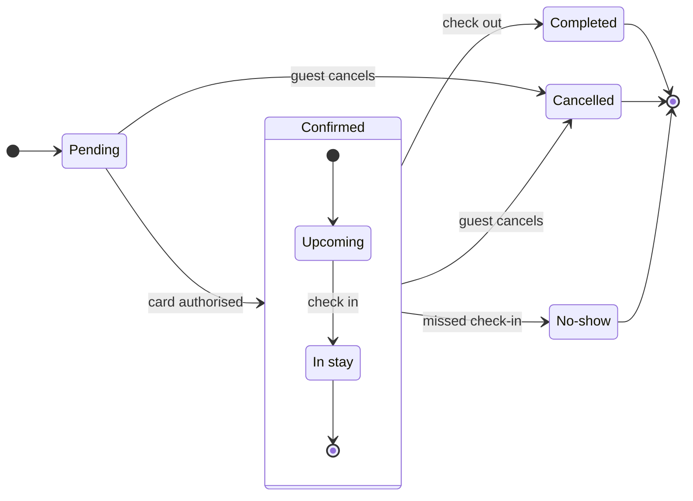

**No board write yet. The target is still missing.**

The Figma connector is live and your go-ahead is noted. The board reference in your message is still the literal `<fileKey of the prepared board>`, so there is no board I can open or add to. I will not create a new board in its place.

The model passes the pre-write check: 7 states, 12 transitions, 6 labelled transitions.

**To land it**
Paste the FigJam board URL, or the fileKey from it. I will add one diagram named "Booking status lifecycle" beside the existing content, read the board back node by node, and reply with the board URL and the measured counts.

If the board is gone and you want a new one instead, say so. I will gate a new file in <figma-plan-1> separately, because a yes for the retro board does not cover a different file.

**Left out:** the 30-minute `payment_pending` expiry, because your five rules do not include it and an Expired state would exceed the 12-transition budget.

`HVR self-scan: 0 hard blockers. Fixed: none. Kept with reason: none.`