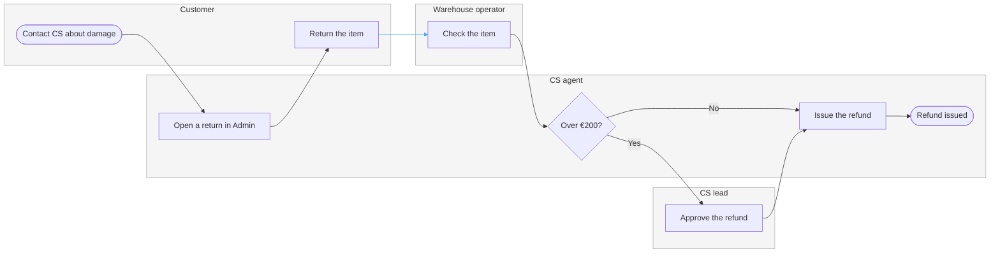

No board was written. No Figma write route is connected in this session, so nothing landed in the Fernhouse Product plan.

`Read-back: not possible, no board exists and no read tool is connected`
`Left out: the 30-day return window and what follows it, no source states the outcome so the decision cannot carry a stated exit, a replacement instead of a refund, no source offers one, what happens when the warehouse check rejects the item, no source states it, the CS order lookup, folded into "Open a return in Admin" at balanced detail, the carrier's in-transit DAMAGED exception and our handling of it, the code is documented and our response is not, the 6-day average refund time, timing is not a step`
`HVR self-scan: 0 hard blockers. Fixed: none. Kept with reason: none.`

## Why nothing was written

Two routes exist and neither is reachable here.

The hosted route is the only one that can create a new board in a named plan, and it is absent. Figma's `generate_diagram` is remote-only, this session exposes no native Figma MCP tool, and the Code Mode manual registered in `.utcp_config.json` is Framelink's `figma-developer-mcp`, which has no diagram write.

The `fj` fallback cannot serve the request even if connected. `figma-ds-cli` 1.2.0 is installed with its `fj` group and Figma Desktop is running, but `figma-ds-cli status` returns first-run setup and `fj list` cannot connect. Beyond that, `fj` writes into the FigJam file already open in Desktop and has no create-file verb, so it cannot place a new board in a plan.

## The reading

Quick energy ran with no intake rounds, so every row below is filled from the sources and defaults. No source in `context/` describes a damaged-item flow, so the board is the returns path the context states, entered at a damaged item. Four rows are assumed, each one named with what would settle it.

| Row | Value | Status |
|---|---|---|
| Reader | CS leads and the Post-purchase team, reading the plan to see where a damaged report goes today | assumed, settled by naming the audience |
| Question | When a customer gets a damaged item, who does what, in which order, and where does the work change hands | assumed, settled by the reader |
| Outcome | The report takes the returns path, the parcel leg sets the delay, and the €200 limit splits approval | assumed |
| Scope | Report to refund across four roles, replacement policy and the window outcome left out | captured, `fernhouse-context.md`, key flow 6 |
| Entry | The customer contacts CS about a damaged item | assumed, settled by a helpdesk runbook or one screenshot of the report |
| Exit | Refund issued, `6 days` on average from first contact | captured, key flow 6 |
| Actors | Customer, CS agent, Warehouse operator and CS lead | captured, context roles and Admin permissions |
| Decisions and states | The €200 refund limit splits the CS agent from the CS lead | captured, Admin permissions |
| Sources and class | `fernhouse-context.md` current behavior, `fernhouse-carrier-tracking-api-facts.md` current behavior for the `DAMAGED` code only, `fernhouse-order-tracking-pm-brief.md` approved direction and not drawn | captured |

Dials, all recommended and assumed: balanced detail, mixed audience, laptop reading distance.

## Type

A process with four lanes, because the reader's question is who does what and where the work changes hands. A user flow of the customer's screens was the second framing: it would show the order page and the contact step and drop the warehouse check and the €200 split, which is most of what the reader needs.

## The model, checked



```text
diagram 1, process: ok, 8 nodes and 8 connectors, widest rank 1 steps, longest path 8 steps, 1.0 connectors per step, labels average 16 characters, 0 crossing pairs
PASSED 1 diagram(s) in model.md
```

Provenance, working data and never on the board:

| Item | Source | Class | Confidence | Rung |
|---|---|---|---|---|
| report | context, key flow 6, no self-serve return | current behavior | high | stated |
| openReturn | context, key flow 6, CS creates the return in Admin | current behavior | high | stated |
| send | context, key flow 6, label emailed then item checked | current behavior | medium | ladder 4, the label and the check imply the parcel moves |
| check | context, key flow 6, warehouse checks the item | current behavior | high | stated |
| over, approve | context, Admin permissions, `€200` split | current behavior | high | stated |
| refund, done | context, key flow 6, agent refunds, `6 days` average | current behavior | high | stated |
| report to openReturn, openReturn to send, check to over, approve to refund, refund to done | lane order in key flow 6 | current behavior | medium | ladder 3 |
| send to check | customer leg into the warehouse | current behavior | medium | ladder 4 |

## The gate that applies once a route is connected

Plan: `Fernhouse Product`. File: a new FigJam file, created by the first `generate_diagram` call. Writes: one process, 8 nodes, 8 connectors, 4 lanes, 2 labelled decision exits, named `Damaged item, report to refund`, plus one title text node above it. Extensions: none. Read calls spent: `whoami` if the server reports it, then one `get_figjam` read-back. Rollback: delete the new file. First glance: the parcel leg from `Return the item` into `Check the item`, where the six days accrue. Second glance: the `Over €200?` split into the CS lead. Last glance: `Open a return in Admin`, the paperwork before the parcel moves.

Connect the hosted Figma MCP to this session, confirm the plan name, and I write it and read it back. Correct any assumed row and the model changes with it.