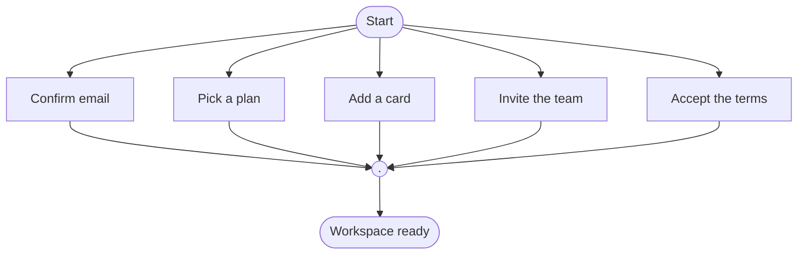

## Check run

```bash
python3 sk-create-figjam/scripts/flow_check.py /tmp/fj043-check-HpAQtI/branch-five.mmd
```

**Output**

```text
  diagram 1, user flow: a rank holds 5 steps, at most 4: split the flow so a rank reads at a glance
FAILED 1 of 1 diagram(s) in branch-five.mmd
```

**Exit status: `1`**

## Model under test

A user flow with a start stadium fanning into five steps, rejoining on a merge dot and closing on an end stadium: 8 nodes, 11 connectors, `flowchart TD`.



## Verification that it failed on the layout measures

* `layout.measure()` returns exactly one problem, the rank-width one. Ranks come out `{start: 0, s1..s5: 1, merge: 2, done: 3}`, so rank widths are `{0: 1, 1: 5, 2: 1, 3: 1}` and the widest is 5 against `MAX_RANK_WIDTH = 4` in `figjam_checks/layout.py`
* `flowchart.check_flow()` returns `[]` for the same block, so no grammar, shape, exit, label, colour, id or budget rule fires. The budget headroom is real: 8 of 9 nodes, 11 of 12 connectors
* The message is raised at `figjam_checks/layout.py:134`, in the rank-width branch
* Control run on the identical flow with four branches instead of five passes, exit `0`, and prints the measures line: `widest rank 4 steps, longest path 4 steps, 1.3 connectors per step, labels average 10 characters, 0 crossing pairs`. The fourth branch is the only thing separating pass from fail

The other four layout measures stay inside their bands on the five-branch model: longest path 4 steps (cap 8), 1.4 connectors per step (cap 2.0), labels average 11 characters (cap 28), 0 crossing pairs (cap 2).

## Notes

* The model lives in `/tmp`, not the repository. Nothing was written to `export/`, and no board was written, because the check gates the write
* The check's own remedy is the only one the measure allows here: a rank of five cannot be read in one pass down the page, so the fan-out shrinks to four or the flow splits into two diagrams that hand off through a named end and a matching start