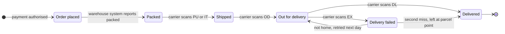

No board this session. A state diagram needs Figma's hosted `generate_diagram` tool, which this session has no connector for, and the `figma-ds-cli` fallback cannot draw one. The checked model below is the deliverable until that connector is on, and it takes a single write call when it is.

Check: PASSED, 6 states and 9 transitions, all 7 between-state transitions labelled. I read the reader as the post-purchase team agreeing the status set before Hamid's story is written, so the machine draws the timeline that brief proposes. `Order placed` and `Shipped` exist on today's page, and `Shipped` today is set at dispatch rather than by a carrier scan, which makes two of these six live and four new.

`Delivery failed` is where the machine branches. A `NOT_HOME` exception brings a new `OD` the next working day, so the order returns to `Out for delivery`, and a second miss sends the parcel to a parcel point, where the `DL` marks it `Delivered`. Those are the only two exits any source states.

Left out: the pallet carrier path (no tracking events, so those orders stop at `Shipped`), `ADDRESS_PROBLEM`, `DAMAGED` and `REFUSED` (no source states the status that follows), returns and refunds (no order status follows delivery), awaiting payment (the order does not exist until the payment is authorised), orders with several parcels (the timeline runs per parcel, so the board draws one), and out-of-order tracking events (event handling, not a status change).

HVR self-scan: 0 hard blockers. Fixed: none. Kept with reason: `PU`, `IT`, `OD`, `DL`, `EX` and the three exception codes as the carrier API's own fixed values.

Want this written to a board with the accent on `Delivery failed` once Figma's hosted connector is on, or should it draw today's two-status page instead?