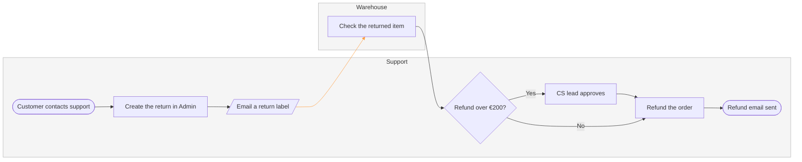

No board was written, because this session has no route to FigJam:

*   The hosted Figma MCP that draws a diagram (`generate_diagram`, `https://mcp.figma.com/mcp`) is not connected here
*   The `fj` fallback cannot draw this one, because `figma-ds-cli` 1.2.0 has no container verb and a lane is a container
*   `fj info` returns `fetch failed`, so no Figma Desktop daemon is listening on that route either

Connect Figma's MCP server and tell me which plan the board belongs to, and the write is one call.

The model below is checked and ready. It is drawn at balanced detail, mixed audience, laptop distance.



`flow_check.py` prints `PASSED`: 8 nodes, 8 connectors, 2 lanes, longest path 8 steps, 0 crossing pairs. The orange connector is the support to warehouse handoff, where the six-day average accumulates.

Two lanes, not three, because the source has no finance step. That is the one thing still open:

```text
Reading: the only refund source here is context/fernhouse-context.md, Key flows item 6. It puts every step in support's hands. A CS agent creates the return in Admin, emails the return label and issues the refund, and a CS lead approves anything above €200. The warehouse checks the item. No source gives finance a step, and finance is not among the six teams the context lists.
Question: what does finance do in a refund?
Recommended: finance owns settlement, the step after support instructs the refund where orders-service sends it to the payment provider and the money reaches the card. Its lane then carries one step and support keeps the €200 decision. If finance touches a refund today in no way at all, the honest board stays at two lanes and the finance lane stays off.
Why: a lane with no step fails the check with "lane finance holds no step", so the third lane cannot be drawn until this is answered, and settlement is the one money step the source leaves unowned.
```

Left out: the finance lane, no source names a finance step, held for the answer above. The 30-day return window, a policy the context states that the flow does not show as a check. The inspection outcome, the context says the warehouse checks the item and never says what happens when it fails.

HVR self-scan: 0 hard blockers. Fixed: none. Kept with reason: none.