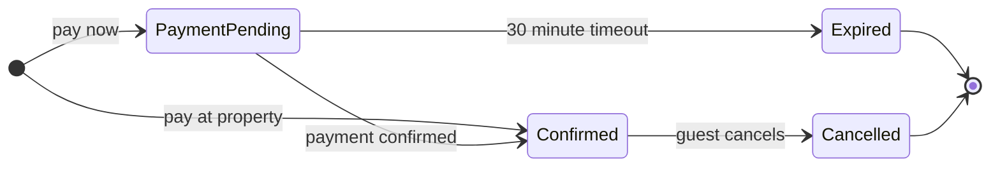

No board yet, and the route is why. No hosted Figma MCP server is connected in this session. The Figma connection this workspace configures is Code Mode's `figma` manual, which runs Framelink and carries no diagram tool, and the local `figma-ds-cli` route has no state-diagram verb. What it needs is Figma's MCP connector (`https://mcp.figma.com/mcp`) in the session. Then one yes from you writes the board.

The model does not wait on that. It is built from the workspace sources, so the shape can be argued before it costs a write.

**The question.** Which statuses a booking can be in and what moves it between them, which is the state type's own question. Outcome, assumed: the Booking squad agrees the status values and the allowed moves before a story is written. Dials, assumed: balanced detail, mixed audience, laptop distance.

`roamstay-context.md` governs, since Product Operations maintains it and reviewed it on 2026-09-18. `roamstay-payment-webhook-incident-notes.md` evidences the 30-minute expiry in production, and `roamstay-support-ticket-58213.md` evidences cancellation inside the free window.

**The model.**

`flow_check.py` printed `diagram 1, state: ok, 4 states and 7 transitions`, then `PASSED 1 diagram(s)`.

**Provenance.**

| Item | Source | Class | Confidence |
|---|---|---|---|
| PaymentPending | context, waits in `payment_pending` for the webhook | current behavior | high |
| Confirmed | context, moves to confirmed | current behavior | high |
| Expired | context, 30 minutes then the room returns on sale. INC-0412, `booking expired state=payment_pending age_s=1800` | current behavior | high |
| Cancelled | context, the guest cancels under Trips | current behavior | high |
| pay now | context, the Pay now payment option | current behavior | high |
| pay at property | context, confirms at once | current behavior | high |
| payment confirmed | context, the provider confirms by webhook | current behavior | high |
| 30 minute timeout | context, known constraints | current behavior | high |
| guest cancels | context, cancellation | current behavior | high |

Mermaid ids cannot carry an underscore, so the board shows `PaymentPending` where Back office prints `payment_pending`. The word `Cancelled` is my label for the outcome the sources call cancel, since no source prints that status value.

**Left out.**
- the state after check-out, because the sources mention completed stays only as the point where a payout is paid, never as a booking status
- cancelling from `payment_pending`, which no source states
- what a cancellation after the free deadline becomes, since the guest reaches Guest Support and the sources stop there
- refund and payout status, which live in `payments-service` and not in this status field

**Three glances.** First glance: `Expired`, the one status that costs a guest the room. Second glance: the two entries, because Pay now and Pay at property land in different statuses. Last glance: `Cancelled`.

**One round, three questions.**

| Still open | What the sources show | My recommendation |
|---|---|---|
| The reader and what the board must not carry | No source names a reader | Booking squad plus Guest Support, with refund and payout status kept off it |
| Where the lifecycle stops | Confirmed, Expired and Cancelled are as far as the sources go | Stop there and leave completion named as absent |
| Which source governs | The context doc states all four statuses, while INC-0412 and ticket 58213 each describe one event | `roamstay-context.md` |

Answer any of them and I redraw where it changes. The write waits for the connector and for your yes.

HVR self-scan: 0 hard blockers. Fixed: none. Kept with reason: none.