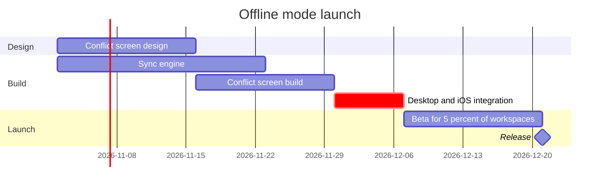

Model passes the check and composes cleanly. Here is the playback and the write gate.

**Reading of the request**

- Reader: the Loomlist product team. Question the board answers: which work runs when before the offline mode release, and what holds it
- Scope: the launch plan from 2 November 2026 through release. Android next quarter is a proposal with no dates and no approval, so it is left out and named on the board's source line
- Detail Balanced, audience Mixed, distance Laptop — assumed defaults, correct me if this hangs on a wall
- Critical path marked `crit` on the integration week only, as you named it

**Model** (checked: `PASSED`, 6 tasks in 3 sections; composed: `COMPOSED`)

This puts release around 21 December 2026: conflict build ends 27 November, integration runs 30 November to 4 December, beta 7 to 18 December.

**Gate**

- First glance: the red Integration bar, the week that gates the release
- Second glance: sync engine running beside the conflict design and build, which is why integration waits until 30 November
- Last glance: the source line naming Android as left out, not yet approved
- Plan: Loomlist Product, as supplied. File: existing FigJam file `<test-file-key>`, a new board placed right of the current content
- Writes: one composed board with title, subtitle, 3 sections, 6 tasks, 1 milestone, a key and the source line
- Calls: `create_session`, one `use_figma`, one `get_figjam` read-back
- Rollback: delete the new board section only, existing content untouched, and only after your yes
- Extensions: none

Write it?