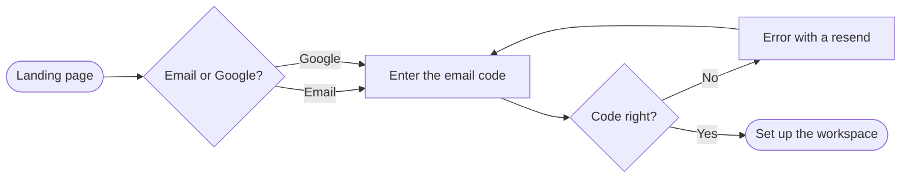
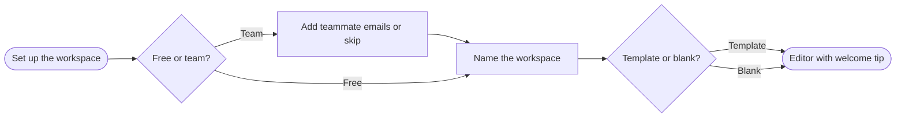

All three rows settle on the recommendations, so the Brief has no assumed rows left. The outline pass is next: the shape as text before anything is drawn.

**userIntent:** Which screens does a new member pass through from the landing page to the editor, and where do they choose or get sent back?

**Outline, in drawing order**

1. Sign up: Landing page (start) → Email or Google? (choice) → Enter the email code → Code right? (choice) → No → Error with a resend → back to Enter the email code; Yes → Set up the workspace (hand-off)
2. Set up the workspace: Set up the workspace (hand-off) → Free or team? (choice) → Team → Add teammate emails or skip → Name the workspace; Free → Name the workspace → Template or blank? (choice) → Editor with welcome tip (goal)

**Two framings**

- **A, one board, 9 nodes:** the wrong code rides the loop edge's label instead of its own node. Buys a single frame, costs the trap state as a visible node and lands exactly at the node budget
- **B, two boards handing off (recommended):** the error and resend keep their own node, matching the doc, and each board sits at 6 nodes with room to breathe. Costs a second frame on the file

**Sketch for B**, never written to the board:

**Look, recommendations unless you say otherwise**

- Marked node: the error and resend step in focus, since the wrong-code trap is the claim this board most needs to surface; both ends take goal colour automatically
- First glance: the wrong-code loop. Second glance: the free or team fork with the skippable invite. Last glance: the hand-off between boards
- Detail Balanced, audience Mixed, distance Laptop, as settled
- No zones; each board is already one short stage
- Titles "1. Sign up" and "2. Set up the workspace", source line naming the onboarding doc

Reading the sketch, your eye should land on the error loop first. Say yes to settle the reading, or name an edit; the write gate comes after the model passes its check.