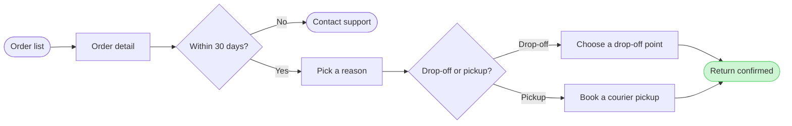

The file is reachable and it's FigJam. Two findings before the gate:

1. The page already holds a **tagged** board named `Start a return` (section `17:1486`, written today 08:28, a probe write) plus an **untagged** section with the same name and the same flow (`9:103`), and a loose unframed sketch of the flow at the top-left. A new board of this title is a revision, so the tagged board gets replaced, not duplicated.
2. `context/fernhouse-context.md` (updated 2026-09-18) still says "There is no self-serve return today" — your description of the app and the returns doc governs, so I read the context doc as stale on this point.

**Playback** — what the intake settled:

*   **Question:** which screens a Fernhouse customer passes through to start a return in the app, and where they choose
*   **Reader:** product and support reviewing where customers abandon the return start (assumed — you named no reader; the three give-up points point there)
*   **Outcome:** see the whole path and the three places support says customers give up
*   **Scope:** order list to the confirmed return. What happens after confirmation, and the CS-created return behind Contact support, stay off the board
*   **Entry:** Order list. **Exit:** Return confirmed, with Contact support as the out-of-window exit
*   **Decisions:** `Within 30 days?` (Yes to reasons, No to Contact support) and `Drop-off or pickup?` (two labelled exits)
*   **Sources:** the app screens and the returns doc as you described them, current behavior; support's give-up report feeds the three pins, not the nodes
*   **Dials:** balanced detail, mixed audience, laptop distance (defaults, assumed)

**Framing:** recommended is one left-to-right flow in three zones — Find the order, Request the return, Done — with Contact support beside the main line and Return confirmed as the goal. The alternative, a top-to-bottom stack, costs the wider read a board favors and pushes the pin legend further right. The merge dot is already cut: both methods lead straight to the confirmation, which says the same thing with one node less.

Checked model (`flow_check.py`: PASSED, 9 nodes, 9 connectors, 0 crossing pairs; composes to 39,199 characters, inside one `use_figma` call):

**Glance lines:** first glance is the main route from Order list to Return confirmed. Second glance is the three numbered pins at the give-up points. Last glance is the Contact support exit and the source line.

**Gate:**

*   **Plan:** Fernhouse Product. **File:** existing FigJam file `<test-file-key>`. The board lands as a new framed section titled `Start a return`, 400 px right of the current content. No new file.
*   **Writes:** one composed board, 9 nodes and 9 connectors in three zones, with title, key and source line. Then the extension: three numbered violet pins on `Pick a reason`, `Drop-off or pickup?` and `Within 30 days?`, each matched to a legend sticky reading `Customers give up here: too many reasons` / `the pickup fee is unclear` / `no warning before day 30`, with the board widened for the sticky column.
*   **Calls:** `create_session` (done), one `use_figma` to compose, one `use_figma` for the pins and stickies, one `get_figjam` read-back, then one `use_figma` to delete the earlier tagged `Start a return` board (`17:1486`) so the file keeps one board of this name. The untagged duplicate (`9:103`) and the loose sketch stay untouched — say so if you want `9:103` removed too.
*   **Rollback:** delete the board section this write returns, pins and stickies included, through `use_figma` after a yes to the deletion.

Write it?