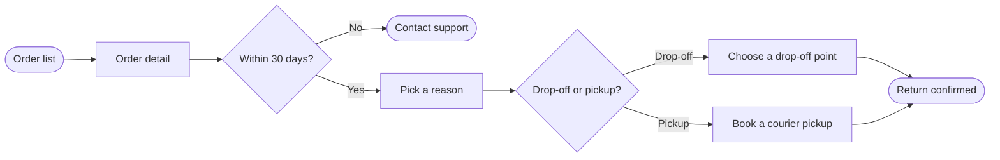

Model passes the pre-write check and composes cleanly (39,194 chars, under the 50,000 `use_figma` limit). Everything is ready for the write gate — here is the full pre-write picture.

**Playback — what the sources settled**

*   Question: which screens does a customer pass through to start a return in the app, and where do they choose — a **user flow**
*   Reader: the Fernhouse team reading the Product plan *(assumed — correct me if it's someone else)*
*   Outcome: the reader can trace every screen and choice from the order list to a confirmed return, and see where the under-review pickup proposal would attach *(assumed)*
*   Entry: Order list. Exits: Return confirmed (the goal), Contact support (the out-of-window exit)
*   Actors: the customer taps through; the app applies the 30-day window as a system check
*   Decisions: `Within 30 days?` from the returns doc, `Drop-off or pickup?` from the app
*   Source class: app screens and the 30-day rule are current behavior; free pickup over €100 is a proposal under review, so it is **not drawn** — named in the board's source line and the Left out line instead
*   Dials: Balanced detail, mixed audience, laptop distance *(defaults)*

**Framing:** happy path with the branches beside it — recommended, because the question asks which screens and where the choices are. The alternative, drawing the proposal as a dashed step, is rejected: under-review material on the board would read as shippable.

**Sketch** (checked: `PASSED`, 9 nodes, 9 connectors, 0 crossings):

Plus board text — title "Start a return", a subtitle, a source line naming what's left out, and three zones: Find the order, Request the return, Done. The confirmation is marked as the goal.

**Glance lines:** first glance — the confirmed return, the green goal the main line runs to; second glance — the `Within 30 days?` decision that splits eligible orders from Contact support; last glance — the source line naming the left-out proposal.

**Write gate**

Plan: Fernhouse Product. File: existing FigJam `<test-file-key>` — the new board lands 400px right of the content already there, so nothing existing is covered.
Writes: one composed board — 9 nodes, 9 connectors in three zones, with a title, a key and a source line.
Calls: `create_session` on the file, one `use_figma`, one `get_figjam` read-back.
Rollback: delete the one board section the write returns, through `use_figma`, and only after you say yes to the deletion.

Write it?