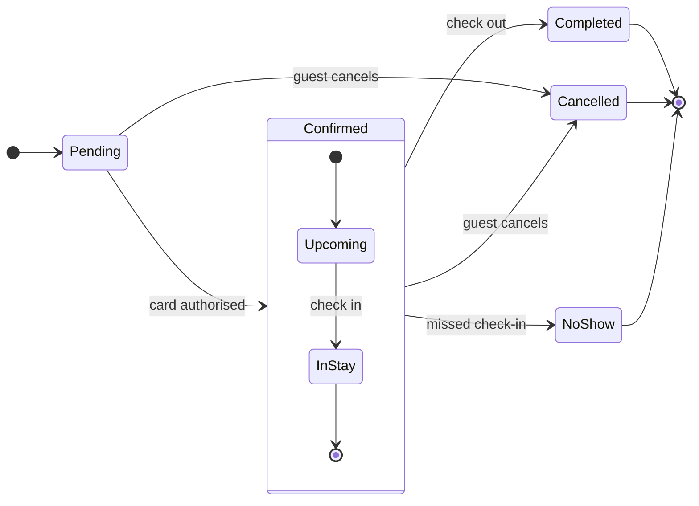

The file is a real FigJam board with plenty of existing content — a hand-drawn flow, a "Sprint retro" section, and a long row of previously composed boards ending near x=57480. A new composed board will land 400px right of that, clear of everything.

Check passed (`7 states and 12 transitions`), and the model composes (39k chars, one `use_figma` call). Here is the playback before the model goes near a board.

**Playback — Roamstay booking status, drawn as a state diagram**

Question the board answers: which statuses does a Roamstay booking pass through, and what moves it between them?

Outcome: a reader can name every status, the event that sets it, and every way a booking ends.

Settled from your description (classed as current behavior):

* A booking starts Pending
* Pending moves to Confirmed when the card is authorised
* Confirmed is a composite covering Upcoming and In stay
* Check out moves Confirmed to Completed
* A guest cancels from Pending or from Confirmed, landing on Cancelled
* A missed check-in moves Confirmed to No-show, marked by the hotel
* Completed, Cancelled and No-show each end the booking

Assumed, named so you can correct it:

* Upcoming to In stay runs on `check in`, which your description does not state outright
* The reader is whoever opens this retro board, at Balanced detail, Mixed audience, Laptop distance

Outline and framing:

* Spine: start → Pending → Confirmed (Upcoming → In stay) → Completed
* Side exits: Pending → Cancelled, Confirmed → Cancelled, Confirmed → No-show
* All three end states → end
* Recommended framing: Confirmed as a composite holding Upcoming and In stay, so a cancel from either is one honest exit. The flat alternative hides the split you named

The look: no accent colour, since a state board colours by role — Pending reads as the first state and the three end states draw in the final-state grey. Title `Booking status`, subtitle naming who reads it and why, source line under the key, no zones (the composite is the zone).

Does this reading hold? A yes moves to the write gate; a correction changes that row and plays back again.