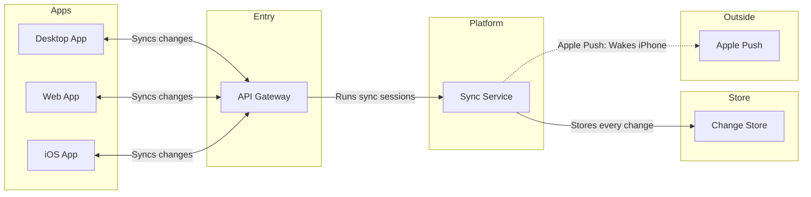

Check passed, board composed clean (7 nodes, 6 connectors, 0 crossings, 39k chars). Here is the full read-back of what I plan to draw before anything is written.

**Playback — the settled brief**

- Reader: leadership, for the leadership update — settled by your request
- Question the board answers: which parts carry a block change between apps, and how do they connect? — settled; that question is an architecture, not a sequence
- Outcome: leadership can see that every change flows through one platform and how a sleeping iPhone gets woken — settled
- Sources: your description plus the Loomlist product context page (`sync-service`, sync sessions, push via the platform's push service) — classed current behavior
- Type: architecture — named in your request and it fits

**Outline** (remove test applied — nothing left earns a cut)

> *Which parts carry a block change between apps, and how does a sleeping iPhone get woken?*
> Desktop App, Web App, iOS App → API Gateway → Sync Service → Change Store; Sync Service → Apple Push

**Two framings**

- **Collapsed platform (recommended):** 7 nodes, one Sync Service — matches your description's grain and an executive reader. Costs: the wake's internals stay inside the platform
- **Full path:** adds a push worker and change stream (9 nodes). Buys the machinery behind the wake — but no supplied source names those parts, so both would be assumed

**Sketch**

**Look** — detail `Balanced`, audience `Executive` (capability names), distance `Laptop`, title "Block sync". Lanes carry the colour; no accent needed.

**Assumed, correct before the write:** API Gateway — no source names the entry point, but the layout cannot join an app straight to a service, so a gateway node sits between them; say if it has another name. Android app exists in the product context but you scoped desktop, web and iOS — left out, say the word and it joins the Apps lane.

**Gate**

- First glance: the Sync Service at the centre — every change flows through it
- Second glance: its two duties — stores every change, wakes iPhones via Apple Push
- Last glance: the key and source line
- Plan: Loomlist Product (as named). File: existing FigJam `<test-file-key>`
- Writes: one composed board — 7 nodes, 6 connectors, 5 lanes, with title, key and source line. No extensions planned
- Calls: `create_session`, one `use_figma`, one `get_figjam` read-back
- Rollback: the write returns a board section id; deleted through `use_figma` after a yes

Write it?