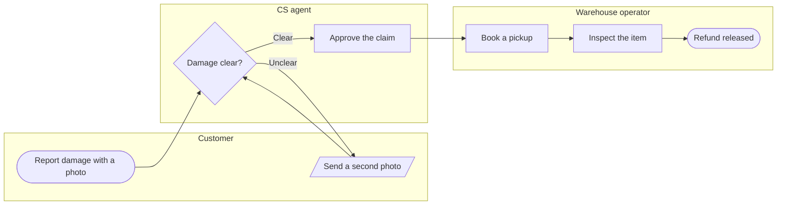

Model passes the pre-write check and composes cleanly. Before any write, here's the reading and the write gate.

**The reading** — correct anything before it hardens:

- **Question the board answers:** who does what in Fernhouse's damaged-item refund, and where does the claim change hands
- **Reader:** the Fernhouse product and support team (assumed — name someone else and I adjust the labels)
- **Outcome:** the reader sees the three handoffs and where the refund ends (assumed)
- **Entry → exit:** customer's photo report → refund released
- **Lanes:** Customer, CS agent, Warehouse operator — the role names from the Fernhouse context note
- **Loop:** "asks for a second photo" reads as CS bouncing the claim back to the customer, so the customer lane gets a "Send a second photo" step that returns to the CS check (assumed — if CS collects it without a customer step, I fold the loop inside the CS lane instead)
- **Dials:** Balanced detail, Mixed audience, Laptop distance (defaults)
- **Colour note:** Flow Mode colours by kind, so team colour lands as each lane's own tinted band. Steps keep their kind colours: decision yellow, the approve step in violet focus, the refund end green as the goal
- **Noted, not a conflict:** the context note's general returns flow has the agent issuing the refund; this board follows your description where the warehouse releases it

**Glance lines:** first glance is `Approve the claim`, the CS-to-warehouse handoff and the step in focus; second is the second-photo loop back to the customer; last is the lane tints and source line.

**Framing** — recommended: three lanes with the photo loop crossing back to the customer, since the handoffs are the point. Alternative: loop kept inside CS, which loses the customer handoff.

The sketch (passed `flow_check.py`: 7 nodes, 7 connectors, 3 lanes, 0 crossings):

**Write gate:**

- **Plan:** Fernhouse Product. **File:** existing FigJam `<test-file-key>` — one new framed board, placed right of existing content
- **Writes:** one composed board with title, subtitle, 3 lanes, 7 nodes, 7 connectors, a key and a source line
- **Calls:** `create_session`, one `use_figma`, one `get_figjam` read-back
- **Extensions:** none planned
- **Rollback:** delete the new board section through `use_figma`, only if you approve the deletion

Write it?