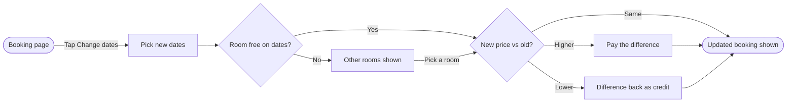

`PASSED` (8 nodes, 10 connectors, 0 crossings) and `COMPOSED` (39,164 chars — fits one `use_figma` call). Here is the playback, the outline pass and the write gate.

**Playback** — what the sources settled, per Brief row:

* Reader: the Roamstay product team sharing the Roamstay Product plan — **assumed**; settled by whoever you show this board to
* Question: which screens a guest passes through to change their booking dates, and where they choose
* Outcome: the reader can trace the path, including the availability and price branches, to the updated booking
* Entry: the booking page (the stay view under Trips, where "change dates" lives per Roamstay context)
* Exit: the updated booking shown
* Actors: the guest; the app checks availability and reprices (system moves, drawn as decisions)
* Decisions: room free on the new dates? — new price vs old? (three exits: higher, lower, same)
* Sources: your description, classed as current behavior; `roamstay-context.md` for product vocabulary

**Assumed fact, named before the gate:** the edge `Other rooms shown → Pick a room → price check`. Your description says the guest sees other rooms but not what happens next; I read it as "a picked room rejoins the same price comparison". If instead it re-checks dates, dead-ends, or exits the flow, say so and I'll reshape it. Also assumed: no detail on *how* they pay the difference (card on file vs new checkout) — your description stops at "they pay".

**The outline** (first line is the `userIntent` the write call uses):

"How a guest changes an existing booking's dates, and what they pay or get back."
1. Booking page →(Tap Change dates)→ 2. Pick new dates → 3. Room free on dates? →Yes→ 4. New price vs old?; →No→ Other rooms shown →(Pick a room)→ back to 4. Then: Higher → Pay the difference; Lower → Difference back as credit; Same → straight on. All three → Updated booking shown.

* Framings: **(a) recommended — happy path with branches beside it**, matching "a person's path through screens". (b) A decision-map framing centred on the three price outcomes — shows every exit clearly but weakens the path the question asks about.
* Sketch:

**Glance lines:** first glance — `Updated booking shown`, the green goal every path lands on (it's the claim: you always end at the updated booking). Second glance — the two diamonds, availability then price. Last glance — the source and left-out line.

**The look:** Balanced detail, Mixed audience, Laptop distance (defaults, marked assumed if you don't weigh in). Three zones: *Pick dates*, *Check the stay*, *Settle up*. Title `Change booking dates`, subtitle as in the model, key and source line drawn by the composer.

**Gate — the write I am asking a yes for:**

* Target: the Roamstay Product plan, existing FigJam file `<test-file-key>` — one new framed board placed 400px right of existing content, nothing existing touched
* Writes: one board, `Change booking dates` — title, subtitle, 3 zones, 8 nodes, 10 connectors, colour-by-kind key, source line
* Extensions: none planned
* Calls spent: `create_session`, one `use_figma`, one `get_figjam` read-back — 3 total
* Rollback: delete the board section this write returns, via `use_figma`, and only after your yes to the deletion

Yes to write?