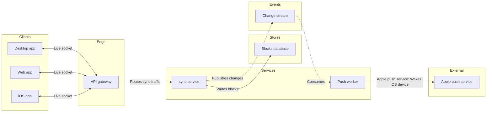

The board is not written. The Figma tools the write needs are no longer connected in this session. The tool list now holds only OpenCode's own tools, so `use_figma`, `get_figjam`, `create_session` and `generate_diagram` are all gone. They were there when I checked the model and composed it.

I took your yes as confirming the reading, and I made no write calls to file `<test-file-key>`. It is untouched.

The other routes don't help. The `fj` route can't draw an architecture, because it has no layout or container verb. I won't stand in an image, HTML page or Mermaid file for the board.

**What I need from you:** reconnect the Figma MCP server, or tell me when it is back. Then reply "go". Your yes covered a write with specific calls, so I'll name the calls again and write once you confirm. The composed code is already built, so I won't redo the checking.

The model below passed `flow_check.py` with 9 nodes, 8 connectors and 0 crossing pairs, and `compose_board.py` composed it. You can keep it as it stands:

Left out:
- **File storage:** no connection was stated, and drawing it would also put the board over the 9-node budget.
- **Apple push service to the iOS app:** an architecture has no edge from an outside system back to a client. The "Wakes iOS device" label carries it.

**Assumed:**
- The gateway-to-sync-service edge.
- Engineering as the reader.
- Laptop reading distance.

The model and composed code are in `/private/var/folders/3c/zfqcqsts0kn19cgblj82gqhm0000gn/T/opencode/`, outside the repository, as `loomlist-sync-model.md` and `loomlist-sync-compose.js`.

HVR self-scan: 0 hard blockers. Fixed: none. Kept with reason: none.