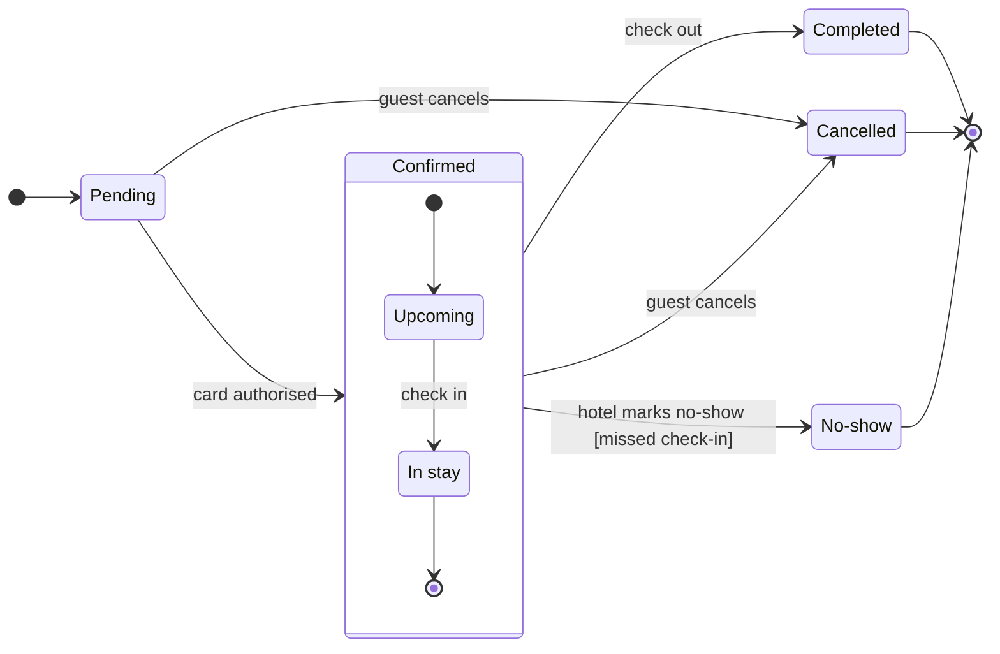

Nothing is written to `<test-file-key>`. The Figma tools dropped out of this session after your reply, so the board can't be drawn right now. The tool list now holds only OpenCode's own tools.

**What each route needs**
- The composed route needs `use_figma`, plus `get_figjam` for the read-back. Neither is connected.
- The `generate_diagram` fallback is not connected either.
- The `fj` route only draws user flows and plain processes, so it can't draw a state diagram even if `figma-ds-cli` were running.

I'm not drawing a stand-in, such as an image or a Mermaid file. Below is the checked model to keep:

`flow_check.py` passed it with 7 states and 12 transitions, and `compose_board.py` composed it into 12 nodes and 12 connectors, within the one-call size limit. The temp copy sits outside the repository in `/private/var/folders/3c/zfqcqsts0kn19cgblj82gqhm0000gn/T/opencode/roamstay-booking-status/`, so a retry needs no rework.

Read-back: not possible, nothing was written, so the board is not done.
HVR self-scan: 0 hard blockers on the board labels. Fixed: none. Kept with reason: none.

I read your reply as confirming the reading. Once Figma is connected again, tell me and I'll ask for a one-word yes on the write itself, since the gate is a separate answer. The plan and file stay as stated, and the colour caveat stands: the three end states draw light gray as a group, and separate colours per end state are a hand edit in FigJam.