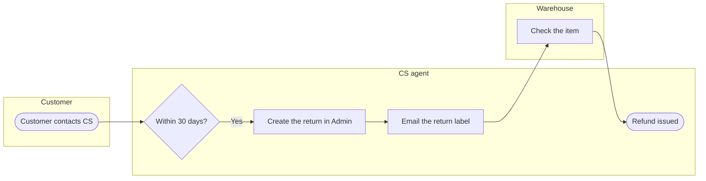

**No board was written.** The Figma connection that was available a moment ago is no longer in the tool catalog. Only the OpenCode tools are left, so I can't reach `use_figma`, `get_figjam` or `create_session`. The write needs `use_figma` to compose the board. The process type with lanes can't use the `figma-ds-cli` route, because that route has no lane verb. File `<test-file-key>` is untouched, and I made no Figma calls.

The checked model is below. It passed the pre-write check (6 nodes, 5 connectors, 0 crossings) and composed to 43,285 characters of code. That is under the 50,000 one `use_figma` call takes.

I'm keeping the model and the composed code in a scratch folder outside the repository. Nothing is saved to `export/`. Your yes covers this exact board in this exact file. Once the Figma connection is back, tell me and I'll run the write you approved: `create_session`, one `use_figma` and one `get_figjam` read-back. I'll also run `whoami` first if you want the plan confirmed. The board's reading and the left-out list stay as I played them back, including the two assumed rows.

If you'd rather not wait, I can instead put this process into a Doc as a numbered list or table with the same lanes and open points.

HVR self-scan: 0 hard blockers. Fixed: none. Kept with reason: none.