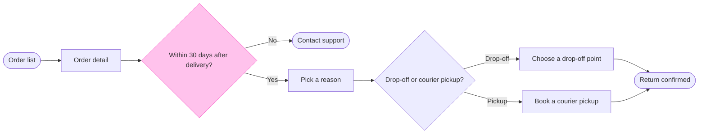

# FJ-022 turn 4 transcript

**User:** Yes, that reading is right.

**Tool call:** `Read` `{"file_path": "/private/var/folders/3c/zfqcqsts0kn19cgblj82gqhm0000gn/T/devin-compare-bench/FJ-022/sk-create-figjam/references/quality-rubric.md"}`

**Tool result:** `Read`

```text
"1\t---\n2\ttitle: \"FigJam Diagram Quality Rubric\"\n3\tdescription: \"The taste gate a FigJam model passes before the write gate, translated from sk-design-diagram's success criteria: type fit, the remove test, signal, the check, the board, the design rubric that scores a composed board and the reply.\"\n4\tcontextType: implementation\n5\timportance_tier: important\n6\ttrigger_phrases:\n7\t  - \"figjam quality rubric\"\n8\t  - \"diagram taste gate\"\n9\t  - \"remove test\"\n10\t  - \"figjam review checklist\"\n11\t  - \"figjam design rubric\"\n12\tversion: 1.0.13.0\n13\t---\n14\t\n15\t# FigJam Diagram Quality Rubric\n16\t\n17\tThe script checks what a script can see. This rubric is the rest: whether the diagram should exist, whether every node earns its place and whether the reader can trust what lands on the board. Walk it after the check passes and before the write gate.\n18\t\n19\t**Loading Condition:** CONDITIONAL, on every Flow route before the write gate\n20\t**Purpose:** The judgement pass between the pre-write check and the gate\n21\t**Scope:** The model, the provenance table, the planned extensions and, after the write, the board and the reply\n22\t\n23\t---\n24\t\n25\t## 1. TYPE FIT\n26\t\n27\t- [ ] The type answers the reader's question, as `references/flow-mode.md` Section 3 maps it\n28\t- [ ] A table, a list or a paragraph would not do the same job. If it would, say so and offer that instead\n29\t- [ ] The type's reference in `references/types/` was loaded and 
```

**Tool call:** `Bash` `{"command": "mktemp -d", "description": "Create scratch folder for model"}`

**Tool result:** `Bash`

```text
"/var/folders/3c/zfqcqsts0kn19cgblj82gqhm0000gn/T/tmp.i1OWn2xL9k"
```

**Tool call:** `ToolSearch` `{"query": "select:mcp__figma-remote__create_session,mcp__figma-remote__get_figjam,mcp__figma-remote__use_figma", "max_results": 5}`

**Tool result:** `ToolSearch`

```text
[{"type": "tool_reference", "tool_name": "mcp__figma-remote__create_session"}, {"type": "tool_reference", "tool_name": "mcp__figma-remote__get_figjam"}, {"type": "tool_reference", "tool_name": "mcp__figma-remote__use_figma"}]
```

**Tool call:** `Write` `{"file_path": "/var/folders/3c/zfqcqsts0kn19cgblj82gqhm0000gn/T/tmp.i1OWn2xL9k/model.md", "content": "```mermaid\nflowchart LR\n    %% goal: confirmed\n    %% title: Start a return\n    %% subtitle: How a Fernhouse customer starts a return in the app, from the order list to a confirmed return\n    %% source: Sources: the Fernhouse app and the returns doc. Left out: a free pickup over 100 euros, a proposal under review.\n    %% level: balanced\n    %% zone: Find the order: orders, detail\n    %% zone: Request the return: window, support, reason, method, dropoff, pickup\n    %% zone: Done: confi`

**Tool result:** `Write`

```text
"File created successfully at: /var/folders/3c/zfqcqsts0kn19cgblj82gqhm0000gn/T/tmp.i1OWn2xL9k/model.md (file state is current in your context \u2014 no need to Read it back)"
```

**Tool call:** `Bash` `{"command": "python3 sk-create-figjam/scripts/flow_check.py /var/folders/3c/zfqcqsts0kn19cgblj82gqhm0000gn/T/tmp.i1OWn2xL9k/model.md", "description": "Run pre-write check on the model"}`

**Tool result (error):** `Bash`

```text
"Exit code 1\n  diagram 1, user flow: %% detail on confirmed, a stadium: only a step [Label] carries a body\nFAILED 1 of 1 diagram(s) in model.md"
```

**Tool call:** `mcp__figma-remote__create_session` `{"fileKey": "<test-file-key>", "description": "Add a Start a return user flow board as a new section to the existing FigJam file"}`

**Tool result:** `mcp__figma-remote__create_session`

```text
"{\"sessionId\":\"88a78643-248a-4af1-891f-a44eec54cb1c\"}"
```

**Tool call:** `Edit` `{"replace_all": false, "file_path": "/var/folders/3c/zfqcqsts0kn19cgblj82gqhm0000gn/T/tmp.i1OWn2xL9k/model.md", "old_string": "    %% detail: confirmed | QR code to scan at the drop-off point | or hand to the courier | Also sent by email\n", "new_string": ""}`

**Tool result:** `Edit`

```text
"The file /var/folders/3c/zfqcqsts0kn19cgblj82gqhm0000gn/T/tmp.i1OWn2xL9k/model.md has been updated successfully. (file state is current in your context \u2014 no need to Read it back)"
```

**Tool call:** `Edit` `{"replace_all": false, "file_path": "/var/folders/3c/zfqcqsts0kn19cgblj82gqhm0000gn/T/tmp.i1OWn2xL9k/model.md", "old_string": "    %% about: Done | Starts: the return is requested | Ends: the QR code is shown and emailed", "new_string": "    %% about: Done | Shows a QR code, also sent by email | Scan it at the drop-off point or hand it to the courier"}`

**Tool result:** `Edit`

```text
"The file /var/folders/3c/zfqcqsts0kn19cgblj82gqhm0000gn/T/tmp.i1OWn2xL9k/model.md has been updated successfully. (file state is current in your context \u2014 no need to Read it back)"
```

**Tool call:** `Bash` `{"command": "python3 sk-create-figjam/scripts/flow_check.py /var/folders/3c/zfqcqsts0kn19cgblj82gqhm0000gn/T/tmp.i1OWn2xL9k/model.md", "description": "Rerun pre-write check on the model"}`

**Tool result:** `Bash`

```text
"  diagram 1, user flow: ok, 9 nodes and 9 connectors, widest rank 2 steps, longest path 7 steps, 1.0 connectors per step, labels average 19 characters, 0 crossing pairs\nGlance: Within 30 days after delivery? (accent) > Order list > Order detail > Pick a reason > Contact support > Drop-off or courier pickup? > Choose a drop-off point > Book a courier pickup > Return confirmed (goal)\nPASSED 1 diagram(s) in model.md"
```

**Tool call:** `mcp__figma-remote__get_figjam` `{"fileKey": "<test-file-key>", "nodeId": "0:1", "sessionId": "88a78643-248a-4af1-891f-a44eec54cb1c"}`

**Tool result:** `mcp__figma-remote__get_figjam`

```text
[{"type": "text", "text": "<canvas id=\"0:1\" name=\"Page 1\" x=\"0\" y=\"0\" width=\"0\" height=\"0\" />"}, {"type": "image", "source": {"type": "base64", "media_type": "image/png", "data": "iVBORw0KGgoAAAANSUhEUgAAAAEAAAABCAYAAAAfFcSJAAAACXBIWXMAAAsTAAALEwEAmpwYAAAAAXNSR0IArs4c6QAAAARnQU1BAACxjwv8YQUAAAAOdEVYdFNvZnR3YXJlAEZpZ21hnrGWYwAAABBJREFUeAEBBQD6/wAAAAAAAAUAAWR4lTgAAAAASUVORK5CYII="}}, {"type": "text", "text": "[Image: source: /Users/michelkerkmeester/.claude/projects/-private-var-folders-3c-zfqcqsts0kn19cgblj82gqhm0000gn-T-devin-compare-bench-FJ-022/131bd65f-4ad0-4e3b-872a-7716b76fae6e/tool-results/mcp-figma-remote-blob-1793339591643-5ptoce.png]"}]
```

**Assistant:**

The model passes the check, and the file is empty, so there's no same-titled section to worry about. I'm running the composer once to confirm it composes before I send the write gate.

**Tool call:** `Bash` `{"command": "python3 sk-create-figjam/scripts/compose_board.py /var/folders/3c/zfqcqsts0kn19cgblj82gqhm0000gn/T/tmp.i1OWn2xL9k/model.md --diagram 1 --out /var/folders/3c/zfqcqsts0kn19cgblj82gqhm0000gn/T/tmp.i1OWn2xL9k/board1.js", "description": "Compose the board code from the checked model"}`

**Tool result:** `Bash`

```text
"COMPOSED diagram 1, 9 nodes and 9 connectors, widest rank 2 steps, longest path 7 steps, 1.0 connectors per step, labels average 19 characters, 0 crossing pairs: 9 nodes and 9 connectors to read back, 44115 characters in /var/folders/3c/zfqcqsts0kn19cgblj82gqhm0000gn/T/tmp.i1OWn2xL9k/board1.js, drawn in the design FigJam default"
```

**Assistant:**

Question: which screens does a Fernhouse customer pass through to start a return, and where do they choose?
Outcome: the product team can follow a return from the order list to a confirmed return and see where the 30 day window ends it.
First glance: Within 30 days after delivery?, the outlined decision where a return can end early.
Second glance: Order list, the light blue entry, then Order detail, Pick a reason, Contact support (the exit below the row), Drop-off or courier pickup?, Choose a drop-off point, Book a courier pickup (the second way to the goal, below the row) and Return confirmed, the goal. This is the order the check's Glance line prints.
Last glance: the key and the source line, since the goal comes last.

Sketch: the checked model in full, with the check's output as it printed.



```text
  diagram 1, user flow: ok, 9 nodes and 9 connectors, widest rank 2 steps, longest path 7 steps, 1.0 connectors per step, labels average 19 characters, 0 crossing pairs
Glance: Within 30 days after delivery? (accent) > Order list > Order detail > Pick a reason > Contact support > Drop-off or courier pickup? > Choose a drop-off point > Book a courier pickup > Return confirmed (goal)
PASSED 1 diagram(s) in model.md
```

Eye first: Within 30 days after delivery?, the one outlined node, and it is the node the board most needs read.
Reads second: the main row from Order list to Return confirmed, which carries the reader past the window to the goal.
Could miss: Book a courier pickup, which sits below the row. Missing it hides the second way a return is made.
Remove next: Order detail, kept because it holds the Start a return button, the step that opens the flow.

Two changes from the playback's outline:
- A goal end cannot carry a body, so the QR code and the email sit in the Done zone's notes and not under Return confirmed.
- The model has no Label or Row warnings.

Plan: Fernhouse Product, as you stated. I did not verify it, because `whoami` only lists the plans your account holds.
File: the existing FigJam file `<test-file-key>`. I read it once and its page is empty, so no section shares the title "Start a return".
Writes: one composed board in a new section, with 9 nodes and 9 connectors in three zones, a title, a key and a source line, at the Laptop distance. No new file is created and nothing already in the file changes.
Left out: a free pickup over 100 euros, a proposal under review. Nothing after the confirmation is drawn.
Extensions: none.
Calls: one `use_figma` and one `get_figjam` read-back. The read of the file before the write is already spent, and I did not need to re-read it afterwards because it was empty.
Rollback: delete the one board section the write returns, through `use_figma`, and only on its own yes.

Write it?
