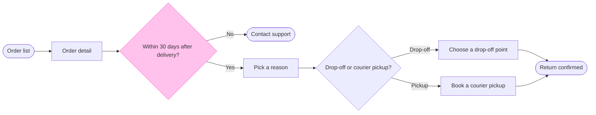

Question: which screens does a Fernhouse customer pass through to start a return, and where do they choose?
Outcome: the product team can follow a return from the order list to a confirmed return and see where the 30 day window ends it.
First glance: Within 30 days after delivery?, the outlined decision where a return can end early.
Second glance: Order list, the light blue entry, then Order detail, Pick a reason, Contact support (the exit below the row), Drop-off or courier pickup?, Choose a drop-off point, Book a courier pickup (the second way to the goal, below the row) and Return confirmed, the goal. This is the order the check's Glance line prints.
Last glance: the key and the source line, since the goal comes last.

Sketch: the checked model in full, with the check's output as it printed.



```text
  diagram 1, user flow: ok, 9 nodes and 9 connectors, widest rank 2 steps, longest path 7 steps, 1.0 connectors per step, labels average 19 characters, 0 crossing pairs
Glance: Within 30 days after delivery? (accent) > Order list > Order detail > Pick a reason > Contact support > Drop-off or courier pickup? > Choose a drop-off point > Book a courier pickup > Return confirmed (goal)
PASSED 1 diagram(s) in model.md
```

Eye first: Within 30 days after delivery?, the one outlined node, and it is the node the board most needs read.
Reads second: the main row from Order list to Return confirmed, which carries the reader past the window to the goal.
Could miss: Book a courier pickup, which sits below the row. Missing it hides the second way a return is made.
Remove next: Order detail, kept because it holds the Start a return button, the step that opens the flow.

Two changes from the playback's outline:
- A goal end cannot carry a body, so the QR code and the email sit in the Done zone's notes and not under Return confirmed.
- The model has no Label or Row warnings.

Plan: Fernhouse Product, as you stated. I did not verify it, because `whoami` only lists the plans your account holds.
File: the existing FigJam file `<test-file-key>`. I read it once and its page is empty, so no section shares the title "Start a return".
Writes: one composed board in a new section, with 9 nodes and 9 connectors in three zones, a title, a key and a source line, at the Laptop distance. No new file is created and nothing already in the file changes.
Left out: a free pickup over 100 euros, a proposal under review. Nothing after the confirmation is drawn.
Extensions: none.
Calls: one `use_figma` and one `get_figjam` read-back. The read of the file before the write is already spent, and I did not need to re-read it afterwards because it was empty.
Rollback: delete the one board section the write returns, through `use_figma`, and only on its own yes.

Write it?