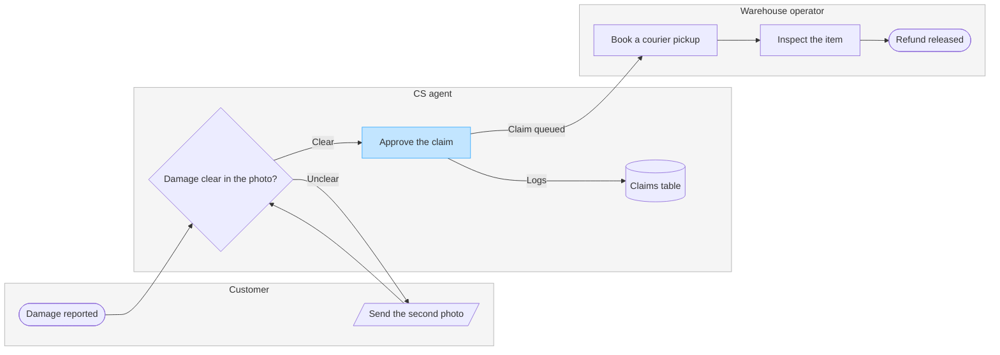

# FJ-023 turn 3 transcript

**User:** Yes, that reading is right.

**Tool call:** `ToolSearch` `{"query": "select:mcp__figma-remote__create_session,mcp__figma-remote__get_figjam,mcp__figma-remote__use_figma,mcp__figma-remote__whoami", "max_results": 4}`

**Tool result:** `ToolSearch`

```text
[{"type": "tool_reference", "tool_name": "mcp__figma-remote__create_session"}, {"type": "tool_reference", "tool_name": "mcp__figma-remote__get_figjam"}, {"type": "tool_reference", "tool_name": "mcp__figma-remote__use_figma"}, {"type": "tool_reference", "tool_name": "mcp__figma-remote__whoami"}]
```

**Tool call:** `Read` `{"file_path": "/private/var/folders/3c/zfqcqsts0kn19cgblj82gqhm0000gn/T/devin-compare-bench/FJ-023/sk-create-figjam/references/quality-rubric.md"}`

**Tool result:** `Read`

```text
"1\t---\n2\ttitle: \"FigJam Diagram Quality Rubric\"\n3\tdescription: \"The taste gate a FigJam model passes before the write gate, translated from sk-design-diagram's success criteria: type fit, the remove test, signal, the check, the board, the design rubric that scores a composed board and the reply.\"\n4\tcontextType: implementation\n5\timportance_tier: important\n6\ttrigger_phrases:\n7\t  - \"figjam quality rubric\"\n8\t  - \"diagram taste gate\"\n9\t  - \"remove test\"\n10\t  - \"figjam review checklist\"\n11\t  - \"figjam design rubric\"\n12\tversion: 1.0.13.0\n13\t---\n14\t\n15\t# FigJam Diagram Quality Rubric\n16\t\n17\tThe script checks what a script can see. This rubric is the rest: whether the diagram should exist, whether every node earns its place and whether the reader can trust what lands on the board. Walk it after the check passes and before the write gate.\n18\t\n19\t**Loading Condition:** CONDITIONAL, on every Flow route before the write gate\n20\t**Purpose:** The judgement pass between the pre-write check and the gate\n21\t**Scope:** The model, the provenance table, the planned extensions and, after the write, the board and the reply\n22\t\n23\t---\n24\t\n25\t## 1. TYPE FIT\n26\t\n27\t- [ ] The type answers the reader's question, as `references/flow-mode.md` Section 3 maps it\n28\t- [ ] A table, a list or a paragraph would not do the same job. If it would, say so and offer that instead\n29\t- [ ] The type's reference in `references/types/` was loaded and 
```

**Tool call:** `Bash` `{"command": "cd /private/var/folders/3c/zfqcqsts0kn19cgblj82gqhm0000gn/T/devin-compare-bench/FJ-023/sk-create-figjam && sed -n 1,200p assets/templates/process.md | head -150; mktemp -d"}`

**Tool result:** `Bash`

```text
"---\ntitle: \"FigJam Process Templates\"\ndescription: \"Process patterns that pass the pre-write check: a decision tree, a laned process with its handoff step in focus, a laned process with a status lane and detail cards, and a pipeline with a store and data in and out.\"\ncontextType: general\nimportance_tier: important\ntrigger_phrases:\n  - \"process templates\"\n  - \"laned process pattern\"\n  - \"decision tree pattern\"\nversion: 1.0.4.0\n---\n\n# FigJam Process Templates\n\nCopy/apply patterns for a process model. Each pattern passes `scripts/flow_check.py`, and `references/types/process.md` holds the rules.\n\n**Loading Condition:** CONDITIONAL, with `references/types/process.md`\n**Purpose:** Starting points for a process or decision flowchart\n**Scope:** Four patterns. The provenance table and the reply shape are in `assets/flow-templates.md`\n\n---\n\n## 1. USAGE\n\n- Keep the `%% type: process` line first, or the check reads the block as a user flow\n- Name a lane after the actor, `subgraph agent [\"CS agent\"]`, and keep its id short and camelCase\n- A lane takes the neutral pair or no style, and the one accent goes on the focal step, such as the step that hands work to the next lane. The composer draws that step in focus. A `linkStyle` passes the check and changes nothing on a composed board\n- `-.->` marks a step that is optional or proposed. A log write that runs today is drawn solid\n- The patterns all run left to right, because the check reads every proces
```

**Tool call:** `Bash` `{"command": "cd /private/var/folders/3c/zfqcqsts0kn19cgblj82gqhm0000gn/T/tmp.rC8cjJHBY7 && cat > model.md <<'EOF'\n```mermaid\n%% type: process\nflowchart LR\n    %% goal: refund\n    %% title: Damaged-item refund\n    %% subtitle: How a damaged-item claim moves from the customer's report to the released refund\n    %% source: Source: the support runbook. Every decision is logged in the claims table. Left out: pickup skipped under 20 euros, a pilot that is not live.\n    %% level: balanced\n    %% detail: pickup | Booked for the next working day\n    %% detail: inspect | Held against the custo`

**Tool call:** `mcp__figma-remote__create_session` `{"fileKey": "<test-file-key>", "description": "Read the FigJam file before adding a damaged-item refund process board as a new section"}`

**Tool result:** `Bash`

```text
"  diagram 1, process: ok, 8 nodes and 8 connectors, widest rank 2 steps, longest path 6 steps, 1.0 connectors per step, labels average 18 characters, 0 crossing pairs\nGlance: Approve the claim (accent) > Damage reported > Damage clear in the photo? > Send the second photo > Claims table > Book a courier pickup > Inspect the item > Refund released (goal)\nPASSED 1 diagram(s) in model.md"
```

**Tool result:** `mcp__figma-remote__create_session`

```text
"{\"sessionId\":\"d4f8490c-19f3-465a-a186-aafe71360c3f\"}"
```

**Tool call:** `mcp__figma-remote__get_figjam` `{"fileKey": "<test-file-key>", "nodeId": "0:1", "sessionId": "d4f8490c-19f3-465a-a186-aafe71360c3f", "includeImagesOfNodes": false}`

**Tool result:** `mcp__figma-remote__get_figjam`

```text
[{"type": "text", "text": "<canvas id=\"0:1\" name=\"Page 1\" x=\"0\" y=\"0\" width=\"0\" height=\"0\" />"}]
```

**Tool call:** `Bash` `{"command": "python3 scripts/compose_board.py /private/var/folders/3c/zfqcqsts0kn19cgblj82gqhm0000gn/T/tmp.rC8cjJHBY7/model.md --diagram 1 --out /private/var/folders/3c/zfqcqsts0kn19cgblj82gqhm0000gn/T/tmp.rC8cjJHBY7/board.js"}`

**Tool result:** `Bash`

```text
"COMPOSED diagram 1, 8 nodes and 8 connectors, widest rank 2 steps, longest path 6 steps, 1.0 connectors per step, labels average 18 characters, 0 crossing pairs: 8 nodes and 8 connectors to read back, 43637 characters in /private/var/folders/3c/zfqcqsts0kn19cgblj82gqhm0000gn/T/tmp.rC8cjJHBY7/board.js, drawn in the design FigJam default"
```

**Assistant:**

Question: who does what, and where does a damaged-item claim change hands?
Outcome: a CS or warehouse lead can see which team owns each step of a damaged-item refund and where the claim moves from CS to the warehouse.
First glance: Approve the claim, the sending step of the handoff to the warehouse. It carries the accent, with the key reading "In focus: hands claim to warehouse".
Second glance: Damage reported, the entry, then Damage clear in the photo?, the decision the claim turns on, then Send the second photo, the loop back to the customer, the Claims table, where decisions are logged, then Book a courier pickup, Inspect the item and Refund released, the goal. This is the order the check's Glance line prints.
Last glance: the key and the source line, since the goal comes last. The lanes and their notes read as part of the frame.

Sketch (the checked model, exactly as the check read it):



```text
  diagram 1, process: ok, 8 nodes and 8 connectors, widest rank 2 steps, longest path 6 steps, 1.0 connectors per step, labels average 18 characters, 0 crossing pairs
Glance: Approve the claim (accent) > Damage reported > Damage clear in the photo? > Send the second photo > Claims table > Book a courier pickup > Inspect the item > Refund released (goal)
PASSED 1 diagram(s) in model.md
```

The composer also printed COMPOSED for the diagram: 8 nodes and 8 connectors to read back, in the FigJam default design.

Eye first: Approve the claim, the handoff to the warehouse you asked to highlight, and it is the node the board most needs read.
Reads second: Damage reported, then Damage clear in the photo?, then the claim on to Refund released, column by column across the lanes, which shows who holds the claim at each step.
Could miss: Send the second photo, the loop back to the customer, which would hide why some claims wait on the customer.
Remove next: the Claims table, kept because the runbook logs every decision there.

File: `<test-file-key>` in the Fernhouse Product plan. I read it just now and it is empty, so no section shares the title "Damaged-item refund" and nothing already there changes. I did not call `whoami` to confirm the plan, so the plan name rests on what you told me.
Writes: one composed board added as a new section to that file, with 3 lanes, 8 nodes and 8 connectors, a title, a key and a source line, at the Laptop reading distance.
Left out: pickup skipped under 20 euros, a pilot that is not live. Also a second unclear photo, a claim that is not approved and an item that fails the inspection, because the runbook gives no step for any of them.
Extensions: none.
Calls: one `use_figma` to compose the board, then one `get_figjam` for the read-back. The session open and the read of the empty file are already spent.
Rollback: delete the one board section the write returns, which removes everything drawn inside it. I would only do that on a yes that names the section.

Write it?
