Question: who does what, and where does a damaged-item claim change hands?
Outcome: a CS or warehouse lead can see which team owns each step of a damaged-item refund and where the claim moves from CS to the warehouse.
First glance: Approve the claim, the sending step of the handoff to the warehouse. It carries the accent, with the key reading "In focus: hands claim to warehouse".
Second glance: Damage reported, the entry, then Damage clear in the photo?, the decision the claim turns on, then Send the second photo, the loop back to the customer, the Claims table, where decisions are logged, then Book a courier pickup, Inspect the item and Refund released, the goal. This is the order the check's Glance line prints.
Last glance: the key and the source line, since the goal comes last. The lanes and their notes read as part of the frame.

Sketch (the checked model, exactly as the check read it):

```mermaid
%% type: process
flowchart LR
    %% goal: refund
    %% title: Damaged-item refund
    %% subtitle: How a damaged-item claim moves from the customer's report to the released refund
    %% source: Source: the support runbook. Every decision is logged in the claims table. Left out: pickup skipped under 20 euros, a pilot that is not live.
    %% level: balanced
    %% detail: pickup | Booked for the next working day
    %% detail: inspect | Held against the customer's photo
    %% about: customer | Help form: order number, photo, short description
    %% about: cs | Answers within one working day
    %% about: warehouse | Refund goes to the original payment method | Within 5 working days of the inspection
    subgraph customer ["Customer"]
        report([Damage reported])
        photo[/Send the second photo/]
    end
    subgraph cs ["CS agent"]
        check{Damage clear in the photo?}
        approve[Approve the claim]
        log[(Claims table)]
    end
    subgraph warehouse ["Warehouse operator"]
        pickup[Book a courier pickup]
        inspect[Inspect the item]
        refund([Refund released])
    end
    report --> check
    check -->|Unclear| photo
    photo --> check
    check -->|Clear| approve
    approve -->|"Claim queued"| pickup
    approve -->|"Logs"| log
    pickup --> inspect
    inspect --> refund
    style customer fill:#F5F5F5,stroke:#B3B3B3
    style cs fill:#F5F5F5,stroke:#B3B3B3
    style warehouse fill:#F5F5F5,stroke:#B3B3B3
    style approve fill:#C2E5FF,stroke:#3DADFF
    %% focus: approve because hands claim to warehouse
```



```text
  diagram 1, process: ok, 8 nodes and 8 connectors, widest rank 2 steps, longest path 6 steps, 1.0 connectors per step, labels average 18 characters, 0 crossing pairs
Glance: Approve the claim (accent) > Damage reported > Damage clear in the photo? > Send the second photo > Claims table > Book a courier pickup > Inspect the item > Refund released (goal)
PASSED 1 diagram(s) in model.md
```

The composer also printed COMPOSED for the diagram: 8 nodes and 8 connectors to read back, in the FigJam default design.

Eye first: Approve the claim, the handoff to the warehouse you asked to highlight, and it is the node the board most needs read.
Reads second: Damage reported, then Damage clear in the photo?, then the claim on to Refund released, column by column across the lanes, which shows who holds the claim at each step.
Could miss: Send the second photo, the loop back to the customer, which would hide why some claims wait on the customer.
Remove next: the Claims table, kept because the runbook logs every decision there.

File: `<test-file-key>` in the Fernhouse Product plan. I read it just now and it is empty, so no section shares the title "Damaged-item refund" and nothing already there changes. I did not call `whoami` to confirm the plan, so the plan name rests on what you told me.
Writes: one composed board added as a new section to that file, with 3 lanes, 8 nodes and 8 connectors, a title, a key and a source line, at the Laptop reading distance.
Left out: pickup skipped under 20 euros, a pilot that is not live. Also a second unclear photo, a claim that is not approved and an item that fails the inspection, because the runbook gives no step for any of them.
Extensions: none.
Calls: one `use_figma` to compose the board, then one `get_figjam` for the read-back. The session open and the read of the empty file are already spent.
Rollback: delete the one board section the write returns, which removes everything drawn inside it. I would only do that on a yes that names the section.

Write it?