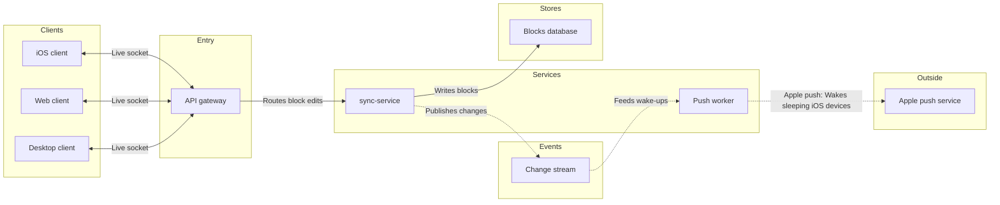

# FJ-024 turn 3 transcript

**User:** Yes, that reading is right.

**Tool call:** `ToolSearch` `{"query": "select:mcp__figma-remote__get_figjam,mcp__figma-remote__create_session,mcp__figma-remote__use_figma,mcp__figma-remote__get_screenshot", "max_results": 4}`

**Tool result:** `ToolSearch`

```text
[{"type": "tool_reference", "tool_name": "mcp__figma-remote__get_figjam"}, {"type": "tool_reference", "tool_name": "mcp__figma-remote__create_session"}, {"type": "tool_reference", "tool_name": "mcp__figma-remote__use_figma"}, {"type": "tool_reference", "tool_name": "mcp__figma-remote__get_screenshot"}]
```

**Tool call:** `Read` `{"file_path": "/private/var/folders/3c/zfqcqsts0kn19cgblj82gqhm0000gn/T/devin-compare-bench/FJ-024/sk-create-figjam/assets/templates/architecture.md"}`

**Tool result:** `Read`

```text
"1\t---\n2\ttitle: \"FigJam Architecture Templates\"\n3\tdescription: \"Architecture patterns that pass the pre-write check: a request path through every lane and an event-driven path with a backward edge.\"\n4\tcontextType: general\n5\timportance_tier: important\n6\ttrigger_phrases:\n7\t  - \"architecture templates\"\n8\t  - \"figjam architecture pattern\"\n9\tversion: 1.0.1.0\n10\t---\n11\t\n12\t# FigJam Architecture Templates\n13\t\n14\tCopy/apply patterns for an architecture model. Each pattern passes `scripts/flow_check.py`, and `references/types/architecture.md` holds the lanes and the allowed edges.\n15\t\n16\t**Loading Condition:** CONDITIONAL, with `references/types/architecture.md`\n17\t**Purpose:** Starting points for an architecture\n18\t**Scope:** Two patterns. The provenance table and the reply shape are in `assets/flow-templates.md`\n19\t\n20\t---\n21\t\n22\t## 1. USAGE\n23\t\n24\t- Keep the `%% type: architecture` line first, before any `%% title:` or other board line. On the generated fallback, pass `useArchitectureLayoutCode` as `\"FIGMA_DIAGRAM_2026\"` on the call\n25\t- Keep the six lane ids exactly and rename only the labels\n26\t- Drop a lane the system does not have. An empty lane is never filled with an invented part\n27\t- Label every edge from its source's side, and an external edge as `\"Service: Purpose\"`\n28\t\n29\t---\n30\t\n31\t## 2. PATTERNS\n32\t\n33\t### Request path\n34\t\n35\t```mermaid\n36\t%% type: architecture\n37\tflowchart LR\n38\t   
```

**Tool call:** `Read` `{"file_path": "/private/var/folders/3c/zfqcqsts0kn19cgblj82gqhm0000gn/T/devin-compare-bench/FJ-024/sk-create-figjam/references/quality-rubric.md"}`

**Tool call:** `Bash` `{"command": "mktemp -d", "description": "Create scratch folder for the model"}`

**Tool result:** `Read`

```text
"1\t---\n2\ttitle: \"FigJam Diagram Quality Rubric\"\n3\tdescription: \"The taste gate a FigJam model passes before the write gate, translated from sk-design-diagram's success criteria: type fit, the remove test, signal, the check, the board, the design rubric that scores a composed board and the reply.\"\n4\tcontextType: implementation\n5\timportance_tier: important\n6\ttrigger_phrases:\n7\t  - \"figjam quality rubric\"\n8\t  - \"diagram taste gate\"\n9\t  - \"remove test\"\n10\t  - \"figjam review checklist\"\n11\t  - \"figjam design rubric\"\n12\tversion: 1.0.13.0\n13\t---\n14\t\n15\t# FigJam Diagram Quality Rubric\n16\t\n17\tThe script checks what a script can see. This rubric is the rest: whether the diagram should exist, whether every node earns its place and whether the reader can trust what lands on the board. Walk it after the check passes and before the write gate.\n18\t\n19\t**Loading Condition:** CONDITIONAL, on every Flow route before the write gate\n20\t**Purpose:** The judgement pass between the pre-write check and the gate\n21\t**Scope:** The model, the provenance table, the planned extensions and, after the write, the board and the reply\n22\t\n23\t---\n24\t\n25\t## 1. TYPE FIT\n26\t\n27\t- [ ] The type answers the reader's question, as `references/flow-mode.md` Section 3 maps it\n28\t- [ ] A table, a list or a paragraph would not do the same job. If it would, say so and offer that instead\n29\t- [ ] The type's reference in `references/types/` was loaded and 
```

**Tool result:** `Bash`

```text
"/var/folders/3c/zfqcqsts0kn19cgblj82gqhm0000gn/T/tmp.WmcdmaV8Kx"
```

**Tool call:** `Write` `{"file_path": "/var/folders/3c/zfqcqsts0kn19cgblj82gqhm0000gn/T/tmp.WmcdmaV8Kx/model.md", "content": "```mermaid\n%% type: architecture\n%% title: Block sync services\n%% subtitle: How a block change reaches the change stream and wakes sleeping iOS devices, for engineers new to the sync path\n%% source: Sources: Loomlist platform doc as quoted in the request. The gateway to sync-service route is assumed. Left out: file storage, no stated connection.\n%% focus: changeStream because both paths meet here\n%% level: balanced\n%% detail: gateway | Checks the session token | Keeps each client socket`

**Tool result:** `Write`

```text
"File created successfully at: /var/folders/3c/zfqcqsts0kn19cgblj82gqhm0000gn/T/tmp.WmcdmaV8Kx/model.md (file state is current in your context \u2014 no need to Read it back)"
```

**Tool call:** `Bash` `{"command": "cd /private/var/folders/3c/zfqcqsts0kn19cgblj82gqhm0000gn/T/devin-compare-bench/FJ-024/sk-create-figjam && python3 -I scripts/flow_check.py /var/folders/3c/zfqcqsts0kn19cgblj82gqhm0000gn/T/tmp.WmcdmaV8Kx/model.md 2>&1 | head -60", "description": "Run the pre-write check on the model"}`

**Tool result:** `Bash`

```text
"  diagram 1, architecture: lane gateway sits inside lane gateway: lanes do not nest\n  diagram 1, architecture: %% detail: gateway names no step: write %% detail: <step id> | line | line\n  diagram 1, architecture: edge desktop to gateway joins a lane: connect a node inside it\n  diagram 1, architecture: edge web to gateway joins a lane: connect a node inside it\n  diagram 1, architecture: edge ios to gateway joins a lane: connect a node inside it\n  diagram 1, architecture: edge gateway to syncService joins a lane: connect a node inside it\n  diagram 1, architecture: edge pushWorker to applePush label runs to 46 characters, at most 40\n  diagram 1, architecture: node desktop has no connector\n  diagram 1, architecture: node web has no connector\n  diagram 1, architecture: node ios has no connector\n  diagram 1, architecture: service syncService needs a way in and a way out: an edge is missing or the node is not needed\nFAILED 1 of 1 diagram(s) in model.md"
```

**Tool call:** `Bash` `{"command": "cd /var/folders/3c/zfqcqsts0kn19cgblj82gqhm0000gn/T/tmp.WmcdmaV8Kx && sed -i '' -e 's/%% detail: gateway /%% detail: apiGateway /' -e 's/gateway\\[API gateway\\]/apiGateway[API gateway]/' -e 's/| gateway$/| apiGateway/' -e 's/^    gateway -->/    apiGateway -->/' -e 's/Apple push service: Wakes/Apple push: Wakes/' model.md && grep -n \"apiGateway\\|Apple push:\" model.md && cd /private/var/folders/3c/zfqcqsts0kn19cgblj82gqhm0000gn/T/devin-compare-bench/FJ-024/sk-create-figjam && python3 -I scripts/flow_check.py /var/folders/3c/zfqcqsts0kn19cgblj82gqhm0000gn/T/tmp.WmcdmaV8Kx/model.`

**Tool result:** `Bash`

```text
"8:%% detail: apiGateway | Checks the session token | Keeps each client socket open\n20:        apiGateway[API gateway]\n35:    desktop <-->|\"Live socket\"| apiGateway\n36:    web <-->|\"Live socket\"| apiGateway\n37:    ios <-->|\"Live socket\"| apiGateway\n38:    apiGateway -->|\"Routes block edits\"| syncService\n42:    pushWorker -.->|\"Apple push: Wakes sleeping iOS devices\"| applePush\n  diagram 1, architecture: ok, 9 nodes and 8 connectors, widest rank 3 steps, longest path 6 steps, 0.9 connectors per step, labels average 13 characters, 0 crossing pairs\nLabel: Apple push service may leave 'service' alone on its last line, so shorten it, or reword it in the source's words, when that keeps the meaning\nPASSED 1 diagram(s) in model.md\n[This command modified 1 file you've previously read: ../../../../../../../../../var/folders/3c/zfqcqsts0kn19cgblj82gqhm0000gn/T/tmp.WmcdmaV8Kx/model.md. Call Read before editing.]"
```

**Tool call:** `Bash` `{"command": "python3 -I scripts/compose_board.py /var/folders/3c/zfqcqsts0kn19cgblj82gqhm0000gn/T/tmp.WmcdmaV8Kx/model.md --diagram 1 --out /var/folders/3c/zfqcqsts0kn19cgblj82gqhm0000gn/T/tmp.WmcdmaV8Kx/board.js 2>&1 | head -20", "description": "Compose the board code from the checked model"}`

**Tool result:** `Bash`

```text
"COMPOSED diagram 1, 9 nodes and 8 connectors, widest rank 3 steps, longest path 6 steps, 0.9 connectors per step, labels average 13 characters, 0 crossing pairs: 9 nodes and 8 connectors to read back, 44105 characters in /var/folders/3c/zfqcqsts0kn19cgblj82gqhm0000gn/T/tmp.WmcdmaV8Kx/board.js, drawn in the design FigJam default"
```

**Tool call:** `mcp__figma-remote__create_session` `{"fileKey": "<test-file-key>", "description": "Add a Block sync services architecture board to the Loomlist FigJam file"}`

**Tool result:** `mcp__figma-remote__create_session`

```text
"{\"sessionId\":\"7a05924f-cb9f-4455-a45d-d2ddc4e80512\"}"
```

**Tool call:** `mcp__figma-remote__get_figjam` `{"fileKey": "<test-file-key>", "nodeId": "0:1", "includeImagesOfNodes": false, "sessionId": "7a05924f-cb9f-4455-a45d-d2ddc4e80512"}`

**Tool result:** `mcp__figma-remote__get_figjam`

```text
[{"type": "text", "text": "<canvas id=\"0:1\" name=\"Page 1\" x=\"0\" y=\"0\" width=\"0\" height=\"0\" />"}]
```

**Assistant:**

The file is empty and has no section titled "Block sync services", so the new board has no title clash and nothing existing to disturb. The model passed the check. This is the write gate.

**Purpose:** the board answers "how does a block change reach every device, and how does a sleeping iPhone get woken?" The reader should finish knowing which part to look at when a change doesn't arrive.

**Glance lines**
- **First glance:** the change stream. Both paths meet there.
- **Second glance:** the API gateway, sync-service and the push worker. The gateway carries a gateway outline, and the other two sit on either side of the stream.
- **Last glance:** the desktop, web and iOS clients, the blocks database and Apple's push service

**The sketch, exactly as the check read it**



```text
diagram 1, architecture: ok, 9 nodes and 8 connectors, widest rank 3 steps, longest path 6 steps, 0.9 connectors per step, labels average 13 characters, 0 crossing pairs
Label: Apple push service may leave 'service' alone on its last line, so shorten it, or reword it in the source's words, when that keeps the meaning
PASSED 1 diagram(s) in model.md
```

The label note is a warning and not a failure. "Apple push service" is your wording, and "Apple push" would drop the word "service", so I'm keeping it. If FigJam strands "service" on a second line, that shows in the read-back.

**The four critique questions**
- **Where the eye goes first:** the change stream, which is the node the board most needs read, because the write path and the wake path both run through it.
- **What it reads second:** the API gateway, then sync-service and the push worker. That advances the first glance by showing who fills the stream and who drains it.
- **What a reader could miss:** that the iOS device is what Apple's push service wakes, because the board has no arrow from Apple to the client. The push worker's edge label says it, and missing it would leave the last hop unclear.
- **Next cut under the remove test:** the web client, since it repeats the desktop client's shape. It stays because you named all three clients and chose to draw them separately.

**What gets written**
- One new section, "Block sync services", in file `<test-file-key>`, beside the (currently empty) page content
- Plan: Loomlist Engineering, as you named it. I can't verify a file's plan from here.
- Extensions: none

**Calls the write spends**
- One `use_figma` call to compose the board
- One `get_figjam` call to read it back
- The session and the read of the file are already spent. If the file sits on a Starter plan or you have a View or Collab seat, Figma caps tool calls at six a month, and those two count against it.

**Rollback:** I delete the one section the write returns, through `use_figma`, and only on your yes to a question that names it.

Left out: file storage, no source states which part uses it
Left out: Apple's push service waking the iOS device, an architecture has no edge from an outside system to a client, so the push worker's edge label carries it

Do you want me to write this board into that file now?
