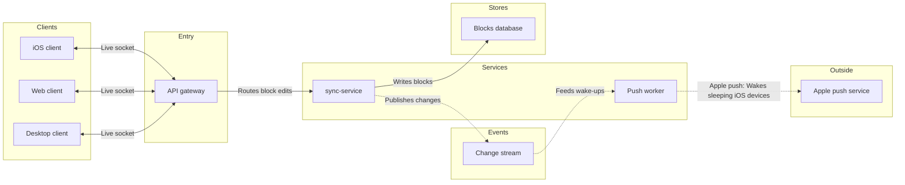

The file is empty and has no section titled "Block sync services", so the new board has no title clash and nothing existing to disturb. The model passed the check. This is the write gate.

**Purpose:** the board answers "how does a block change reach every device, and how does a sleeping iPhone get woken?" The reader should finish knowing which part to look at when a change doesn't arrive.

**Glance lines**
- **First glance:** the change stream. Both paths meet there.
- **Second glance:** the API gateway, sync-service and the push worker. The gateway carries a gateway outline, and the other two sit on either side of the stream.
- **Last glance:** the desktop, web and iOS clients, the blocks database and Apple's push service

**The sketch, exactly as the check read it**



```text
diagram 1, architecture: ok, 9 nodes and 8 connectors, widest rank 3 steps, longest path 6 steps, 0.9 connectors per step, labels average 13 characters, 0 crossing pairs
Label: Apple push service may leave 'service' alone on its last line, so shorten it, or reword it in the source's words, when that keeps the meaning
PASSED 1 diagram(s) in model.md
```

The label note is a warning and not a failure. "Apple push service" is your wording, and "Apple push" would drop the word "service", so I'm keeping it. If FigJam strands "service" on a second line, that shows in the read-back.

**The four critique questions**
- **Where the eye goes first:** the change stream, which is the node the board most needs read, because the write path and the wake path both run through it.
- **What it reads second:** the API gateway, then sync-service and the push worker. That advances the first glance by showing who fills the stream and who drains it.
- **What a reader could miss:** that the iOS device is what Apple's push service wakes, because the board has no arrow from Apple to the client. The push worker's edge label says it, and missing it would leave the last hop unclear.
- **Next cut under the remove test:** the web client, since it repeats the desktop client's shape. It stays because you named all three clients and chose to draw them separately.

**What gets written**
- One new section, "Block sync services", in file `<test-file-key>`, beside the (currently empty) page content
- Plan: Loomlist Engineering, as you named it. I can't verify a file's plan from here.
- Extensions: none

**Calls the write spends**
- One `use_figma` call to compose the board
- One `get_figjam` call to read it back
- The session and the read of the file are already spent. If the file sits on a Starter plan or you have a View or Collab seat, Figma caps tool calls at six a month, and those two count against it.

**Rollback:** I delete the one section the write returns, through `use_figma`, and only on your yes to a question that names it.

Left out: file storage, no source states which part uses it
Left out: Apple's push service waking the iOS device, an architecture has no edge from an outside system to a client, so the push worker's edge label carries it

Do you want me to write this board into that file now?