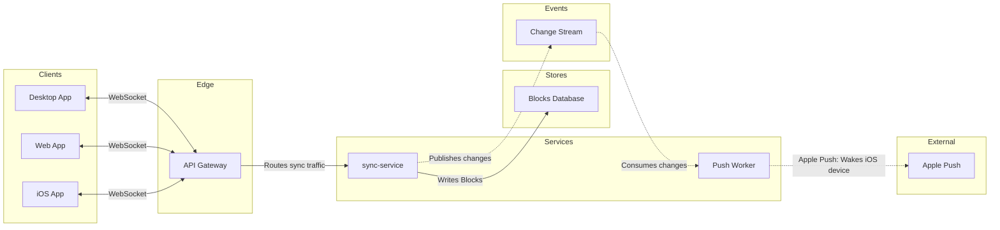

# FJ-024 turn 3 transcript

**User:** Yes, that reading is right.

**Tool call:** `ToolSearch` `{"query": "select:mcp__figma-remote__create_session,mcp__figma-remote__get_figjam,mcp__figma-remote__use_figma", "max_results": 5}`

**Tool result:** `ToolSearch`

```text
[{"type": "tool_reference", "tool_name": "mcp__figma-remote__create_session"}, {"type": "tool_reference", "tool_name": "mcp__figma-remote__get_figjam"}, {"type": "tool_reference", "tool_name": "mcp__figma-remote__use_figma"}]
```

**Tool call:** `Bash` `{"command": "mktemp -d", "description": "Create scratch folder for model"}`

**Tool result:** `Bash`

```text
"/var/folders/3c/zfqcqsts0kn19cgblj82gqhm0000gn/T/tmp.Rj94McAnbJ"
```

**Tool call:** `Read` `{"file_path": "/private/var/folders/3c/zfqcqsts0kn19cgblj82gqhm0000gn/T/devin-compare-bench/FJ-024/sk-create-figjam/references/quality-rubric.md"}`

**Tool result:** `Read`

```text
"1\t---\n2\ttitle: \"FigJam Diagram Quality Rubric\"\n3\tdescription: \"The taste gate a FigJam model passes before the write gate, translated from sk-design-diagram's success criteria: type fit, the remove test, signal, the check, the board, the design rubric that scores a composed board and the reply.\"\n4\tcontextType: implementation\n5\timportance_tier: important\n6\ttrigger_phrases:\n7\t  - \"figjam quality rubric\"\n8\t  - \"diagram taste gate\"\n9\t  - \"remove test\"\n10\t  - \"figjam review checklist\"\n11\t  - \"figjam design rubric\"\n12\tversion: 1.0.13.0\n13\t---\n14\t\n15\t# FigJam Diagram Quality Rubric\n16\t\n17\tThe script checks what a script can see. This rubric is the rest: whether the diagram should exist, whether every node earns its place and whether the reader can trust what lands on the board. Walk it after the check passes and before the write gate.\n18\t\n19\t**Loading Condition:** CONDITIONAL, on every Flow route before the write gate\n20\t**Purpose:** The judgement pass between the pre-write check and the gate\n21\t**Scope:** The model, the provenance table, the planned extensions and, after the write, the board and the reply\n22\t\n23\t---\n24\t\n25\t## 1. TYPE FIT\n26\t\n27\t- [ ] The type answers the reader's question, as `references/flow-mode.md` Section 3 maps it\n28\t- [ ] A table, a list or a paragraph would not do the same job. If it would, say so and offer that instead\n29\t- [ ] The type's reference in `references/types/` was loaded and 
```

**Tool call:** `mcp__figma-remote__create_session` `{"fileKey": "<test-file-key>", "description": "Draw the Loomlist block sync architecture as a new FigJam board section in an existing file"}`

**Tool result:** `mcp__figma-remote__create_session`

```text
"{\"sessionId\":\"b0f7a040-7bf4-4e90-a0b4-6b637ce4dbe4\"}"
```

**Tool call:** `Write` `{"file_path": "/var/folders/3c/zfqcqsts0kn19cgblj82gqhm0000gn/T/tmp.Rj94McAnbJ/model.md", "content": "```mermaid\n%% type: architecture\nflowchart LR\n    %% title: Block sync\n    %% subtitle: How a block change travels from a client to every other client, including a sleeping iOS device, for engineers new to block sync\n    %% source: Source: the platform doc. Left out: file storage, no call stated in the doc.\n    %% focus: syncService because every change is written here\n    %% level: balanced\n    %% detail: apiGateway | Checks the session token | Keeps each client socket open\n    %% de`

**Tool result:** `Write`

```text
"File created successfully at: /var/folders/3c/zfqcqsts0kn19cgblj82gqhm0000gn/T/tmp.Rj94McAnbJ/model.md (file state is current in your context \u2014 no need to Read it back)"
```

**Tool call:** `Bash` `{"command": "python3 sk-create-figjam/scripts/flow_check.py /var/folders/3c/zfqcqsts0kn19cgblj82gqhm0000gn/T/tmp.Rj94McAnbJ/model.md", "description": "Run pre-write check on the model"}`

**Tool result:** `Bash`

```text
"  diagram 1, architecture: ok, 9 nodes and 8 connectors, widest rank 3 steps, longest path 6 steps, 0.9 connectors per step, labels average 12 characters, 0 crossing pairs\nLabel: Apple Push Service may leave 'Service' alone on its last line, so shorten it, or reword it in the source's words, when that keeps the meaning\nPASSED 1 diagram(s) in model.md"
```

**Tool call:** `mcp__figma-remote__get_figjam` `{"fileKey": "<test-file-key>", "nodeId": "0:1", "sessionId": "b0f7a040-7bf4-4e90-a0b4-6b637ce4dbe4", "includeImagesOfNodes": false}`

**Tool result:** `mcp__figma-remote__get_figjam`

```text
[{"type": "text", "text": "<canvas id=\"0:1\" name=\"Page 1\" x=\"0\" y=\"0\" width=\"0\" height=\"0\" />"}]
```

**Tool call:** `Bash` `{"command": "M=/var/folders/3c/zfqcqsts0kn19cgblj82gqhm0000gn/T/tmp.Rj94McAnbJ/model.md && sed -i '' 's/Apple Push Service: Wakes iOS device/Apple Push: Wakes iOS device/; s/applePush\\[Apple Push Service\\]/applePush[Apple Push]/' $M && grep -n \"Apple\" $M && python3 sk-create-figjam/scripts/flow_check.py $M && python3 sk-create-figjam/scripts/compose_board.py $M --diagram 1 --out /var/folders/3c/zfqcqsts0kn19cgblj82gqhm0000gn/T/tmp.Rj94McAnbJ/board1.js", "description": "Reword label, recheck and compose the board code"}`

**Tool result:** `Bash`

```text
"33:        applePush[Apple Push]\n42:    pushWorker -.->|\"Apple Push: Wakes iOS device\"| applePush\n  diagram 1, architecture: ok, 9 nodes and 8 connectors, widest rank 3 steps, longest path 6 steps, 0.9 connectors per step, labels average 11 characters, 0 crossing pairs\nPASSED 1 diagram(s) in model.md\nCOMPOSED diagram 1, 9 nodes and 8 connectors, widest rank 3 steps, longest path 6 steps, 0.9 connectors per step, labels average 11 characters, 0 crossing pairs: 9 nodes and 8 connectors to read back, 44707 characters in /var/folders/3c/zfqcqsts0kn19cgblj82gqhm0000gn/T/tmp.Rj94McAnbJ/board1.js, drawn in the design FigJam default\n[This command modified 1 file you've previously read: ../../../../../../../../var/folders/3c/zfqcqsts0kn19cgblj82gqhm0000gn/T/tmp.Rj94McAnbJ/model.md. Call Read before editing.]"
```

**Assistant:**

The model passed the check and composes. Here is the gate, which asks about the write alone. Nothing is on the board yet.

**Question:** which parts carry a block change from one client to the others, and which part owns each rule?
**Outcome:** an engineer new to block sync can say which part checks the token, merges edits, keeps history, holds events and limits wake-ups.
**First glance:** sync-service, where every block change is written and published.
**Second glance:** the API Gateway, the Change Stream and the Blocks Database, which show how a change enters, is stored and leaves.
**Last glance:** the three clients, the Push Worker and Apple Push, the end of the path that wakes a sleeping iOS device.

**Sketch**, the checked model exactly as the check read it:



```text
  diagram 1, architecture: ok, 9 nodes and 8 connectors, widest rank 3 steps, longest path 6 steps, 0.9 connectors per step, labels average 11 characters, 0 crossing pairs
PASSED 1 diagram(s) in model.md
```

**Four critique questions**
- **Eye first:** sync-service, and it is the node the board most needs read.
- **Reads second:** the API Gateway, the Change Stream and the Blocks Database, which show how a change arrives, is kept and leaves.
- **Could miss:** Apple Push at the far end, which would hide how a sleeping iOS device hears of a change.
- **Remove next:** the Web App, kept because it is one of the three clients you named.

**One change from the playback:** the check flagged "Apple Push Service" as likely to wrap with "Service" alone on its last line. The node now reads "Apple Push", the name its edge label already used.

**Plan and file:** Loomlist Engineering, which is your statement, since reading the file doesn't show its plan. The file is `<test-file-key>`. I read it once and its page is empty, so no section shares the title "Block sync".
**Writes:** one composed board section, 9 nodes and 8 connectors in 6 lanes, with a title, a key and a source line, at Laptop distance. No file is created.
**Left out:** file storage, no call stated in the doc.
**Extensions:** none.
**Calls:** one `use_figma` and one `get_figjam` read-back. The session and the file read are already spent. On a Starter plan or a View or Collab seat, reads count toward the six calls a month.
**Rollback:** delete the one board section the write returns. I do that only on your separate yes to a question that names the section.

Write it?
