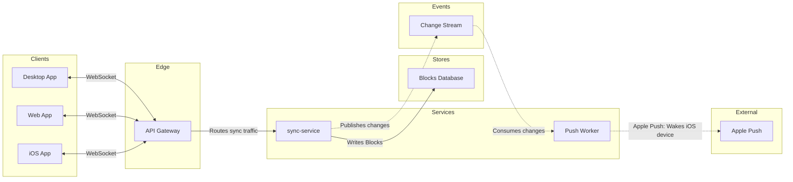

The model passed the check and composes. Here is the gate, which asks about the write alone. Nothing is on the board yet.

**Question:** which parts carry a block change from one client to the others, and which part owns each rule?
**Outcome:** an engineer new to block sync can say which part checks the token, merges edits, keeps history, holds events and limits wake-ups.
**First glance:** sync-service, where every block change is written and published.
**Second glance:** the API Gateway, the Change Stream and the Blocks Database, which show how a change enters, is stored and leaves.
**Last glance:** the three clients, the Push Worker and Apple Push, the end of the path that wakes a sleeping iOS device.

**Sketch**, the checked model exactly as the check read it:



```text
  diagram 1, architecture: ok, 9 nodes and 8 connectors, widest rank 3 steps, longest path 6 steps, 0.9 connectors per step, labels average 11 characters, 0 crossing pairs
PASSED 1 diagram(s) in model.md
```

**Four critique questions**
- **Eye first:** sync-service, and it is the node the board most needs read.
- **Reads second:** the API Gateway, the Change Stream and the Blocks Database, which show how a change arrives, is kept and leaves.
- **Could miss:** Apple Push at the far end, which would hide how a sleeping iOS device hears of a change.
- **Remove next:** the Web App, kept because it is one of the three clients you named.

**One change from the playback:** the check flagged "Apple Push Service" as likely to wrap with "Service" alone on its last line. The node now reads "Apple Push", the name its edge label already used.

**Plan and file:** Loomlist Engineering, which is your statement, since reading the file doesn't show its plan. The file is `<test-file-key>`. I read it once and its page is empty, so no section shares the title "Block sync".
**Writes:** one composed board section, 9 nodes and 8 connectors in 6 lanes, with a title, a key and a source line, at Laptop distance. No file is created.
**Left out:** file storage, no call stated in the doc.
**Extensions:** none.
**Calls:** one `use_figma` and one `get_figjam` read-back. The session and the file read are already spent. On a Starter plan or a View or Collab seat, reads count toward the six calls a month.
**Rollback:** delete the one board section the write returns. I do that only on your separate yes to a question that names the section.

Write it?