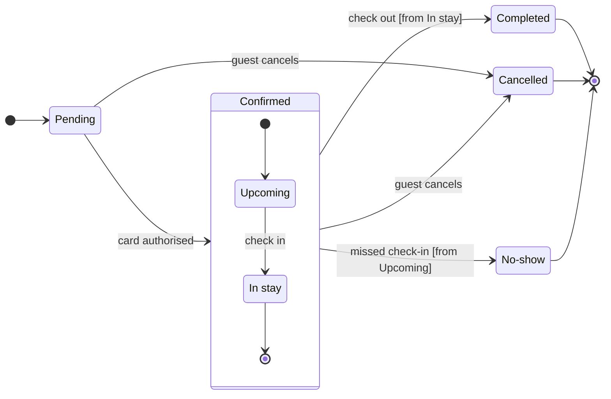

# FJ-026 turn 3 transcript

**User:** Yes, go ahead.

**Tool call:** `ToolSearch` `{"query": "select:mcp__figma-remote__whoami,mcp__figma-remote__create_session,mcp__figma-remote__get_figjam,mcp__figma-remote__use_figma,mcp__figma-remote__get_screenshot", "max_results": 5}`

**Tool result:** `ToolSearch`

```text
[{"type": "tool_reference", "tool_name": "mcp__figma-remote__whoami"}, {"type": "tool_reference", "tool_name": "mcp__figma-remote__create_session"}, {"type": "tool_reference", "tool_name": "mcp__figma-remote__get_figjam"}, {"type": "tool_reference", "tool_name": "mcp__figma-remote__use_figma"}, {"type": "tool_reference", "tool_name": "mcp__figma-remote__get_screenshot"}]
```

**Tool call:** `Bash` `{"command": "cd /private/var/folders/3c/zfqcqsts0kn19cgblj82gqhm0000gn/T/devin-compare-bench/FJ-026/sk-create-figjam && D=$(mktemp -d) && echo $D && cat > $D/model.md <<'EOF'\n```mermaid\nstateDiagram-v2\n    %% title: Booking status\n    %% subtitle: Every status a Roamstay booking passes through, from the pending card check to a completed, cancelled or missed stay\n    %% source: Source: the booking doc lines quoted in the request. Left out: where a booking goes when the 15-minute card check ends without authorisation.\n    %% level: balanced\n    %% focus: Cancelled because support must spo`

**Tool result:** `Bash`

```text
"/var/folders/3c/zfqcqsts0kn19cgblj82gqhm0000gn/T/tmp.o4KPt1tnim\n  diagram 1, state: ok, 7 states and 12 transitions\nPASSED 1 diagram(s) in model.md"
```

**Tool call:** `mcp__figma-remote__create_session` `{"fileKey": "<test-file-key>", "description": "Add a Booking status state diagram board as a new section in the Roamstay FigJam file"}`

**Tool result:** `mcp__figma-remote__create_session`

```text
"{\"sessionId\":\"b3a6ff89-94e2-4201-b855-7d5f6d3f2cd0\"}"
```

**Tool call:** `mcp__figma-remote__get_figjam` `{"fileKey": "<test-file-key>", "nodeId": "0:1", "sessionId": "b3a6ff89-94e2-4201-b855-7d5f6d3f2cd0", "includeImagesOfNodes": false}`

**Tool result:** `mcp__figma-remote__get_figjam`

```text
[{"type": "text", "text": "<canvas id=\"0:1\" name=\"Page 1\" x=\"0\" y=\"0\" width=\"0\" height=\"0\" />"}]
```

**Assistant:**

**Question:** which statuses can a Roamstay booking be in, and what moves it between them?
**Outcome:** support can read every booking status and spot the three it ends in.
**First glance:** Pending, the light blue first state where every booking starts.
**Second glance:** Upcoming and In stay, the states inside Confirmed, read with the section that frames them.
**Last glance:** Cancelled, marked by the focus line with a pink outline where it is drawn. Completed and No-show follow, each in light gray with the end-state ring.

**Sketch:** the checked model, with the check's output as it printed.



```text
  diagram 1, state: ok, 7 states and 12 transitions
PASSED 1 diagram(s) in model.md
```

**Eye first:** Pending, the light blue first state. Cancelled is the state the request names, and its pink outline marks it where it is drawn.
**Reads second:** Upcoming and In stay inside Confirmed. They carry the booking from the card check to the stay, and their bodies hold the date-change, No-show and room-charge rules.
**Could miss:** No-show. It leaves from Confirmed with the guard `from Upcoming`, so a reader could take it for a guest action when the hotel marks it.
**Remove next:** In stay. It stays because check-out leaves from it and it carries the room-charge rule.

**Plan:** Roamstay Product, as you named it. **File:** `<test-file-key>`. I read it once and it is empty, so no section shares the title "Booking status".
**Writes:** one new section, "Booking status", with 7 states and 12 transitions, a title, a key and a source line. The three end states are light gray and keyed "Final state". The reading distance is Laptop.
**Left out:** where a booking goes when the 15-minute card check ends without authorisation, because the doc leaves it open.
**Extensions:** none.
**Calls:** one `use_figma` and one `get_figjam` read-back. Figma caps a Starter plan or a View or Collab seat at six tool calls a month and this work has already used two, so tell me if that applies to you.
**Rollback:** delete the one board section the write returns, on your yes to a question that names it.

Write it?
