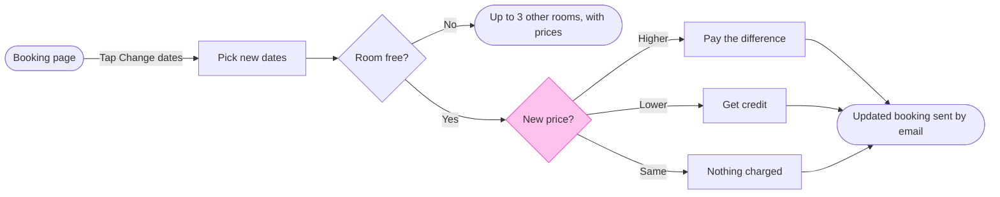

# FJ-036 turn 3 transcript

**User:** Yes, that reading is right.

**Tool call:** `Read` `{"file_path": "/private/var/folders/3c/zfqcqsts0kn19cgblj82gqhm0000gn/T/devin-compare-bench/FJ-036/sk-create-figjam/references/types/user-flow.md"}`

**Tool result:** `Read`

```text
"1\t---\n2\ttitle: \"FigJam Type - User Flow\"\n3\tdescription: \"A person's path through a product composed as a FigJam board: four shapes, labelled exits, colour by kind, optional zones and a nine-node budget.\"\n4\tcontextType: implementation\n5\timportance_tier: important\n6\ttrigger_phrases:\n7\t  - \"figjam user flow\"\n8\t  - \"user flow rules\"\n9\t  - \"screen flow figjam\"\n10\t  - \"merge dot\"\n11\tversion: 1.0.5.0\n12\t---\n13\t\n14\t# FigJam Type - User Flow\n15\t\n16\tA user flow is the screens and choices one person passes through to reach a goal. It is the default Flow type and the strictest, because it is drawn from screenshots and frames a reader will compare node by node.\n17\t\n18\t**Loading Condition:** CONDITIONAL, when the Flow route draws a user flow\n19\t**Purpose:** The grammar, rules, budget and read-back for a user flow\n20\t**Pairs With:** `assets/flow-templates.md`\n21\t\n22\t---\n23\t\n24\t## 1. WHEN TO USE\n25\t\n26\t**The reader's question:** which screens does a person pass through, and where do they choose?\n27\t\n28\t- A flow drawn from screenshots, from Figma frames or from a product doc that walks one person through the product\n29\t- A platform split, such as desktop and mobile, that rejoins on a later screen\n30\t- A journey, which Flow Mode does not draw as such, redrawn as the screens it visits\n31\t\n32\tUse another type when several people or teams hand work to each other (a process), when the subject is services and stores (an arc
```

**Tool call:** `Read` `{"file_path": "/private/var/folders/3c/zfqcqsts0kn19cgblj82gqhm0000gn/T/devin-compare-bench/FJ-036/sk-create-figjam/references/quality-rubric.md"}`

**Tool result:** `Read`

```text
"1\t---\n2\ttitle: \"FigJam Diagram Quality Rubric\"\n3\tdescription: \"The taste gate a FigJam model passes before the write gate, translated from sk-design-diagram's success criteria: type fit, the remove test, signal, the check, the board, the design rubric that scores a composed board and the reply.\"\n4\tcontextType: implementation\n5\timportance_tier: important\n6\ttrigger_phrases:\n7\t  - \"figjam quality rubric\"\n8\t  - \"diagram taste gate\"\n9\t  - \"remove test\"\n10\t  - \"figjam review checklist\"\n11\t  - \"figjam design rubric\"\n12\tversion: 1.0.13.0\n13\t---\n14\t\n15\t# FigJam Diagram Quality Rubric\n16\t\n17\tThe script checks what a script can see. This rubric is the rest: whether the diagram should exist, whether every node earns its place and whether the reader can trust what lands on the board. Walk it after the check passes and before the write gate.\n18\t\n19\t**Loading Condition:** CONDITIONAL, on every Flow route before the write gate\n20\t**Purpose:** The judgement pass between the pre-write check and the gate\n21\t**Scope:** The model, the provenance table, the planned extensions and, after the write, the board and the reply\n22\t\n23\t---\n24\t\n25\t## 1. TYPE FIT\n26\t\n27\t- [ ] The type answers the reader's question, as `references/flow-mode.md` Section 3 maps it\n28\t- [ ] A table, a list or a paragraph would not do the same job. If it would, say so and offer that instead\n29\t- [ ] The type's reference in `references/types/` was loaded and 
```

**Tool call:** `ToolSearch` `{"query": "select:mcp__figma-remote__create_session,mcp__figma-remote__get_figjam,mcp__figma-remote__use_figma,mcp__figma-remote__whoami", "max_results": 4}`

**Tool result:** `ToolSearch`

```text
[{"type": "tool_reference", "tool_name": "mcp__figma-remote__create_session"}, {"type": "tool_reference", "tool_name": "mcp__figma-remote__get_figjam"}, {"type": "tool_reference", "tool_name": "mcp__figma-remote__use_figma"}, {"type": "tool_reference", "tool_name": "mcp__figma-remote__whoami"}]
```

**Tool call:** `mcp__figma-remote__create_session` `{"fileKey": "<test-file-key>", "description": "Read the existing FigJam file before drawing a user flow board for changing booking dates (Roamstay)"}`

**Tool call:** `Bash` `{"command": "mktemp -d", "description": "Create scratch folder for the model"}`

**Tool result:** `mcp__figma-remote__create_session`

```text
"{\"sessionId\":\"2caae12f-55f4-4fa2-8d28-582f08da0f5d\"}"
```

**Tool result:** `Bash`

```text
"/var/folders/3c/zfqcqsts0kn19cgblj82gqhm0000gn/T/tmp.AQeCHtyvmh"
```

**Tool call:** `mcp__figma-remote__get_figjam` `{"fileKey": "<test-file-key>", "nodeId": "0:1", "sessionId": "2caae12f-55f4-4fa2-8d28-582f08da0f5d", "includeImagesOfNodes": false}`

**Tool result:** `mcp__figma-remote__get_figjam`

```text
[{"type": "text", "text": "<canvas id=\"0:1\" name=\"Page 1\" x=\"0\" y=\"0\" width=\"0\" height=\"0\" />"}]
```

**Tool call:** `Write` `{"file_path": "/var/folders/3c/zfqcqsts0kn19cgblj82gqhm0000gn/T/tmp.AQeCHtyvmh/model.md", "content": "```mermaid\nflowchart LR\n    %% title: Change booking dates\n    %% subtitle: From the booking page to the updated booking, for Roamstay support and product staff\n    %% source: Sources: the request and the help article. Left out: what the guest does after the other rooms list, the help article does not say.\n    %% goal: updated\n    %% level: balanced\n    %% detail: pick | Only nights the hotel has open\n    %% detail: other | Up to 3 rooms at the same hotel | Each with its price for the `

**Tool result:** `Write`

```text
"File created successfully at: /var/folders/3c/zfqcqsts0kn19cgblj82gqhm0000gn/T/tmp.AQeCHtyvmh/model.md (file state is current in your context \u2014 no need to Read it back)"
```

**Tool call:** `Bash` `{"command": "cd /private/var/folders/3c/zfqcqsts0kn19cgblj82gqhm0000gn/T/devin-compare-bench/FJ-036/sk-create-figjam && python3 -I scripts/flow_check.py /var/folders/3c/zfqcqsts0kn19cgblj82gqhm0000gn/T/tmp.AQeCHtyvmh/model.md 2>&1 | head -60", "description": "Run the pre-write check on the model"}`

**Tool result:** `Bash`

```text
"  diagram 1, user flow: %% detail on other, a stadium: only a step [Label] carries a body\n  diagram 1, user flow: %% detail on updated, a stadium: only a step [Label] carries a body\nFAILED 1 of 1 diagram(s) in model.md"
```

**Tool call:** `Bash` `{"command": "cd /var/folders/3c/zfqcqsts0kn19cgblj82gqhm0000gn/T/tmp.AQeCHtyvmh && sed -i '' -e '/%% detail: other/d' -e '/%% detail: updated/d' -e 's/other(\\[See other rooms\\])/other([\"Up to 3 other rooms, with prices\"])/' -e 's/updated(\\[See updated booking\\])/updated([\"Updated booking, also emailed\"])/' -e 's/--> updated(\\[See updated booking\\])/--> updated/' model.md && sed -i '' 's/pay --> updated(\\[See updated booking\\])/pay --> updated/' model.md && cat model.md && cd /private/var/folders/3c/zfqcqsts0kn19cgblj82gqhm0000gn/T/devin-compare-bench/FJ-036/sk-create-figjam && pyth`

**Tool result:** `Bash`

```text
"```mermaid\nflowchart LR\n    %% title: Change booking dates\n    %% subtitle: From the booking page to the updated booking, for Roamstay support and product staff\n    %% source: Sources: the request and the help article. Left out: what the guest does after the other rooms list, the help article does not say.\n    %% goal: updated\n    %% level: balanced\n    %% detail: pick | Only nights the hotel has open\n    %% detail: pay | Charged to the card on file\n    %% detail: credit | Kept for 12 months\n    booking([Booking page]) -->|Tap Change dates| pick[Pick new dates]\n    pick --> free{Room free?}\n    free -->|No| other([\"Up to 3 other rooms, with prices\"])\n    free -->|Yes| price{New price?}\n    price -->|Higher| pay[Pay the difference]\n    price -->|Lower| credit[Get credit]\n    price -->|Same| same[Nothing charged]\n    pay --> updated([\"Updated booking, also emailed\"])\n    credit --> updated\n    same --> updated\n    style price fill:#FFC2EC,stroke:#F849C1\n    %% focus: price because it sets what the guest pays\n```\n  diagram 1, user flow: ok, 9 nodes and 10 connectors, widest rank 3 steps, longest path 6 steps, 1.1 connectors per step, labels average 17 characters, 0 crossing pairs\nLabel: Updated booking, also emailed may leave 'emailed' alone on its last line, so shorten it, or reword it in the source's words, when that keeps the meaning\nGlance: New price? (accent) > Booking page > Pick new dates > Room free? > Up to 3 other rooms, with prices > Pay 
```

**Assistant:**

I'm fixing the one label the check flagged, then composing the board to confirm it fits one write call. After that I'll send the write gate.

**Tool call:** `Bash` `{"command": "cd /var/folders/3c/zfqcqsts0kn19cgblj82gqhm0000gn/T/tmp.AQeCHtyvmh && sed -i '' 's/Updated booking, also emailed/Updated booking and email/' model.md && cd /private/var/folders/3c/zfqcqsts0kn19cgblj82gqhm0000gn/T/devin-compare-bench/FJ-036/sk-create-figjam && python3 -I scripts/flow_check.py /var/folders/3c/zfqcqsts0kn19cgblj82gqhm0000gn/T/tmp.AQeCHtyvmh/model.md 2>&1 | head; python3 -I scripts/compose_board.py /var/folders/3c/zfqcqsts0kn19cgblj82gqhm0000gn/T/tmp.AQeCHtyvmh/model.md --diagram 1 --out /var/folders/3c/zfqcqsts0kn19cgblj82gqhm0000gn/T/tmp.AQeCHtyvmh/board1.js 2>&1 | `

**Tool result:** `Bash`

```text
"  diagram 1, user flow: ok, 9 nodes and 10 connectors, widest rank 3 steps, longest path 6 steps, 1.1 connectors per step, labels average 16 characters, 0 crossing pairs\nLabel: Updated booking and email leaves 'email' alone on its last line, so shorten it, or reword it in the source's words, when that keeps the meaning\nGlance: New price? (accent) > Booking page > Pick new dates > Room free? > Up to 3 other rooms, with prices > Pay the difference > Get credit > Nothing charged > Updated booking and email (goal)\nPASSED 1 diagram(s) in model.md\nCOMPOSED diagram 1, 9 nodes and 10 connectors, widest rank 3 steps, longest path 6 steps, 1.1 connectors per step, labels average 16 characters, 0 crossing pairs: 9 nodes and 10 connectors to read back, 43950 characters in /var/folders/3c/zfqcqsts0kn19cgblj82gqhm0000gn/T/tmp.AQeCHtyvmh/board1.js, drawn in the design FigJam default\n   43950 /var/folders/3c/zfqcqsts0kn19cgblj82gqhm0000gn/T/tmp.AQeCHtyvmh/board1.js\n[This command modified 1 file you've previously read: ../../../../../../../../../var/folders/3c/zfqcqsts0kn19cgblj82gqhm0000gn/T/tmp.AQeCHtyvmh/model.md. Call Read before editing.]"
```

**Tool call:** `Bash` `{"command": "cd /var/folders/3c/zfqcqsts0kn19cgblj82gqhm0000gn/T/tmp.AQeCHtyvmh && sed -i '' 's/Updated booking and email/Updated booking sent by email/' model.md && cd /private/var/folders/3c/zfqcqsts0kn19cgblj82gqhm0000gn/T/devin-compare-bench/FJ-036/sk-create-figjam && python3 -I scripts/flow_check.py /var/folders/3c/zfqcqsts0kn19cgblj82gqhm0000gn/T/tmp.AQeCHtyvmh/model.md 2>&1 | head", "description": "Try a reworded last label and recheck"}`

**Tool result:** `Bash`

```text
"  diagram 1, user flow: ok, 9 nodes and 10 connectors, widest rank 3 steps, longest path 6 steps, 1.1 connectors per step, labels average 17 characters, 0 crossing pairs\nGlance: New price? (accent) > Booking page > Pick new dates > Room free? > Up to 3 other rooms, with prices > Pay the difference > Get credit > Nothing charged > Updated booking sent by email (goal)\nPASSED 1 diagram(s) in model.md\n[This command modified 1 file you've previously read: ../../../../../../../../../var/folders/3c/zfqcqsts0kn19cgblj82gqhm0000gn/T/tmp.AQeCHtyvmh/model.md. Call Read before editing.]"
```

**Assistant:**

Clean now. Recomposing so the code matches the final model.

**Tool call:** `Bash` `{"command": "python3 -I scripts/compose_board.py /var/folders/3c/zfqcqsts0kn19cgblj82gqhm0000gn/T/tmp.AQeCHtyvmh/model.md --diagram 1 --out /var/folders/3c/zfqcqsts0kn19cgblj82gqhm0000gn/T/tmp.AQeCHtyvmh/board1.js 2>&1 | head -5", "description": "Recompose board code from final model"}`

**Tool result:** `Bash`

```text
"COMPOSED diagram 1, 9 nodes and 10 connectors, widest rank 3 steps, longest path 6 steps, 1.1 connectors per step, labels average 17 characters, 0 crossing pairs: 9 nodes and 10 connectors to read back, 43954 characters in /var/folders/3c/zfqcqsts0kn19cgblj82gqhm0000gn/T/tmp.AQeCHtyvmh/board1.js, drawn in the design FigJam default"
```

**Assistant:**

**Write gate.** Nothing is written yet.

**Question and outcome:** After a guest taps Change dates, what do they see and pay for each outcome? The board lets support and product staff tell a guest which of the three price outcomes applies and what happens next.

**Sketch, the checked model as the check read it**



`PASSED 1 diagram(s) in model.md`, with 9 nodes, 10 connectors and 0 crossing pairs. The composer printed `COMPOSED` for 9 nodes and 10 connectors in the FigJam default design.

**Glance lines**
- First: the New price? decision, because it sets which of the three outcomes the guest gets
- Second: Booking page, Pick new dates, Room free?, Pay the difference, Get credit, Nothing charged and Updated booking sent by email, in the order the check prints them
- Last: Up to 3 other rooms, with prices, the side exit that stays available without competing

**Critique**
- Where the eye goes first: the New price? diamond in the accent colour. It is the node the board most needs read, because the three price outcomes are what a support reader looks up
- What it reads second: the main row from the booking page through the room check. That advances the first glance, since the price question only arises once the room is free
- What a reader could miss: that the other rooms list is a dead end on this board. A reader who assumes it continues would wrongly think the guest can rebook from there. The source line says so, and so does Left out
- Next cut by the remove test: Nothing charged. It stays, because a reader asking "what if the price is the same?" has no other node that answers it

**Changes from the playback**
- Bodies are only allowed on step rectangles, and the other rooms list and the final booking are ends. So the other rooms rule moved into its label, `Up to 3 other rooms, with prices`, and the email moved into the last label, `Updated booking sent by email`
- The same hotel and the "price for the new dates" detail are no longer on the board. They stay in the source line's source, the help article
- Pay the difference, Get credit and Pick new dates keep their bodies: card on file, 12 months, and only open nights

**Target:** the existing FigJam file `<test-file-key>` in the Roamstay Product plan. I read it with `get_figjam` and it is empty, with no sections and no board sharing the title, so nothing already there is touched.

**What will be written:** one section titled `Change booking dates`, holding the 9 nodes, 10 connectors, a key and the source line.

**Calls the write will spend:** one `use_figma` call to compose the board and one `get_figjam` call to read it back. The session and the earlier read are already spent. If the file sits on a Starter plan or you hold a View or Collab seat, Figma limits tool calls to six a month, and those two count against it.

**Rollback:** delete that one section with `use_figma`, only on a reply that names it. The file itself stays, since it existed before this work.

**Left out:** what the guest does after the other rooms list, because the help article does not say.

Do you want me to write this board into `<test-file-key>`?
